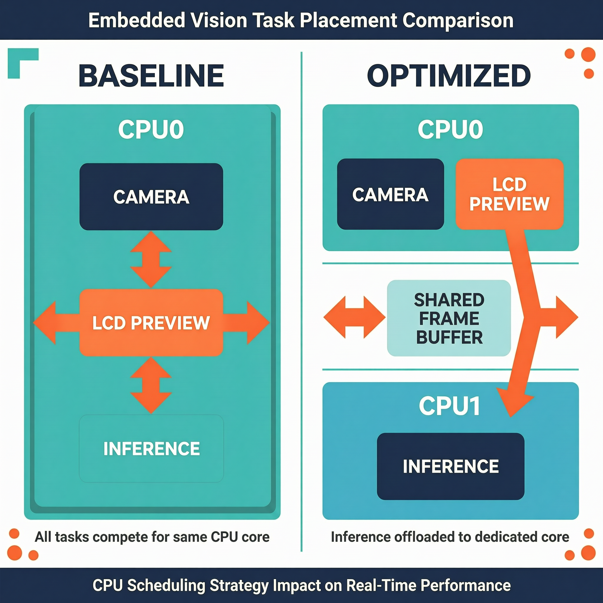

# 扩展案例 4：实时推理优化版

> 类型：`FW` ｜ 验证状态：已实测（历史记录，当前批次仍需复核） ｜ 对应微课：[`microcourses/04_live_infer_tuning`](../../microcourses/04_live_infer_tuning/)

## 摘要

本案例是 `04_live_infer_trace` 卡顿基线的实时推理优化版：预览留在 CPU0，推理固定钉到 CPU1，比较任务核心、优先级、CPU 频率与系统响应性的关系。工程输出 LCD FPS、推理耗时、周期、帧年龄、heap 和 PSRAM；可选 trace 模式还会打印一段 Chrome Trace JSON，复制到文件后用 Perfetto 查看阶段时间线。历史实测结果保留为参考，个人串口设备名已脱敏。微课 04 只看单次 `infer` 耗时；本扩展把问题升级成**系统级**的：推理跑的时候预览还流畅吗？内存稳定吗？watchdog 会不会报警？你需要同时盯 FPS、`infer`、`period`、`frame_age`、heap、PSRAM 和 watchdog 七类信号做决策。

## Quick Start

**预备知识**

- **本工程的任务布局**：`FrameCapFetch`（取帧）和 `LCDDisp`（显示 + FPS 回调）钉在 CPU0、优先级 2；`classifier_task`（推理）用 `xTaskCreatePinnedToCore` 钉在 **CPU1**、优先级 3（`kInferCore = 1`）；`Yield2Idle`（防饿死监控）最高档、不绑核。本工程不用 WiFi。
- **优先级与饿死**：同核高优先级就绪时低优先级完全停摆；连空闲任务（idle task）都轮不上时，任务看门狗会打印 `task watchdog` 告警甚至复位。`Yield2Idle` 是配套保险丝：发现某核长期没空闲就强制暂停受监控任务 10 ms，检查窗口由 `CONFIG_ESP_TASK_WDT_TIMEOUT_S` 和 `CONFIG_MAX_TASK_LOOP_TIME`（默认 1 秒）决定。
- **FPS**：`preview_measurement` 回调挂在 LCD 显示路径上，每显示 30 帧结算一次 `fps = 30 / 窗口耗时秒`；预览稳定时约 1.5 秒一个窗口（≈20 FPS）。FPS 是"预览响应性"的直接量化。
- **DFS 与固定 240 MHz**：动态调频会给对比实验引入噪声，本工程在 `sdkconfig.defaults` 固定 `CONFIG_ESP_DEFAULT_CPU_FREQ_MHZ_240=y`（微课 04 固定 160 MHz 作对照）；PSRAM 速度独立配置（八线 @80 MHz），升主频不加快访存。
- **三个健康指标**：`frame_age` 是推理结束时刻减帧采集时间戳，即"从拍摄到推理结束"的总延迟；`heap` 是内部 RAM 剩余字节（`esp_get_free_heap_size()`），持续下降 = 泄漏；PSRAM 剩余字节（`heap_caps_get_free_size(MALLOC_CAP_SPIRAM)`）同样要求长期稳定。
- **Chrome Trace JSON 与 Perfetto**：前者是用 JSON 描述"什么事件、何时开始、持续多久、在哪条时间线"的通用格式；后者（[https://ui.perfetto.dev/](https://ui.perfetto.dev/)）是浏览器里的可视化界面，把 JSON 画成时间线上的色块。设备画不了图但能打印文本，人工复制成文件即可。


**第 0 步：前置条件**

- ESP-IDF ≥ 5.4；托管组件 `esp-dl ^3.3.0`、`esp32_s3_eye ^6.0.0`（见 `main/idf_component.yml`）；
- 本目录**不自带组件和模型**：根 `CMakeLists.txt` 通过 `EXTRA_COMPONENT_DIRS` 复用 `../03_live_catdog_assignment/components/who_*` 五个组件，`main/CMakeLists.txt` 通过 `EMBED_FILES` 嵌入同目录的 `main/models/s3/catdog_mobilenet_v2.espdl`。先完成最小案例 3 作业并确认模型在位，否则构建报 `Missing model file`。

**第 1 步：常规构建（普通性能日志模式）**

```bash
cd extensions/04_live_infer_optimized
idf.py --version
idf.py set-target esp32s3   # 按 sdkconfig.defaults 生成配置：240 MHz、八线 PSRAM @80 MHz、8 MB flash 自定义分区
idf.py build                # 编译并嵌入模型；首次 5～15 分钟（联网拉取托管组件），增量 1 分钟内
```

预期输出 `Project build complete`。

**第 2 步：烧录运行（有开发板时）**

```bash
idf.py -p <PORT> flash monitor
```

`<PORT>` 换成实际串口设备名（macOS 是以 cu 开头的设备）。预期：LCD 出现预览，串口打印 `Ready: preview CPU0 priority=2, inference CPU1 priority=3, CPU=240MHz`，随后交替出现 `preview frames=... fps=...`（约每 1.5 秒一行）和 `infer[N] core=1 cpu=240MHz ...`（约每 5.2 秒一行）。默认配置为 240 MHz、3 个帧缓冲、500 ms 推理间隔。没有开发板时只能完成构建验证；性能表中的历史数据不能替代当前硬件复测。

**第 3 步：对照实验——回到卡顿基线（可选，需改代码）**

修改 `main/app_main.cpp`，修改前：

```cpp
static constexpr BaseType_t kInferCore = 1;
```

修改后：

```cpp
static constexpr BaseType_t kInferCore = 0;   // 对照实验：推理与预览同核
```

再按需把 `sdkconfig.defaults` 的 `CONFIG_ESP_DEFAULT_CPU_FREQ_MHZ_240=y` 改为 `CONFIG_ESP_DEFAULT_CPU_FREQ_MHZ_160=y`（并删除 `sdkconfig` 重新 `set-target`）。每次只改一个变量，重新 `idf.py build` 烧录，观察 FPS 与 watchdog 行为；这些是编译期常量，必须重编重烧。做完对照记得改回默认值。

**第 4 步：启用 trace 模式**

```bash
idf.py -DPERFETTO_TRACE_JSON=1 build
# 有开发板时：
idf.py -p <PORT> flash monitor
```

`-D` 给 CMake 传缓存变量，`main/CMakeLists.txt` 检测到为真时给组件加编译宏，激活 `trace_json.cpp` 的事件缓冲和 `app_main.cpp` 的记录调用；构建输出中应有 `-- PERFETTO_TRACE_JSON is enabled`。

trace 模式完成 3 次推理后停止推理任务并打印 JSON。在串口输出中找到 `TRACE_JSON_BEGIN` 和 `TRACE_JSON_END`，只复制两个标记之间的 `{...}` 内容保存为 `trace.json`，然后校验：

```bash
python -m json.tool trace.json   # 校验并格式化打印，无报错后拖入 Perfetto UI
```

**第 5 步：在 Perfetto 中查看时间线**

1. 浏览器打开 [https://ui.perfetto.dev/](https://ui.perfetto.dev/)（纯前端页面，trace 文件不会上传到服务器），把 `trace.json` 拖进窗口或点 `Open trace file`；
2. 左侧出现两条时间线：`10`（预览，事件 `preview_window`）和 `11`（推理，事件 `classifier_task`、`frame_peek`、`input_prepare`、`infer`）；
3. `W/S` 缩放、`A/D` 平移；点色块可在底部看到 `name`、`ts`、`dur` 和 `args.core`；
4. 应观察到：`classifier_task` 内套着几乎等宽的 `infer`，`frame_peek`/`input_prepare` 细如发丝；`preview_window` 约 1.5 秒一个，与推理色块在时间上**并行重叠**，且两者 `args.core` 分别是 0 和 1——这就是"隔离生效"的可视化证据；
5. 目录里有历史示例 [`trace.json`](trace.json)（推理在 `core=1`、`infer` 约 4.66～4.67 s、`preview_window` 约 1.45～1.50 s），没板子时可先拖进 Perfetto 熟悉界面。

**第 6 步：关闭 trace 模式**

```bash
idf.py -DPERFETTO_TRACE_JSON=0 build
```

CMake 缓存变量会一直留在 `build/` 里，必须**显式设回 0**（或删除 `build/` 目录）才能恢复普通性能日志路径。

## 预期现象

预览日志形如：

```text
preview frames=120 fps=20.01
```

`frames` 是**累计**显示帧数（30、60、90、120…递增，不每窗口清零）；`fps` 是最近 30 帧窗口的平均值（`30.0 / elapsed_s`）。

推理日志形如：

```text
infer[2] core=1 cpu=240MHz infer=4704.736ms period=5.206s frame_age=112.241ms heap=... psram=... cat 0.7311
```

字段对照（`main/app_main.cpp`）：

| 字段 | 来源 | 含义 |
|---|---|---|
| `infer[2]` | `g_infer_count` | 第几次推理 |
| `core=1` | `xPortGetCoreID()` | 实际运行核心，验证绑核生效 |
| `cpu=240MHz` | `esp_clk_cpu_freq()` | 实际主频，验证频率配置生效 |
| `infer=4704.736ms` | `end - start` | 单次模型推理耗时 |
| `period=5.206s` | 两次推理结束时刻之差 | ≈ infer + 500ms 延时 + 调度开销 |
| `frame_age=112.241ms` | `end - fb->timestamp` | 所用帧从拍摄到推理结束的总延迟 |
| `heap=...` | `esp_get_free_heap_size()` | 内部 RAM 剩余字节 |
| `psram=...` | `heap_caps_get_free_size(MALLOC_CAP_SPIRAM)` | PSRAM 剩余字节 |
| `cat 0.7311` | `results[0]` | Top-1 类别与置信度；结果为空时打印 `none 0.0000` |

历史案例记录（来源：仓库此前 README 的已脱敏实机记录；原始设备路径不纳入仓库）如下，当前批次应重新记录：

| 配置 | 预览表现 | 推理耗时 | 稳定性 | 状态 |
|---|---:|---:|---|---|
| CPU0 / 160 MHz | 肉眼明显卡顿 | 约 3273 ms | 正常 | 参考值，待复核 |
| CPU0 / 240 MHz | 有所改善但仍被推理占用 | 约 2985 ms | 正常 | 参考值，待复核 |
| CPU0 / 低优先级 | 约 20 FPS | 约 5100～11100 ms | watchdog 或延迟过大 | 历史失败对照 |
| CPU1 / 240 MHz | 稳定约 20 FPS | 4696～4709 ms | 连续测试稳定 | 历史实测，待复核 |

若出现 `task watchdog`、预览停止、内存持续下降或分类结果为空，应将该组标为失败并保留完整日志。

trace 模式的输出是 `TRACE_JSON_BEGIN` 与 `TRACE_JSON_END` 之间的一段 JSON，事件含 `preview_window`、`classifier_task`、`frame_peek`、`input_prepare`、`infer`（完整格式示例见 [`04_live_infer_trace`](../04_live_infer_trace/README.md)）。Perfetto 中应至少看到预览和推理两条时间线；`infer` 时间片的宽度表示本次阶段持续时间，不应直接解释为整个系统的 CPU 占用率。

**常见问题排查**

| # | 现象 | 原因 | 解决 |
|---|---|---|---|
| 1 | 构建报 `Missing model file: .../03_live_catdog_assignment/...espdl` | 本工程复用最小案例 3 作业的模型和组件 | 先完成作业工程、确认 `.espdl` 在位，不要移动作业目录 |
| 2 | `-DPERFETTO_TRACE_JSON=1` 后串口仍是普通日志 | CMake 缓存没生效或没重新烧录 | 确认构建输出含 `-- PERFETTO_TRACE_JSON is enabled` 后重新 `flash`；想关 trace 必须显式 `-DPERFETTO_TRACE_JSON=0` |
| 3 | 日志 `core=0` 而非预期 `core=1`，或改了配置没变化 | 板子跑旧固件，编译期常量改动后未重编 | 重新 `idf.py build` + `flash monitor`，看启动行是否更新 |
| 4 | 出现 `task watchdog` 告警甚至复位 | 高优先级任务长期霸占某核（如对照实验或优先级改得过高） | 该组标为失败并保留完整日志；恢复默认配置，必要时按 Kconfig 帮助调大超时 |
| 5 | `heap` 或 `psram` 随时间持续下降 | 内存泄漏（多因自行改代码引入 new/delete 不配对） | 保留连续日志定位下降速率，恢复原始代码对照，记为"稳定性失败" |
| 6 | 复制出的 JSON 无法通过 `python -m json.tool` | 复制范围超出标记或混入日志行 | 只复制 `TRACE_JSON_BEGIN` 与 `TRACE_JSON_END` 之间从 `{` 到 `}` 的内容（dump 前代码已关闭日志） |

## 学习目标

- 测量预览 FPS、单次推理耗时和推理周期；
- 解释 `frame_age`、heap、PSRAM 和 watchdog 的含义；
- 比较 CPU0/CPU1 隔离与降低推理优先级两种方案，根据延迟、响应性和稳定性选择系统级配置；
- 生成并复制 Chrome Trace JSON，在 Perfetto 中查看阶段时间线。

## 原理讲解

实时系统有两个不同目标：模型单次执行更快，以及 LCD 预览在模型运行时仍能及时刷新。三种优化手段的差别：

1. **换核心（本工程方案）**：把推理从预览所在的 CPU0 搬到 CPU1，预览完全不受影响，FPS 稳定在约 20；但两个核共享 PSRAM/flash 带宽，单次 `infer` 未必更快——历史数据里 CPU1/240 MHz 约 4.7 s，反而略慢于微课 CPU0/240 MHz 的约 2.98 s。**隔离买的是"预览流畅"，不是"推理加速"**。
2. **调低推理优先级**：推理留在 CPU0 但给预览让路，预览能保住（历史数据约 20 FPS），可推理被切得稀碎，单次耗时从 5.1 s 拖到 11.1 s（长尾），watchdog 风险上升——历史表格里这行是"历史失败对照"。
3. **升主频**：`infer` 确实下降，但只要推理和预览同核，3 秒的推理块头还在，卡顿只是缓解不是消除（"有所改善但仍被推理占用"）。结论要落到数据上：用你自己的 FPS/`infer`/`frame_age`/watchdog 记录说话。



> 图：优化版把推理任务迁移到 CPU1，让 CPU0 更专注于摄像头和 LCD 预览；图片不替代当前硬件的实测。

**Chrome Trace JSON 时间线**

trace 模式只记录课程自有代码能稳定划分的阶段：`preview_window`、`frame_peek`、`input_prepare`、`infer` 和 `classifier_task`。每条事件用 Chrome Trace 完整事件格式：`ts` 开始时间、`dur` 持续时间、`tid` 区分时间线、`args.core` 记录 CPU。设备在 RAM 暂存事件，完成 3 次推理后一次性打印 JSON。这是阶段级时间线，不是 ESP-DL 内部函数级火焰图；普通 `infer=...ms` 日志仍用于基线，不能直接转换成 Chrome Trace JSON。与 `04_live_infer_trace`（4A）的区别：4A 跑卡顿基线（CPU0/160 MHz）且把 `infer` 再拆成 `preprocess`/`model_infer`/`postprocess` 三段；本工程是优化布局（CPU1/240 MHz），trace 事件只到 `infer` 一层。


> 图：`classifier_task`、`infer` 和 `model_infer` 的嵌套关系用于帮助阅读 Trace；真实时间以设备打印的 JSON 为准。

## 整体流程图

```text
摄像头 + LCD（CPU0，priority=2） → preview frames / fps
                                      ↑
最新帧 ─────→ classifier_task（CPU1，priority=3）
                  ↓
       infer / period / frame_age / heap / psram
```

数据流：摄像头驱动（RGB565、240×240、3 帧缓冲、PSRAM）→ `FrameCapFetch`（CPU0）把最新帧放入环形缓冲并广播新帧事件 → `LCDDisp`（CPU0）显示并每 30 帧结算 FPS → `classifier_task`（CPU1）每 500 ms `peek` 最新帧、跑一次分类、打印一行七字段日志。

## 关键代码解析

**1. FPS 统计回调：[`preview_measurement`](main/app_main.cpp)**

```cpp
static void preview_measurement(who::cam::cam_fb_t *)
{
    const int64_t now = esp_timer_get_time();
    g_preview_count++;                            // 累计显示帧数（不每窗口清零）
    if (g_preview_window_start == 0) g_preview_window_start = now;
    if (g_preview_count % 30 == 0) {              // 每满 30 帧结算一次
#if PERFETTO_TRACE_JSON
        perfetto_trace::record_complete("preview_window", "preview", g_preview_window_start, now, 1, 10, xPortGetCoreID());
#else
        const double elapsed_s = (now - g_preview_window_start) / 1000000.0;
        ESP_LOGI(TAG, "preview frames=%" PRIu32 " fps=%.2f", g_preview_count, 30.0 / elapsed_s);
#endif
        g_preview_window_start = now;             // 开启下一个 30 帧窗口
    }
}
```

**2. 推理任务与七字段日志：[`classifier_task`](main/app_main.cpp)（节选）**

```cpp
static constexpr BaseType_t kInferCore = 1;        // 优化点：推理钉在 CPU1（预览优先级 2）
static constexpr UBaseType_t kInferPriority = 3;

// 创建：xTaskCreatePinnedToCore(classifier_task, ..., 8192, nullptr, kInferPriority, nullptr, kInferCore)
auto fb = g_frame_node ? g_frame_node->cam_fb_peek() : nullptr;  // 取最新帧
const int64_t start = esp_timer_get_time();
auto &results = g_classifier->run(static_cast<dl::image::img_t>(*fb));
const int64_t end = esp_timer_get_time();
// frame_age = 推理结束时刻 - 帧的采集时间戳，即"拍摄到出结果"的总延迟
const double frame_age_ms = (end - (int64_t)fb->timestamp.tv_sec * 1000000
                                 - fb->timestamp.tv_usec) / 1000.0;
ESP_LOGI(TAG, "infer[%" PRIu32 "] core=%d cpu=%dMHz infer=%.3fms period=%.3fs "
              "frame_age=%.3fms heap=%" PRIu32 " psram=%" PRIu32 " %s %.4f", ...);
```

与最小案例 3 作业的 `xTaskCreate`（不绑核）只差最后一个核心号参数，却是本案例全部优化的核心。

**3. trace 事件缓冲与 3 次限制：[`main/trace_json.cpp`](main/trace_json.cpp)**

```cpp
constexpr size_t kMaxEvents = 256;          // RAM 中最多暂存 256 个事件，超出静默丢弃
portMUX_TYPE s_lock = ...;                  // 自旋锁：预览(CPU0)和推理(CPU1)并发记录

void dump() {
    esp_log_level_set("*", ESP_LOG_NONE);   // 关闭所有日志，防止日志行混进 JSON
    std::sort(...);                          // 按时间戳排序（两任务并发追加，顺序不保证）
    // 在 TRACE_JSON_BEGIN / TRACE_JSON_END 之间逐条打印
    // {"name":..,"cat":..,"ph":"X","ts":..,"dur":..,"pid":..,"tid":..,"args":{"core":..}}
}

// app_main.cpp（trace 模式）：采满 3 次就停
if (g_infer_count >= kTraceInferLimit) {     // kTraceInferLimit = 3
    perfetto_trace::dump();                  // 打印 JSON
    vTaskDelete(nullptr);                    // 推理任务自删，预览继续
}
```

`ph:"X"` 是"完整事件"：自带开始时间和持续时间，Perfetto 直接画成色块；`tid` 用 10/11 区分预览/推理两条时间线。

## 关键文件说明

| 文件 | 职责 | 类型 |
|---|---|---|
| [`main/app_main.cpp`](main/app_main.cpp) | 预览测量、分类任务和资源日志 | 课程代码 |
| [`main/frame_cap_pipeline.cpp`](main/frame_cap_pipeline.cpp) | 摄像头帧管线 | 课程代码 |
| [`main/catdog_classifier.hpp`](main/catdog_classifier.hpp) | ESP-DL 分类器 | 课程代码 |
| [`main/trace_json.hpp`](main/trace_json.hpp) | Chrome Trace JSON 追踪接口和开关 | 课程代码 |
| [`main/trace_json.cpp`](main/trace_json.cpp) | 事件缓冲、排序和 JSON 输出 | 课程代码 |
| [`main/CMakeLists.txt`](main/CMakeLists.txt) | trace 源文件和 `PERFETTO_TRACE_JSON` 开关 | 构建配置 |
| [`sdkconfig.defaults`](sdkconfig.defaults) | 240 MHz、PSRAM 和 LCD 配置 | 构建配置 |
| [`CMakeLists.txt`](CMakeLists.txt) | 复用作业目录的 `components/who_*` | 构建配置 |
| [`trace.json`](trace.json) | 历史采集的示例 trace（可先拖入 Perfetto 熟悉界面） | 示例数据 |

## 配置说明

| 修改位置 | 配置项 | 现象变化 |
|---|---|---|
| [`main/app_main.cpp`](main/app_main.cpp) | `kInferCore` | 改变推理任务核心，影响隔离关系 |
| 同上 | `kInferPriority` / `kPreviewPriority` | 改变调度竞争和 watchdog 风险 |
| 同上 | `kInferIntervalTicks` | 改变推理频率、帧年龄和吞吐 |
| [`main/CMakeLists.txt`](main/CMakeLists.txt) | `PERFETTO_TRACE_JSON=1` | 启用串口 Chrome Trace JSON 输出 |
| [`main/trace_json.cpp`](main/trace_json.cpp) | `kMaxEvents` | trace 事件缓冲容量；事件过多时缩短采集窗口 |
| [`sdkconfig.defaults`](sdkconfig.defaults) | CPU 频率、LCD 缓冲 | 影响单次耗时、显示和内存 |
| [`main/frame_cap_pipeline.cpp`](main/frame_cap_pipeline.cpp) | 帧缓冲数量 | 影响 PSRAM 占用和管线余量 |

实操要点：`PERFETTO_TRACE_JSON` 是 **CMake 缓存变量**，`-D` 传一次后会留在 `build/` 里，关闭要显式 `-DPERFETTO_TRACE_JSON=0` 或删掉 `build/`；改 `sdkconfig.defaults` 后必须 `rm sdkconfig && idf.py set-target esp32s3` 才生效，改 `.cpp/.hpp` 后直接 `idf.py build` 即可；`kMaxEvents=256` 对应约 3 次推理 + 25 个预览窗口，若调大 `kTraceInferLimit` 或预览窗口变密，超限事件会被静默丢弃。

## 术语小表

| 术语 | 解释 |
|---|---|
| FPS | 每秒显示的预览帧数 |
| `frame_age` | 帧从拍摄到推理结束的总延迟 |
| watchdog | 检测任务长期不让出 CPU 的稳定性机制 |
| 任务隔离 | 把不同负载放到不同 CPU 核上 |
| Chrome Trace JSON | 用时间戳和持续时间描述事件的 JSON trace 格式 |
| Perfetto | 打开和分析 trace 时间线的浏览器可视化工具 |
| `ts` / `dur` | 事件开始时间和持续时间，单位微秒 |
| `tid` | 时间线标识，本案例 10=预览、11=推理 |
| heap / PSRAM | 内部 RAM 与外部 RAM 的空闲字节数，持续下降说明泄漏；帧缓冲和推理张量都在 PSRAM |
| idle task / 饿死 | 每核最低优先级的空闲任务；长期得不到运行说明该核被霸占 |
| `Yield2Idle` | 防饿死监控任务，空闲计数为零时强制暂停受监控任务 10 ms |
| 长尾延迟 | 最坏情况耗时上限；低优先级方案的 `infer` 从 5.1 s 拖到 11.1 s 就是长尾恶化 |
| `kTraceInferLimit` | trace 模式采集多少次推理后打印 JSON 并停止推理任务（本工程为 3） |

## 验证清单

- [ ] 记录硬件、IDF 版本、模型、帧缓冲、分辨率和推理间隔；
- [ ] 每组至少保存 3 条 FPS 和 3 条推理日志，含 core、cpu、infer、period、frame_age、heap、PSRAM；
- [ ] 检查 watchdog、重启和内存是否持续下降，历史数据与当前批次分开标记；
- [ ] trace 模式能打印 `TRACE_JSON_BEGIN` 到 `TRACE_JSON_END` 之间的 JSON，通过 `python -m json.tool`，并在 Perfetto 中区分预览/推理两条时间线；
- [ ] trace 与普通模式数据分开记录，报告注明阶段级时间线不代表 ESP-DL 内部函数级 CPU 占用。

**讲师参考基线**

```text
历史参考：CPU1/240 MHz 约 20 FPS，推理约 4696～4709 ms，周期约 5.20 s，frame_age 约 112～154 ms
解释边界：该方案主要改善 CPU0 预览响应性，不等于模型单次推理加速
复核要求：重新记录硬件、配置、连续运行时长和完整串口日志
```

## 思考题与拓展挑战

**思考题**

1. 为什么 CPU1/240 MHz 的推理时间可能不如 CPU0/240 MHz，但预览更流畅？

   **参考答案：**CPU1 方案的收益是把模型负载从 CPU0 预览链路隔离出去，改善的是调度响应性，不保证模型执行本身更快。

2. 为什么降低推理优先级不能只看 FPS？

   **参考答案：**低优先级可能让预览暂时稳定，却使推理长尾变大、空闲任务得不到调度；watchdog、周期和内存同样决定方案是否可用。

3. `preview frames=` 为什么持续累加，而 `fps` 却每行都在 20 附近？

   **参考答案：**`g_preview_count` 是从启动开始的累计帧数，`fps` 用的却是每个 30 帧窗口的独立耗时；读日志要分清"累计量"和"窗口量"。

**拓展挑战**

- 一次只改变帧缓冲数量或推理间隔，重新完成 FPS、帧年龄和内存对照；
- 设计一个能区分"预览响应性改善"和"模型推理加速"的报告结论模板。

