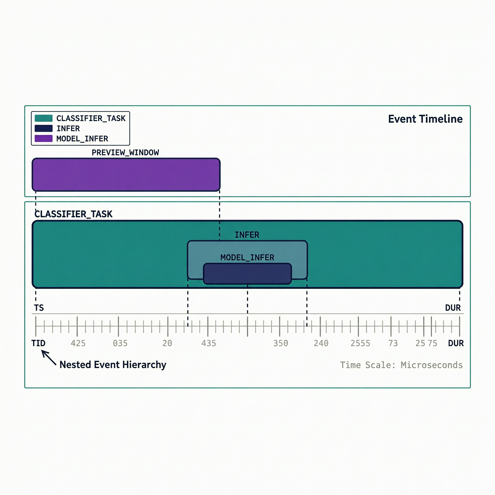

# 扩展案例 4A：卡顿基线与 Chrome Trace JSON

> 类型：`FW` ｜ 验证状态：参考值，待实机校准 ｜ 基线：[`microcourses/04_live_infer_tuning`](../../microcourses/04_live_infer_tuning/) ｜ 方案：[`Chrome Trace JSON 与 Perfetto 方案`](../../docs/extension-04-perfetto-trace-json-plan.md)

## 摘要

本案例直接复用最小案例 4 微课的卡顿基线：摄像头/LCD 预览和猫狗推理都运行在 CPU0，默认 160 MHz。扩展内容只加一个可选 trace 模式：ESP32 完成 3 次推理后通过串口打印 Chrome Trace JSON，你手动复制到 `trace.json`，再用 Perfetto 查看预览、取帧、输入准备和推理阶段的时间关系。和姊妹案例 [`04_live_infer_optimized`](../04_live_infer_optimized/)（优化版：推理在 CPU1、240 MHz）的关系：**4A 是"病历"，4 是"治疗方案"**——4A 故意保留推理与预览挤在 CPU0 的卡顿条件，让你在时间线上亲眼看到"一次 3 秒多的推理如何把预览窗口撑长"。

## Quick Start

**预备知识**

- **卡顿基线**：`FrameCapFetch`（取帧）和 `LCDDisp`（显示）钉在 CPU0、优先级 2；`classifier_task`（推理）由 `perf_config.h` 的 `CATDOG_INFER_CORE=0` 钉在 **CPU0**、优先级 3。同核高优先级严格抢占：推理一跑约 3.3 秒，取帧和显示只能干等，LCD 每 3～4 秒才跳一下。故意保留卡顿，是为了让优化前后的差异在时间线上可观测。
- **watchdog 与 Yield2Idle**：某核被霸占、空闲任务长期轮不上时，任务看门狗会打印 `task watchdog` 告警甚至复位；组件里的 `Yield2Idle` 是配套保险丝，发现某核从未空闲就强制暂停受监控任务 10 ms。3 秒级单次推理正踩在这条红线附近，所以卡顿基线要观察 watchdog。
- **preview_window 与 FPS**：trace 模式不打印 FPS，而是把"每显示 30 帧"打包成一个 `preview_window` 时间片，窗口越短刷得越快（FPS = 30 / dur 秒）。空闲窗口约 1.5 秒（≈20 FPS）；目录内示例 [`trace.json`](trace.json) 的第一个窗口 `dur≈7.94 s`（≈3.8 FPS），就是启动阶段被长推理压住的真实记录。
- **DFS 与固定 160 MHz**：动态调频会给对比实验引入噪声，`sdkconfig.defaults` 固定 `CONFIG_ESP_DEFAULT_CPU_FREQ_MHZ_160=y`（240 MHz 选项显式关闭），与微课 04 对照条件一致。
- **阶段级时间线 ≠ 函数级火焰图**：只给课程自有代码能稳定划分的阶段打点，不改 ESP-DL 第三方库源码；`infer` 内再分 `preprocess`/`model_infer`/`postprocess` 三段（子类重写 `run()` 在公开接口前后打点）。模型内部逐算子耗时不在本课程范围。
- **Chrome Trace JSON 字段**：每条事件是一个 JSON 对象——`name` 事件名（八个事件见第 6 步对照表）、`cat` 类别（`preview` 或 `vision`）、`ph:"X"` 完整时间片、`ts`/`dur` 开始时间与持续时间（微秒，`ts` 相对 trace 起点即 `perfetto_trace::init()` 时刻）、`pid` 固定 1、**`tid` 10=预览时间线 / 11=推理时间线**、`args.core` 记录事件发生时任务实际运行的 CPU 核心。
- **Perfetto**（[https://ui.perfetto.dev/](https://ui.perfetto.dev/)）是 Google 开源的 trace 可视化网页：把 JSON 拖进去，每个 `tid` 是一条水平时间线，每条事件是一个色块，宽度 = `dur`，嵌套事件叠成多层"楼层"。它完全在本地浏览器运行，trace 文件不会被上传。


**第 0 步：前置条件**

- ESP-IDF ≥ 5.4；托管组件 `esp-dl ^3.3.0`、`esp32_s3_eye ^6.0.0`（见 `main/idf_component.yml`）；
- 本目录**不自带组件和模型**：根 `CMakeLists.txt` 通过 `EXTRA_COMPONENT_DIRS` 复用 `../../extensions/03_live_catdog_assignment/components/who_*`，`main/CMakeLists.txt` 通过 `EMBED_FILES` 嵌入同目录的 `main/models/s3/catdog_mobilenet_v2.espdl`。先完成最小案例 3 作业并确认模型在位，否则构建报 `Missing model file`；
- 建议先做完微课 04（认识 `infer`/`period`/`core`/`cpu` 四个字段）再进本案例。

**第 1 步：普通构建（复现卡顿基线）**

```bash
cd extensions/04_live_infer_trace
idf.py --version
idf.py set-target esp32s3   # 按 sdkconfig.defaults 生成配置：160 MHz、八线 PSRAM @80 MHz、8 MB flash 自定义分区
idf.py build                # 编译并嵌入模型；首次 5～15 分钟，预期 Project build complete
```

普通构建保留微课的原始性能日志。

**第 2 步：烧录运行、确认卡顿（有开发板时）**

```bash
idf.py -p <PORT> flash monitor
```

`<PORT>` 换成实际串口设备名（macOS 是以 cu 开头的设备）。预期：LCD 有预览但明显卡顿（每 3～4 秒跳一下），串口打印 `Loading cat/dog classifier from flash rodata` 和 `Ready: preview CPU0, inference CPU0, CPU=160MHz`（TAG 为 `catdog_perfetto_trace`），之后约每 3.8 秒一行推理日志。肉眼确认卡顿基线存在，这一步的观察本身就是实验记录的一部分。

**第 3 步：启用 trace 模式重新构建**

```bash
idf.py -DPERFETTO_TRACE_JSON=1 build
# 有开发板时：
idf.py -p <PORT> flash monitor
```

`-D` 设置 CMake 缓存变量；`main/CMakeLists.txt` 检测到为真时给组件加编译宏，激活 `trace_json.cpp` 的事件缓冲、`app_main.cpp` 的打点回调和 `catdog_classifier.hpp` 的三段式 `run()` 重写。构建输出应包含 `-- PERFETTO_TRACE_JSON is enabled`。必须重新 build 的原因：`PERFETTO_TRACE_JSON` 是**编译期宏**，`#if` 分支在编译时被裁剪，改开关等于换了一份源代码。

**第 4 步：等待 3 次推理，复制 JSON**

设备完成 3 次成功推理后打印 JSON。找到 `TRACE_JSON_BEGIN` 和 `TRACE_JSON_END`，只复制两个标记之间从 `{` 到 `}` 的内容，保存为 `trace.json`。要点：

- 打印期间日志已被代码关闭，两标记之间不应有其他行；在 `idf.py monitor` 里用鼠标选中复制即可，保存为纯文本 UTF-8（别用会加 BOM 或自动折行的编辑器另存）；
- 推理任务在 `dump()` 后自删、预览继续，属预期行为；想再采一份就重启板子（monitor 里按 `Ctrl+T` 再按 `Ctrl+R`，或按板上 RST 键）。

**第 5 步：校验 JSON**

```bash
python -m json.tool trace.json   # 校验语法并格式化打印；报错说明复制范围不完整或混入杂质
```

**第 6 步：导入 Perfetto UI 并解读**

1. 浏览器打开 [https://ui.perfetto.dev/](https://ui.perfetto.dev/)，把 `trace.json` 拖进窗口（或 `Open trace file`）。没有板子时可先拖目录内的历史示例 [`trace.json`](trace.json) 熟悉界面；
2. 左侧时间线列表应看到进程 `1` 下两条轨：**`10`**（预览）和 **`11`**（推理）；
3. `W`/`S` 缩放、`A`/`D` 平移，框选可放大到选区；点色块，底部显示 `name`、`cat`、`ts`、`dur` 和 `args`（含 `core`）；
4. 各事件名含义（与代码中 `record_complete()` 一一对应）：

   | 事件名 | 轨（tid） | 含义 | 预期量级（示例文件） |
   |---|---|---|---|
   | `preview_window` | 10 | LCD 每显示 30 帧结算一次 | 空闲约 1.5 s；被推理压住时可达 7.9 s |
   | `classifier_task` | 11 | 推理任务单轮全程：取帧→准备输入→推理 | ≈ 3.27 s |
   | `frame_peek` | 11 | `cam_fb_peek()` 拿最新帧指针 | 几十微秒（示例 34 µs） |
   | `input_prepare` | 11 | `cam_fb_t` → `dl::image::img_t` 视图转换 | 几微秒（示例 4 µs） |
   | `infer` | 11 | `g_classifier->run(img)` 总耗时 | ≈ 3.27 s，几乎占满 `classifier_task` |
   | `preprocess` | 11 | 缩放/归一化到模型输入 | 约 13 ms |
   | `model_infer` | 11 | MobileNetV2 量化模型计算 | ≈ 3.25 s，**绝对主角** |
   | `postprocess` | 11 | softmax + Top-1 | 约 182 µs |

5. 重点观察三件事：① `classifier_task` ⊃ `infer` ⊃ `model_infer` 的嵌套楼层，确认耗时大头在 `model_infer`；② `frame_peek`/`input_prepare`/`postprocess` 细如发丝，瓶颈不在取帧和后处理；③ 把 `tid=11` 的宽色块与 `tid=10` 的 `preview_window` 对齐——覆盖推理的预览窗口被显著撑长，且两者 `args.core` 都是 0，这就是"同核竞争导致卡顿"的可视化证据。

没有开发板时可以完成构建和示例 JSON 校验，但不能把 Perfetto 打开结果写成已实机验证。

**第 7 步：关闭 trace 模式**

```bash
idf.py -DPERFETTO_TRACE_JSON=0 build
```

CMake 缓存变量会一直保留在 `build/` 里，必须**显式设回 0**（或删除 `build/` 目录）才能恢复普通性能日志路径。

## 预期现象

普通模式日志形如：

```text
[2] core=0 cpu=160MHz infer=3272.545ms period=3.794s
```

字段来源与微课 04 相同（`main/app_main.cpp` 非 trace 分支）：`[2]` 是推理序号，`core=`/`cpu=` 来自运行时查询，`infer=` 是 `run()` 前后计时差，`period=` 是两次推理结束时刻之差（第一次为 `0.000s`）。普通模式**没有** FPS 日志，也没有 `frame_age`/heap/psram 字段（那些在优化版工程里）。

trace 模式输出形如（数字只是格式示例，不是当前硬件实测）：

```text
TRACE_JSON_BEGIN
{"traceEvents":[
{"name":"preview_window","cat":"preview","ph":"X","ts":100000,"dur":1500000,"pid":1,"tid":10,"args":{"core":0}},
{"name":"classifier_task","cat":"vision","ph":"X","ts":101000,"dur":320500,"pid":1,"tid":11,"args":{"core":0}},
{"name":"infer","cat":"vision","ph":"X","ts":101105,"dur":320395,"pid":1,"tid":11,"args":{"core":0}},
{"name":"model_infer","cat":"vision","ph":"X","ts":102305,"dur":319100,"pid":1,"tid":11,"args":{"core":0}}
],"displayTimeUnit":"us"}
TRACE_JSON_END
```

实际输出还包含 `frame_peek`、`input_prepare`、`preprocess`、`postprocess` 事件。正常结果应满足：JSON 通过语法检查；Perfetto 能看到 `tid=10` 预览时间线和 `tid=11` 推理时间线；`infer` 覆盖 `preprocess`、`model_infer`、`postprocess` 三个阶段。

目录内的历史示例 [`trace.json`](trace.json) 是真实采集文件，可供对照量级：3 轮 `classifier_task`/`infer` 各约 3.26～3.27 s，其中 `preprocess` 约 12～13 ms、`model_infer` 约 3.25 s、`postprocess` 约 182 µs、`frame_peek` 约 34 µs；首个 `preview_window` 约 7.94 s（被启动阶段的长推理压住），后续窗口恢复约 1.5 s。

若出现以下情况，保留完整日志并标记失败：模型初始化失败、摄像头/LCD 管线启动失败、连续 3 次没有取得有效帧、JSON 标记之间混入普通日志，或事件超过缓冲容量（256 个）导致 trace 不完整。

**常见问题排查**

| # | 现象 | 原因 | 解决 |
|---|---|---|---|
| 1 | 构建报 `Missing model file: .../03_live_catdog_assignment/...espdl` | 本工程复用最小案例 3 作业的组件和模型 | 先完成作业工程、确认 `.espdl` 在位，不要移动/改名作业目录 |
| 2 | `-DPERFETTO_TRACE_JSON=1` 后仍是普通日志、没有 JSON | 开关没生效或没重新烧录 | 确认构建输出含 `-- PERFETTO_TRACE_JSON is enabled` 后重新烧录；想关关不掉就显式 `-DPERFETTO_TRACE_JSON=0 build` 或删 `build/` |
| 3 | 等很久都不打印 JSON | 成功推理不足 3 次：peek 拿不到帧或模型未就绪 | 看 LCD 有无预览、启动日志有无 `Failed to initialize classifier` / `Failed to start camera capture / LCD tasks` |
| 4 | JSON 标记之间混入日志行，`python -m json.tool` 报错 | 复制范围超出标记 | 只复制两标记之间从 `{` 到 `}` 的内容；`dump()` 已关闭日志，标记内理论上不会有日志 |
| 5 | Perfetto 里事件明显缺失或打不开 | 事件超 `kMaxEvents=256` 被丢弃，或文件带 BOM/被折行 | 保持 3 次推理的短窗口；用纯文本 UTF-8 保存，先本地校验，再用示例 `trace.json` 验证 Perfetto 本身 |
| 6 | 出现 `task watchdog` 告警或设备复位 | 3 秒级推理与预览同核竞争，空闲任务被饿到保护边界 | 保留完整日志作为卡顿基线证据；复位频繁时按 Kconfig 帮助调大 `CONFIG_ESP_TASK_WDT_TIMEOUT_S` |

## 学习目标

- 复现推理任务与预览任务竞争 CPU0 时的卡顿基线；
- 解释 `preview_window`、`frame_peek`、`input_prepare`、`preprocess`、`model_infer`、`postprocess`、`infer` 和 `classifier_task` 时间片；
- 使用 trace 构建开关，让设备输出一段合法的 Chrome Trace JSON；
- 手动复制、校验并在 Perfetto UI 中打开 `trace.json`；
- 对照普通性能日志，判断最长阶段与预览响应性之间的关系。

## 原理讲解

微课 04 的变量是推理核心和 CPU 频率；本扩展固定 `CATDOG_INFER_CORE=0` 和 160 MHz，保留推理与摄像头/LCD 竞争同一 CPU 的卡顿现象。trace 模式不改任务核心和优先级，只在应用代码中记录少量阶段时间。

把整份 trace 想象成一条**纪录片剪辑时间线**：`tid=10` 是"摄影机轨"（预览），每 30 帧一个 `preview_window` 色块；`tid=11` 是"鉴定师轨"（推理），每次推理一组嵌套色块——最外层 `classifier_task` 里几乎被 `infer` 占满（`frame_peek`、`input_prepare` 只有几十微秒，细得看不见），`infer` 内部又分三层：`preprocess`（缩放/归一化）、`model_infer`（MobileNetV2 计算，绝对主角）、`postprocess`（softmax 取 Top-1）。两轨对齐看：只要 `tid=11` 出现宽大的 `infer` 色块，同一时段 `tid=10` 的 `preview_window` 就被撑长——**"谁拖慢了谁"从推测变成可视证据**。



> 图：只解释 `classifier_task`、`infer`、`model_infer` 和 `preview_window` 的阅读方式，不是实际 Perfetto 截图；性能判断以设备打印的 Trace JSON 为准。

**Chrome Trace JSON 时间线**

流程（以 `main/trace_json.cpp` 为准）：`init()` 启动时记下 trace 起点；每次 `record_complete()` 把绝对时间戳换算成相对起点的微秒数，存进容量 `kMaxEvents=256` 的静态数组（自旋锁保护并发追加）；完成 3 次成功推理后 `dump()` 先关掉全部日志防止混行，再按 `ts` 排序，在 `TRACE_JSON_BEGIN` / `TRACE_JSON_END` 标记之间逐条打印，随后推理任务自删。缓冲满后新事件被静默丢弃，所以采集窗口要短（3 次推理 ≈ 12～15 秒）。普通模式用于测量基线，trace 模式用于观察阶段关系，两者分开记录。

## 整体流程图

```text
摄像头/LCD 预览（CPU0，priority=2） ──→ preview_window（tid=10）
                                      ↘
最新帧 ──→ classifier_task（CPU0，priority=3）
             ├─ frame_peek
             ├─ input_prepare
             └─ infer（g_classifier->run）
                  ├─ preprocess
                  ├─ model_infer
                  └─ postprocess
                    ↓
          3 次推理完成后打印 Chrome Trace JSON
                    ↓
       手动复制为 trace.json → Perfetto UI
```

注意：`preview_measurement` 回调和 `preview_window` 事件**只在 trace 模式下存在**（`app_main.cpp` 中被 `#if PERFETTO_TRACE_JSON` 包裹）；普通模式没有任何 FPS 输出，只有微课同款的 `[N] core=... cpu=... infer=... period=...` 日志。

## 关键代码解析

**1. 推理任务打点：[`classifier_task`](main/app_main.cpp)（节选）**

```cpp
// classifier_task 主循环（trace 模式分支节选）
while (true) {
    const int64_t task_start_us = esp_timer_get_time();   // 本轮起点
    auto fb = g_frame_node ? g_frame_node->cam_fb_peek() : nullptr;  // frame_peek 阶段
    dl::image::img_t img = static_cast<dl::image::img_t>(*fb);       // input_prepare 阶段
    g_classifier->run(img);                             // infer：触发三段式打点的 run()
    // 推理结束后一次性记录 4 个 vision 事件（tid=11）：classifier_task(task_start_us→end_us) / frame_peek / input_prepare / infer
    if (s_infer_count >= kTraceInferLimit) {            // kTraceInferLimit = 3
        perfetto_trace::dump();                         // 打印 JSON
        vTaskDelete(nullptr);                           // 推理任务自删，预览继续
        return;
    }
    // 普通模式（#else 分支）：打印与微课 04 相同的四字段日志
    vTaskDelay(kInferIntervalTicks);                    // 每轮睡 500ms
}
```

**2. 三段式分类：[`CatDogClassifier::run`](main/catdog_classifier.hpp)（仅 trace 模式重写）**

```cpp
// run(img, mode) override——不改 ESP-DL 库源码，只在子类展开三步并打点
#if PERFETTO_TRACE_JSON
    const int64_t t0 = esp_timer_get_time();
    m_image_preprocessor->preprocess(img);              // ESP-DL 公开接口：预处理
    const int64_t t1 = esp_timer_get_time();
    m_model->run(mode);                                 // ESP-DL 公开接口：模型计算（单核）
    const int64_t t2 = esp_timer_get_time();
    std::vector<dl::cls::result_t> &result = m_postprocessor->postprocess(); // softmax + Top-1
    const int64_t t3 = esp_timer_get_time();
    // record_complete 三个事件（tid=11）：preprocess(t0→t1) / model_infer(t1→t2) / postprocess(t2→t3)
    return result;
#else
    return dl::cls::ClsImpl::run(img, mode);            // 普通模式：ESP-DL 默认实现，零打点开销
#endif
```

**3. 事件缓冲与输出：[`main/trace_json.cpp`](main/trace_json.cpp)（节选）**

```cpp
constexpr size_t kMaxEvents = 256;                  // 静态数组容量，超出静默丢弃
portMUX_TYPE s_lock = portMUX_INITIALIZER_UNLOCKED; // 自旋锁保护并发追加

void record_complete(name, category, start_us, end_us, pid, tid, core) {
    if (!name || !category || end_us < start_us) return;           // 非法区间直接丢弃
    event.timestamp_us = std::max<int64_t>(0, start_us - s_trace_start_us); // 绝对→相对
    event.duration_us  = end_us - start_us;
}
void dump() {
    esp_log_level_set("*", ESP_LOG_NONE);           // 关日志，保证 JSON 纯净可复制
    std::sort(...);                                  // 按 ts 排序，抵消并发追加的乱序
    // 在 TRACE_JSON_BEGIN / TRACE_JSON_END 之间逐条打印完整事件（ph:"X"）
}
```

`trace_json.hpp` 有开关兜底：未定义时 `#define PERFETTO_TRACE_JSON 0`，普通构建链接的是三个空函数，运行期零开销。

## 关键文件说明

| 文件 | 职责 | 类型 |
|---|---|---|
| [`main/app_main.cpp`](main/app_main.cpp) | 微课卡顿基线、预览回调、推理任务和 trace 接入 | 课程代码 |
| [`main/trace_json.hpp`](main/trace_json.hpp) | trace 接口和编译开关 | 课程代码 |
| [`main/trace_json.cpp`](main/trace_json.cpp) | 事件缓冲、排序和 JSON 序列化 | 课程代码 |
| [`main/perf_config.h`](main/perf_config.h) | CPU0 卡顿基线配置 | 实验配置 |
| [`main/frame_cap_pipeline.cpp`](main/frame_cap_pipeline.cpp) | RGB565 摄像头帧管线和 3 个帧缓冲 | 课程代码 |
| [`main/catdog_classifier.hpp`](main/catdog_classifier.hpp) | 分类封装，trace 模式下标记三段分类流程 | 课程代码 |
| [`main/CMakeLists.txt`](main/CMakeLists.txt) | 模型嵌入、trace 源文件和构建开关 | 构建配置 |
| [`sdkconfig.defaults`](sdkconfig.defaults) | 160 MHz、八线 PSRAM、LCD 缓冲默认配置 | 构建配置 |
| [`trace.json`](trace.json) | 历史采集的示例 trace（量级对照/熟悉 Perfetto 用） | 示例数据 |

## 配置说明

| 修改位置 | 配置项/命令 | 现象变化 |
|---|---|---|
| [`main/perf_config.h`](main/perf_config.h) | `CATDOG_INFER_CORE=0` | 保留推理与预览竞争 CPU0 的卡顿基线 |
| [`sdkconfig.defaults`](sdkconfig.defaults) | 160 MHz 默认频率 | 保留微课中的低频率对照条件 |
| [`main/CMakeLists.txt`](main/CMakeLists.txt) | `PERFETTO_TRACE_JSON=1` | 启用 trace 事件缓冲和串口 JSON 输出 |
| 构建命令 | `idf.py -DPERFETTO_TRACE_JSON=0 build` | 关闭 trace，恢复普通性能日志路径 |
| [`main/trace_json.cpp`](main/trace_json.cpp) | `kMaxEvents=256` | trace 事件容量；事件过多时缩短采集窗口 |

修改示例——做拓展挑战"CPU1 对照 trace"时，`main/perf_config.h` 修改前/修改后：

```c
#define CATDOG_INFER_CORE 0   // 修改前：卡顿基线
// #define CATDOG_INFER_CORE 1   // 修改后：CPU1 隔离对照
```

改完必须重新 `idf.py -DPERFETTO_TRACE_JSON=1 build` 并烧录：这是编译期宏，旧固件不会自己变。采集后在 Perfetto 里对比两份 trace：`tid=11` 色块的 `args.core` 变为 1，且 `preview_window` 不再被推理撑长——这就是隔离方案的可视化证据。频率对照同理：`sdkconfig.defaults` 中把 `CONFIG_ESP_DEFAULT_CPU_FREQ_MHZ_160=y` / `# CONFIG_ESP_DEFAULT_CPU_FREQ_MHZ_240 is not set` 两行互换后，需 `rm sdkconfig && idf.py set-target esp32s3` 再构建。

## 术语小表

| 术语 | 解释 |
|---|---|
| Chrome Trace JSON | 用时间戳和持续时间描述事件的 JSON 格式 |
| Perfetto | 打开和分析 trace 时间线的浏览器可视化工具 |
| `ph: "X"` / `ts` / `dur` | 完整时间片事件类型；开始时间和持续时间，单位微秒 |
| `tid` | 时间线标识，本案例 10=预览、11=推理 |
| `args.core` | 记录事件发生时任务实际运行的 CPU 核心 |
| 卡顿基线 | 推理和预览竞争同一 CPU 时的可重复对照条件 |
| `preview_window` | 预览时间线上"每 30 帧"一个的窗口时间片，宽度反映 FPS |
| `frame_peek` / `input_prepare` | 取最新帧指针、转换为分类器输入视图的两个微秒级阶段 |
| `preprocess` / `model_infer` / `postprocess` | `infer` 内部三阶段：图像预处理、模型计算、softmax 后处理 |
| `kMaxEvents` | RAM 事件缓冲容量（256），超出后新事件被丢弃 |
| `kTraceInferLimit` | 采集多少次成功推理后打印 JSON 并停止推理任务（3） |
| 编译期宏 | `#if PERFETTO_TRACE_JSON` 在编译时裁剪分支，改开关必须重新构建 |
| watchdog / `Yield2Idle` | 看门狗检测任务长期不让出 CPU；`Yield2Idle` 是工程自带的防饿死保险丝 |

## 验证清单

- [ ] 记录硬件、ESP-IDF 版本、模型、CPU 频率、推理核心和帧缓冲数量；
- [ ] 普通模式至少记录 3 次 `infer`、`period`、`core` 和 `cpu`；
- [ ] trace 模式完成 3 次成功推理，串口输出含 `TRACE_JSON_BEGIN` 和 `TRACE_JSON_END`；
- [ ] 复制后的 `trace.json` 能通过 `python -m json.tool`，并在 Perfetto 中同时看到预览和推理时间线；
- [ ] 能指出 `preprocess`、`model_infer`、`postprocess` 中的最长阶段并与普通 `infer` 日志相互印证；trace 与普通模式数据分开记录，报告注明这是阶段级时间线、不是 ESP-DL 内部函数级火焰图。

**讲师参考基线（待实机填写）**

- 硬件：ESP32-S3-EYE；ESP-IDF：`v5.4.3`；模型：嵌入式猫狗 MobileNetV2；
- 配置：CPU0 推理、CPU0 预览、160 MHz、3 个帧缓冲、500 ms 推理间隔；
- 普通模式：记录至少 3 次 `infer`、`period`、`core`、`cpu`；
- Trace 模式：记录 3 次成功推理、复制后的 JSON、Perfetto 截图和 trace 开销说明；
- 实测字段：填写 `preview_window`、`classifier_task`、`frame_peek`、`input_prepare`、`infer`、`preprocess`、`model_infer`、`postprocess` 的持续时间，不预填未经实机确认的数值。

## 思考题与拓展挑战

**思考题**

1. 为什么要从卡顿的 CPU0 基线开始生成 trace？

   **参考答案：**预览和推理同核时，时间线最容易表现出任务竞争和预览响应性问题，优化前后的差异也更直观。

2. 为什么不能把普通的 `infer=3272ms` 日志直接复制到 Perfetto？

   **参考答案：**普通日志没有 Chrome Trace 所需的事件名、开始时间、持续时间和时间线标识，无法表示可视化时间片。

3. 示例 `trace.json` 的第一个 `preview_window` 为什么长达约 7.9 秒，而后续窗口只有约 1.5 秒？

   **参考答案：**第一个窗口覆盖了启动阶段的前几次长推理，30 帧显示被 3 秒级推理块反复打断；进入稳态后（推理之间还有 500 ms 延时）恢复约 1.5 秒（≈20 FPS）。卡顿程度取决于推理占空比，不只是单次耗时。

**拓展挑战**

- 将 `CATDOG_INFER_CORE` 改为 1，分别生成 CPU0 基线和 CPU1 隔离方案的两份 trace，并比较预览时间线；
- 在不追踪第三方库的前提下增加一个课程自有阶段，观察阶段划分对性能结论的影响。

