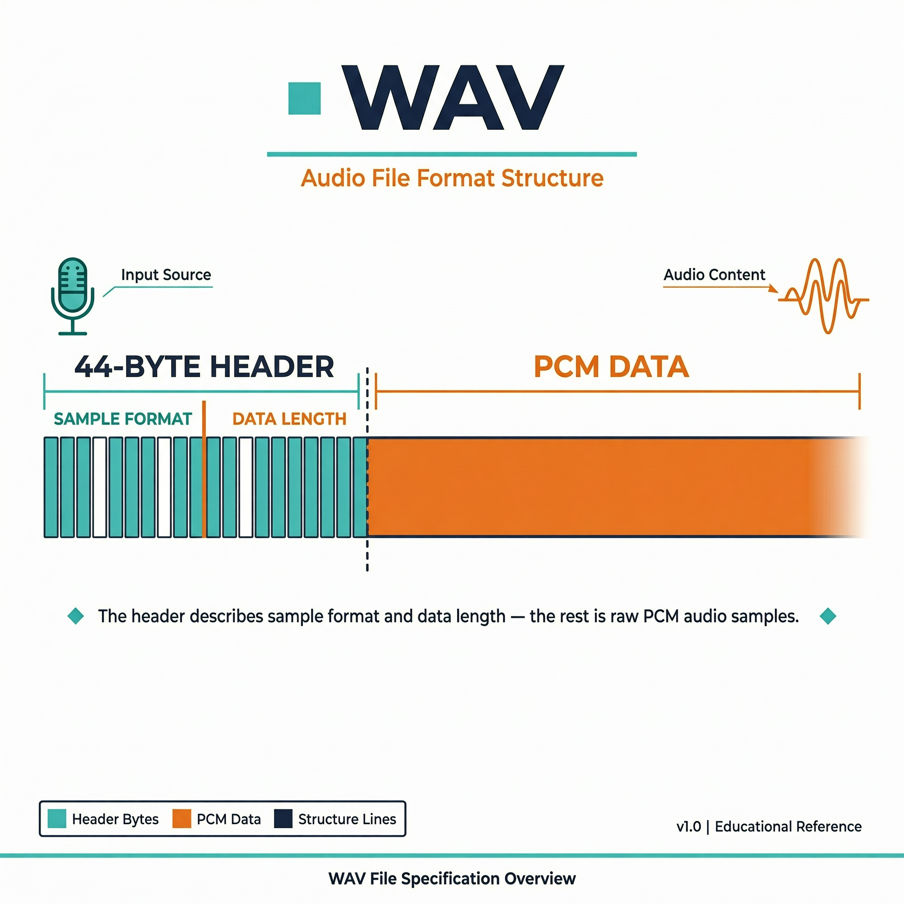
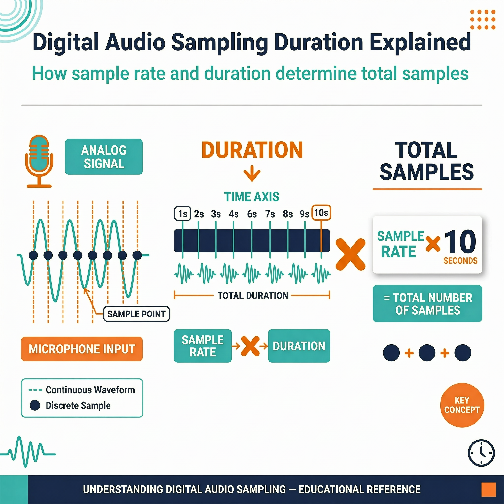

# 扩展案例 5：录音保存与回放验证

> 类型：`FW` ｜ 验证状态：参考值，待实机校准 ｜ 对应微课：[`microcourses/05_mic_recording`](../../microcourses/05_mic_recording/)

## 摘要

本案例在最小案例 5 微课"自动录 10 秒 PCM"的基础上，加入三样真实设备才会遇到的东西：**GPIO0 按键触发**、**把录音保存成 MicroSD 卡上的 WAV 文件**、**保存后做文件检查**。目标是得到一段约 10 秒、能被电脑播放器打开收听的 `/sdcard/lesson05_record.wav`。**但"文件写成功"不等于"听起来对"**——听感回放必须把 SD 卡拿到电脑上人工验证，这就是案例名里 "playback_verify" 的含义。

> ⚠️ 隐私要求：本案例会真实录下周围的声音。**测试时不要录入真实个人语音、他人谈话或敏感内容**；生成的 `lesson05_record.wav` 是生成物，**不要提交到仓库**。听感验证用拍手、敲击或朗读公开文字即可。

## Quick Start

**预备知识**

做完微课 05 的话，前两条可快速略过；WAV 头和 SD 卡是新知识。

- **PCM 与数据量（复习）**：16000 Hz、16 bit、单声道；10 秒 = 160000 样本 = **320000 字节**纯 PCM。
- **I2S 与 32→16 bit（复习）**：麦克风经 I2S（GPIO41/42/2）发 32 bit 原始样本，`voice_read_samples()` 右移 14 位（放大约 4 倍）截成 16 bit，每次读 160 样本 = 10 ms，见 [`voice_common.c`](../../components/voice_common/voice_common.c)。
- **WAV = 44 字节头 + PCM 数据**：裸 PCM 没有格式说明，播放器不知道怎么解释；WAV 头写明格式。关键字段：偏移 0/8 是 `RIFF`/`WAVE` 固定标识，偏移 4 是 ChunkSize（=36+数据长度），`fmt ` 子块写 AudioFormat=1（PCM）、声道=1、采样率=16000、ByteRate=32000、BlockAlign=2、位深=16，偏移 36 是 `data` 标识，偏移 40 是数据区字节数（10 秒 = 320000）。整数都按小端序写入（`put_u16`/`put_u32`）。**文件总大小 = 44 + 320000 = 320044 字节**。
- **先写空头，最后回填**：开始录音时不知道最终数据长度，先写 `data_size=0` 的占位头，录完用 `voice_wav_patch_header()` 回到文件开头重写正确的头。中途断电时头也是诚实的，不会写着假长度。
- **MicroSD 卡与 FAT32**：卡槽走 SDMMC 总线（1 线模式，CLK=GPIO39、CMD=GPIO38、D0=GPIO40），挂载后出现在路径 `/sdcard`。代码 `format_if_mount_failed = false`，**板子不会替你格式化**——必须先在电脑上把卡格式化为 FAT32（建议 ≤ 32 GB，大卡默认常是 exFAT，不一定支持）。
- **GPIO0 按键与下降沿**：GPIO0 按键配成输入、内部上拉、每 20 ms 轮询。`voice_button_pressed()` 只在电平从高(1)变低(0)时返回 true——按住不放也只触发一次。


以下命令在电脑上执行。先确认已安装 ESP-IDF（课程验证版本 v5.4.3，见 [`docs/build-verification.md`](../../docs/build-verification.md)）并导出环境。

**第 0 步：准备 MicroSD 卡（关键，别跳过）**

1. 找一张 ≤ 32 GB 的 MicroSD 卡，插到电脑读卡器，**格式化为 FAT32**（会清空数据，先备份）：Windows 右键卡→格式化→选 `FAT32`；macOS 磁盘工具→抹掉→选 `MS-DOS (FAT)`；Linux `sudo mkfs.vfat -F 32 /dev/sdX1`（务必确认设备名别格错盘）；
2. 把卡插入 ESP32-S3-EYE 卡槽插到位，**再给板子重新上电（power cycle）**，SD 卡检测更可靠。

**第 1 步：进入工程目录并确认环境**

```bash
cd extensions/05_recording_playback_verify
idf.py --version
```

工程通过 `EXTRA_COMPONENT_DIRS` 引入共享组件，必须在仓库原位构建。版本预期 `ESP-IDF v5.4.3`（或其他 v5.x）；报 `command not found` 先执行 IDF 的 `export.sh`。

**第 2 步：设置目标芯片**

```bash
idf.py set-target esp32s3
```

[`sdkconfig.defaults`](sdkconfig.defaults) 比微课多了 `CONFIG_FATFS_LFN_HEAP=y`（长文件名支持），其余相同（8MB Flash、自定义分区、PSRAM、CPU 240MHz）。

**第 3 步：编译**

```bash
idf.py build
```

首次会下载 `espressif/esp-sr` 及依赖（本扩展未调用，属统一依赖布局）。预期末尾 `Project build complete`，首次 3～10 分钟。**没有开发板的同学到此完成构建验证——但"构建成功"不代表"WAV 已保存"，两者要严格分开。**

**第 4 步：找串口**

USB 连板后：macOS `ls /dev/cu*`（以 `cu` 开头的设备）；Linux `ls /dev/ttyUSB* /dev/ttyACM*`；Windows 看设备管理器 `COMx`。

**第 5 步：烧录并监视**

```bash
idf.py -p <PORT> flash monitor
```

烧录（1～2 分钟）后自动复位。复位后应先看到 SD 卡信息和 `SD card detected`、`ready: press GPIO0`。**按一下 GPIO0 键**开始 10 秒录音；录音期间没有逐秒进度日志，录满后一次性输出 `state=DONE ... file_bytes=...`、`verify=...` 和 `result=ok`。可反复按键（每次覆盖同名文件）。退出监视器按 `Ctrl + ]`。

**第 6 步：把 SD 卡拿到电脑上回放验证（人工必做）**

1. 先断电再拔卡，插到电脑读卡器，打开卡里的 `lesson05_record.wav`：双击用系统播放器，或用 Audacity（免费）打开能同时看波形，验证更充分；命令行 `ls -l lesson05_record.wav` 应显示 `320044` 字节（10 秒时）；
2. 应能听到录音时制造的声音（拍手、敲击等）。时长正确、波形连续、大小 320044 字节，即回放验证通过。

## 预期现象

复位后先看到（挂载成功时组件还会打印卡信息；若出现 `Warning: Long filenames` 类提示可忽略，不影响功能）：

```text
I (xxx) ext05_record: SD card detected
I (xxx) ext05_record: ready: press GPIO0
```

按下 GPIO0 后（**格式示例，具体时间戳和数值以实机为准**）：

```text
I (xxx) ext05_record: state=START
I (xxx) ext05_record: state=RECORDING target_ms=10000
I (xxx) ext05_record: state=DONE path=/sdcard/lesson05_record.wav duration_ms=10000 file_bytes=320044
I (xxx) ext05_record: verify=playback_required_on_host_or_audio_player
I (xxx) ext05_record: result=ok
```

失败示例：SD 卡没插好时启动阶段打印 `E ... SD card not found at /sdcard — check that a FAT32-formatted card is inserted` 和 `E ... hint: power cycle the board after inserting the SD card`；录音中途写盘失败则是 `storage_error=write` 后跟 `result=failed`。**失败时不要留残缺文件当成果，也不要在 `result=failed` 时宣称录音已保存。**

**常见问题排查**

| # | 现象 | 可能原因 | 解决办法 |
|---|---|---|---|
| 1 | 启动即 `abort()` 重启或打印 `SD card not found` | 卡没插好、未格式化 FAT32、卡不兼容 | 断电重插紧；电脑上格式化为 FAT32（≤32GB）；插卡后重新上电 |
| 2 | `storage_error=open path=...` | 卡满、只读或文件系统损坏 | 换空卡或清理空间，重新格式化 |
| 3 | 按键后没有 `state=START` | 按错键、按太短被 20ms 轮询漏掉、还没 ready | 等 `ready: press GPIO0` 出现，按住 GPIO0 约 0.5 秒 |
| 4 | `file_bytes` 明显小于 320044 | 中途 `storage_error=write`，文件未写全 | 看失败日志，换空卡重试；失败文件不要当成果 |
| 5 | 电脑播放器打不开、有噪声或声音变速 | WAV 头字段与实际数据不一致，或回填头失败 | 确认无 `storage_error=header`；用 Audacity 按 16kHz/16bit/mono/小端导入原始数据核对 |
| 6 | 回放完全静音 | 麦克风没采到声音，录的是全零数据 | 回微课 05 确认能采到 progress；制造明显声音再录 |

## 学习目标

- 用 GPIO0 按键触发一次固定时长录音，理解下降沿检测；
- 解释 WAV 头关键字段（RIFF、fmt、data）和文件总大小的关系（44 + 320000 = 320044 字节）；
- 区分**板端文件检查**（`stat` + 头字段）和**播放器回放验证**（必须人工在电脑上做）；
- 建立"失败不能伪装成成功"的存储习惯：出错时保留失败状态，不留残缺文件当成果。

## 原理讲解

**时长由"写进文件的字节数"决定**

和微课一样不靠计时器，录音主循环条件是 `data_size / sizeof(int16_t) < target_samples`（160000）。`data_size` 只统计 `fwrite` 成功的字节——**"录够时长"和"写够字节"是同一个判断**，写失败立即触发 `storage_error=write` 返回，绝不会把没落盘的数据算成成功。

**每一步失败都有独立日志**

打开文件失败打 `storage_error=open path=...`（SD 未挂载好、卡满、只读），读麦克风失败打 `audio_error=<err>`（I2S 异常），写 PCM 失败打 `storage_error=write`（卡满、拔卡），回填头失败打 `storage_error=header`，录完 `stat()` 读不到文件打 `verify_error=stat`。SD 卡启动挂载失败时 `ESP_ERROR_CHECK` 直接 `abort()`；即便侥幸挂载，`stat("/sdcard")` 二次检查失败也会打印两行提示并返回，不进入按键循环。





> 图：先写头部占位信息，再写 PCM 数据，结束时回填数据长度。图中结构和公式用于概念说明，实际文件必须通过播放器和字节检查验证。

## 整体流程图

```text
上电 → 初始化：I2S 麦克风、SD 卡挂载（失败即报错停止）、GPIO0 按键
        ↓ 启动先打印 SD card detected，再打印 ready: press GPIO0
主循环每 20 ms 轮询按键（检测下降沿）
        ↓ 按下按键
state=START → 新建 /sdcard/lesson05_record.wav，写 44 字节占位 WAV 头
        ↓
state=RECORDING → 每次读 160 个样本写入文件，累计 160000 个样本（约 10 秒）
        ↓ 回填 WAV 头真实长度 → fclose → stat 读回字节数
state=DONE path=... duration_ms=... file_bytes=... → result=ok
（任一步失败 → 对应 storage_error/audio_error 日志 + result=failed）
        ↓ 回到主循环，等待下一次按键
```

## 关键代码解析

以下片段摘自 [`main/main.c`](main/main.c) 和 [`voice_common.c`](../../components/voice_common/voice_common.c) 真实代码，注释为教学补充。`app_main` 的流程是：初始化麦克风和 SD 卡 → `stat("/sdcard")` 二次确认 → 打印 `ready` → 每 20 ms 轮询按键，按下则执行 `record_and_verify()` 并打印 `result=ok/failed`。

**1. `record_and_verify` 核心：建文件 → 写头 → 采集写入 → 回填 → stat（[`main/main.c`](main/main.c)）**

```c
FILE *file = fopen(RECORD_PATH, "wb+");    // 可读写、覆盖已存在文件
if (!file) { ESP_LOGE(TAG, "storage_error=open path=%s", RECORD_PATH); return ESP_FAIL; }
esp_err_t err = voice_wav_write_header(file, 0);   // 先写 data_size=0 的占位头
while (data_size / sizeof(int16_t) < target_samples) {   // 用"已写入样本数"控制时长
    err = voice_read_samples(samples, VOICE_FEED_SAMPLES);       // 阻塞读 160 样本
    if (err != ESP_OK) { fclose(file); ESP_LOGE(TAG, "audio_error=%s", esp_err_to_name(err)); return err; }
    if (fwrite(samples, sizeof(int16_t), VOICE_FEED_SAMPLES, file) != VOICE_FEED_SAMPLES) {
        fclose(file); ESP_LOGE(TAG, "storage_error=write"); return ESP_FAIL;   // 写盘失败
    }
    data_size += VOICE_FEED_SAMPLES * sizeof(int16_t);   // 只累计真正落盘的字节
}
err = voice_wav_patch_header(file, data_size);   // 回到文件开头回填真实长度
fclose(file);
if (stat(RECORD_PATH, &st) != 0) { ESP_LOGE(TAG, "verify_error=stat"); return ESP_FAIL; }
ESP_LOGI(TAG, "state=DONE path=%s duration_ms=%u file_bytes=%ld", ...);   // 打印真实文件大小
```

`file_bytes` 来自 `stat` 读回的真实大小（`st.st_size`），应等于 44 + `data_size`；明显偏小说明写盘没落全。

**2. `voice_button_pressed`：下降沿检测（[`voice_common.c`](../../components/voice_common/voice_common.c)）**

```c
bool voice_button_pressed(void)
{
    static int previous = 1;                    // 上次电平，初值 1（上拉，未按下）
    int current = gpio_get_level(VOICE_RECORD_BUTTON_GPIO);
    bool pressed = (previous == 1 && current == 0);   // 只有 1→0 才算"按下"
    previous = current;
    return pressed;
}
```

`static` 让 `previous` 跨调用保持：按住不放不会重复触发，松开不触发，下次真正按下才再触发一次。WAV 头的拼装见预备知识里的字段说明，代码在 `voice_wav_write_header()`/`voice_wav_patch_header()`。

## 关键文件说明

| 文件 | 职责 | 类型 |
|---|---|---|
| [`main/main.c`](main/main.c) | 按键轮询、录音、WAV 保存与 `stat` 检查 | 课程代码 |
| [`main/CMakeLists.txt`](main/CMakeLists.txt)、[`main/idf_component.yml`](main/idf_component.yml) | 声明 `voice_common` 依赖和 `espressif/esp-sr` 托管依赖（统一布局） | 构建配置 |
| [`CMakeLists.txt`](CMakeLists.txt)、[`partitions.csv`](partitions.csv)、[`sdkconfig.defaults`](sdkconfig.defaults) | 引入共享组件；`factory` 2500K + `model` 5168K 分区；esp32s3/8MB Flash/PSRAM/CPU 240MHz/`CONFIG_FATFS_LFN_HEAP=y` | 构建配置 |
| [`../../components/voice_common/include/voice_common.h`](../../components/voice_common/include/voice_common.h) | 音频格式常量、按键 GPIO、WAV/SD/按键 API 声明 | 共享组件 |
| [`../../components/voice_common/voice_common.c`](../../components/voice_common/voice_common.c) | I2S 采集、SD 卡挂载、按键、WAV 头读写实现 | 共享组件 |
| `/sdcard/lesson05_record.wav` | 板上生成的测试录音 | **生成物，不提交、不含真实个人语音** |

## 配置说明

| 修改位置 | 配置项 | 现象变化 |
|---|---|---|
| [`main/main.c`](main/main.c) | `RECORD_SECONDS`（默认 10） | 改为 5 → `data_size=160000`、`file_bytes=160044` |
| [`main/main.c`](main/main.c) | `RECORD_PATH`、主循环 `vTaskDelay(20ms)` | 改输出路径（须在 `/sdcard` 下）；改按键轮询频率（太小占 CPU，太大漏按） |
| [`voice_common.h`](../../components/voice_common/include/voice_common.h)、[`voice_common.c`](../../components/voice_common/voice_common.c) | 采样率/声道/位深常量、`VOICE_RECORD_BUTTON_GPIO`、`SDMMC_BUS_WIDTH`、SD 引脚 | 同时改变 WAV 头字段和播放器兼容性；改触发按键、SDMMC 总线宽度/引脚需与硬件一致 |
| [`sdkconfig.defaults`](sdkconfig.defaults) | `CONFIG_FATFS_LFN_HEAP` 等 | 影响长文件名支持、Flash 和内存 |

改采样格式后务必重新做第 6 步回放验证：播放器靠 WAV 头解释数据，头里采样率与实际不符会变速或出噪声。

## 术语小表

| 术语 | 解释 |
|---|---|
| WAV 头 | 文件开头 44 字节，描述采样格式（RIFF/fmt/data）和数据长度 |
| `data_size` / Subchunk2Size | PCM 数据区字节数；10 秒 = 320000 |
| ByteRate / BlockAlign | 每秒字节数（=32000）/ 每采样帧字节数（=2） |
| 小端序 | 多字节整数低位字节存前面；`put_u16/put_u32` 按此写入 |
| 占位头 / 回填 | 先写 `data_size=0` 的头，录完用真实长度重写 |
| FAT32 | SD 卡文件系统，需在电脑上预先格式化 |
| SDMMC / 挂载点 `/sdcard` | SD 卡通信总线（本例 1 线，GPIO39/38/40）；卡在虚拟文件系统里的根路径 |
| 下降沿检测 | 电平从高(1)变低(0)才算一次按下，避免长按重复触发 |
| `stat` | 读取文件元数据（如大小）的系统调用；成功≠音频可回放 |
| 回放验证 / 生成物 | 把卡拿到电脑用播放器实际收听；板上产生的文件不纳入版本提交 |

## 验证清单

- [ ] 记录 SD 卡格式（FAT32）、容量、目标板、IDF 版本和按键触发次数；
- [ ] 启动日志出现 `SD card detected` 和 `ready: press GPIO0`；
- [ ] 每次按键触发一次 `state=START → RECORDING → DONE`，且 `result=ok`；
- [ ] 核对 10 秒时 `file_bytes≈320044`、`duration_ms≈10000`，并检查 WAV 头关键字段（AudioFormat=1、声道=1、采样率=16000、位深=16、Subchunk2Size=data_size）；
- [ ] 在电脑播放器（建议 Audacity 看波形）完成回放检查，并制造过一次 SD 卡缺失/写入失败场景，确认输出对应错误日志且 `result=failed`；
- [ ] **不提交 `lesson05_record.wav` 或任何真实个人语音到仓库。**

**讲师参考基线**

```text
格式：16 kHz / mono / 16 bit PCM WAV；理论文件大小 320044 bytes（44 头 + 320000 数据）
触发：GPIO0 下降沿，20ms 轮询；输出 /sdcard/lesson05_record.wav（每次覆盖）
错误标记：storage_error=open/write/header、audio_error、verify_error=stat
状态：未连接目标板前仅为参考；隐私：测试用非个人语音，生成物不提交
```

## 思考题与拓展挑战

**思考题**

1. 为什么先写空 WAV 头，结束时还要补写一次？

   **参考答案：**开始时不知道实际数据长度，占位头先把格式字段写好、长度填 0；录完拿到真实 `data_size` 后回填 ChunkSize 和 Subchunk2Size，播放器才能按正确长度解释文件。

2. `stat` 成功是否等于音频可回放？

   **参考答案：**不等于。`stat` 只证明文件存在、能读到大小，不校验头字段也不保证数据是有效声音，必须在播放器里实际打开收听——这正是 `verify=playback_required_on_host_or_audio_player` 强调的。

3. 如果 `RECORD_SECONDS` 改成 5，`file_bytes` 应该是多少？

   **参考答案：**data_size = 16000×5×2 = 160000 字节，file_bytes = 44 + 160000 = 160044 字节。

**拓展挑战**

- 录完后重新 `fopen` 读回 44 字节头，逐字段解析打印并与预期值比对，做成启动自检；
- 不提交原始语音，设计一份"文件时长/大小/回放结果"测试报告模板，把每次按键的数据记录成表；
- 支持多次录音存成不同文件（`lesson05_record_1.wav`、`_2.wav`……）验证长文件名配置，或给录音过程加逐秒进度日志，观察写文件是否拖慢采集节奏。

