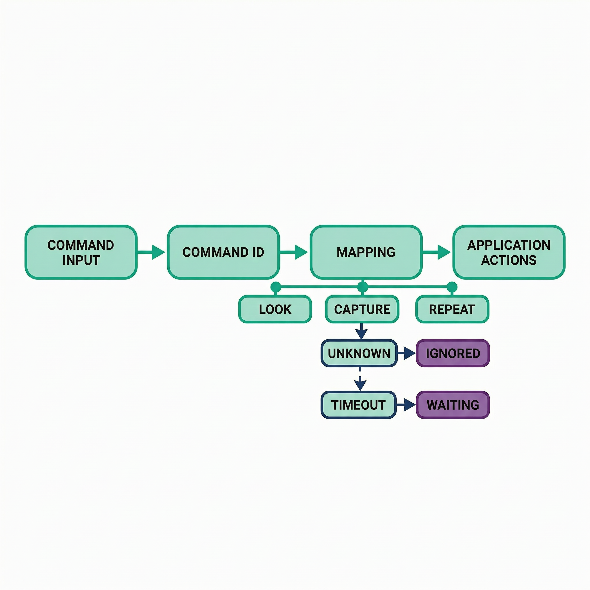

# 扩展案例 8：自定义命令词与应用回调

> 类型：`FW` ｜ 验证状态：参考值，待实机校准 ｜ 对应微课：[`microcourses/08_multinet_command`](../../microcourses/08_multinet_command/)

## 摘要

本案例在最小案例 8 微课"唤醒→命令识别"的基础上再往前走一步：把 MultiNet 输出的 `command_id` **映射到模拟的应用动作回调**。工程配置了三条拼音命令——`da kai deng`（打开灯，id=1）、`guan bi deng`（关闭灯，id=2）、`chong shi`（重试，id=3）；命中后 `action_for_command()` 把编号翻译成动作名 `LOOK` / `CAPTURE` / `REPEAT`，`app_action()` 打印一条"回调日志"。回调**只打印、不驱动任何硬件**，用来验证"识别层"和"业务动作层"之间的接口边界，并统计唤醒、命中、超时次数。最小案例 10 的系统状态机会把这里的模拟动作替换为真实的拍照、录音和保存。

## Quick Start

**预备知识：从"识别结果"到"应用动作"**

- **微课 8 已做到的**：WakeNet 待机监听 `Hi ESP`（模型 `wn9_hiesp`）→ 唤醒后 MultiNet 在 6 秒窗口内识别命令 → 打印 `command_id`、短语和概率。但识别层只输出"编号"，编号本身不会让设备做任何事。
- **本案例新增的一层**：应用回调。识别层把 `command_id` 交给业务层入口 `app_action()`，业务层用映射表 `action_for_command()` 把编号翻译成动作名：`LOOK`（看一看）、`CAPTURE`（拍一张）、`REPEAT`（重来一次）。当前动作只是打印日志的"模拟动作"，**不接摄像头、不接录音**——否则一次实验会同时引入语音、摄像头、存储、时序四类问题，出错很难定位；最小案例 10 再换成真实硬件操作。
- **命令词怎么自定义**：全部写在 [`sdkconfig.defaults`](sdkconfig.defaults) 的 `CONFIG_CN_SPEECH_COMMAND_ID1/2/3` 中，用空格分隔的拼音音节书写；启动时由 `esp_mn_commands_update_from_sdkconfig()` 注册进 MultiNet7 中文模型，`IDn` 的序号 n 就是 `command_id`。修改后只需重新构建烧录，不需要重新训练任何模型。
- **编号与动作的对应是"约定"**：`da kai deng`（打开灯）映射到 `LOOK`、`guan bi deng`（关闭灯）映射到 `CAPTURE`——动作名和命令词的字面意思并不绑定，绑定它们的是**编号**。这是刻意按编号解耦的设计：你可以把 ID1 改成任何模型支持的词条，也可以把 case 1 的动作名改成任何业务含义，两边互不影响。`chong shi`（重试）→ `REPEAT` 则是语义上顺理成章的一对。
- **未知编号为什么忽略**：如果配置里出现映射表没定义的编号（比如新增 `ID4` 但没改 `action_for_command()`），回调输出 `action=UNKNOWN ... result=ignored`——未定义命令不允许触发任何动作，避免错误语音引发危险或昂贵操作，同时保留日志供排查。


前置条件：ESP32-S3-EYE（板载麦克风）；`idf.py flash` 会自动把 `Hi ESP` 唤醒词、MultiNet7 中文模型、VADNet 打包烧入 `model` 分区（esp-sr 的 `add_dependencies(flash srmodels_bin)` 机制，无需额外命令）。不需要 SD 卡。

```bash
cd extensions/08_command_action_binding
idf.py --version          # 确认 ESP-IDF 可用，报错就先按环境文档配置
idf.py set-target esp32s3 # 目标芯片 esp32s3
idf.py build              # 构建固件并自动打包 srmodels.bin，结束打印 Project build complete
idf.py -p <PORT> flash monitor   # 有开发板时烧录并打开串口
```

1. **核对命令配置**。[`sdkconfig.defaults`](sdkconfig.defaults) 中应有：

   ```text
   CONFIG_SR_VADN_VADNET1_MEDIUM=y
   CONFIG_SR_WN_WN9_HIESP=y
   CONFIG_SR_MN_CN_MULTINET7_QUANT=y
   CONFIG_CN_SPEECH_COMMAND_ID1="da kai deng"   ← id=1 → LOOK
   CONFIG_CN_SPEECH_COMMAND_ID2="guan bi deng"  ← id=2 → CAPTURE
   CONFIG_CN_SPEECH_COMMAND_ID3="chong shi"     ← id=3 → REPEAT
   ```

2. **烧录后核对**：启动先看 esp-sr 打印的生效命令表（应含上面三条），再看 `ready: Hi ESP then say a configured command`。
3. **走一次命中**：说 `Hi ESP` → `wake count=1` → 6 秒内说"打开灯" → `callback action=LOOK command_id=1 phrase=... result=accepted`。同法验证"关闭灯"（`CAPTURE`/id=2）和"重试"（`REPEAT`/id=3）。
4. **验证超时与汇总**：说 `Hi ESP` 后沉默 6 秒以上，预期 `command_timeout count=N`；累计完成 10 次唤醒（每次都命中或超时收尾），预期出现 `summary wake=10 command=.. timeout=..`，且 `command+timeout == wake`。
5. **（选做）验证 UNKNOWN**：增加 `CONFIG_CN_SPEECH_COMMAND_ID4="<模型支持的拼音词条>"`，**不改** `action_for_command()`，重新构建烧录后说该命令，预期 `action=UNKNOWN command_id=4 result=ignored`。退出：monitor 里按 `Ctrl + ]`。

环境安装与 `<PORT>` 见仓库根 README 和 [`docs/environment-setup.md`](../../docs/environment-setup.md)。没有开发板时只能完成构建验证；命令形式必须以当前 ESP-SR/MultiNet 模型支持的词条为准。

## 预期现象

下面是**格式示例，具体数值以实机为准**（TAG 为 `ext08_command`）。启动、一次完整命中（以"打开灯"为例）、超时与汇总：

```text
I (xxxx) ext08_command: ready: Hi ESP then say a configured command
I (xxxx) ext08_command: wake count=1
I (xxxx) ext08_command: callback action=LOOK command_id=1 phrase=da kai deng result=accepted
I (xxxx) ext08_command: wake count=2
I (xxxx) ext08_command: command_timeout count=1
...（累计 10 次唤醒且全部收尾后）
I (xxxx) ext08_command: summary wake=10 command=8 timeout=2
```

- `ready: ...`：AFE 和两个任务创建成功，设备进入待机。`wake count=N`：第 N 次唤醒命中，MultiNet 窗口已打开。
- `callback action=... command_id=... phrase=... result=...`：应用回调日志。`action` 来自 `action_for_command(id)` 的映射（1→LOOK、2→CAPTURE、3→REPEAT、其它→UNKNOWN）；`phrase` 来自 `mn->string`；`result` 在 `id <= 3` 时为 `accepted`，否则为 `ignored`。
- `command_timeout count=N`：第 N 次命令窗口超时（6 秒内无有效命令）。`summary ...`：每满 10 次唤醒且 `command+timeout == wake` 时打印，用于核对"每次唤醒都有明确结局"。

失败路径：AFE `fetch` 出错打印 `fetch_error` 并退出检测任务；模型创建失败通常在启动阶段即报错。成功率、超时率和误触发率属于**待实机测量**数值；回调只打印，**不能**把 `accepted` 理解成"照片已拍好/录音已保存"。

**常见问题排查**

| 现象 | 可能原因 | 解决办法 |
|---|---|---|
| 说命令后只出现 `command_timeout` | 没在 6 秒内说完、发音与词条差异大或环境噪声 | 唤醒后立刻清晰念命令；核对启动命令表；换安静环境 |
| 回调里 `action=UNKNOWN result=ignored` | 新增了 `ID4` 及以上命令，但 `action_for_command()` 没加对应 case | 在 `switch` 中补充新编号映射，或删掉多余命令配置 |
| 改了命令词但设备行为没变 | 没有重新构建烧录，或旧 `sdkconfig` 缓存了配置 | 重新 `idf.py build flash`；必要时删除工程目录下的 `sdkconfig` 再 build |
| `summary` 一直不出现 | 唤醒未满 10 次，或有唤醒未收尾（`command+timeout != wake`） | 继续测试到 10 次；检查是否有唤醒被打断导致计数不平 |
| 频繁误唤醒（没说话也有 `wake count`） | 环境噪声与 `Hi ESP` 相似 | 记录误唤醒次数作为实验数据；换环境对照，不随意改模型阈值 |
| 启动崩溃或提示内存不足 | WakeNet+MultiNet+VAD 需要 PSRAM | 核对 `CONFIG_SPIRAM=y`、`CONFIG_SPIRAM_MODE_OCT=y`、`CONFIG_ESPTOOLPY_FLASHSIZE_8MB=y` |

## 学习目标

- 修改并记录 MultiNet 固定命令词配置（拼音形式），理解"改命令词≠训练模型"；
- 运行唤醒、命令命中、命令超时和汇总统计四条日志路径；
- 解释 `command_id → 动作名 → 回调` 的映射链，以及为什么未知编号要被忽略；
- 统计唤醒、命中、超时次数，评估命令交互的可靠性，并判断识别层与业务层是否解耦。

## 原理讲解

**程序整体做了什么**

1. `app_main`：初始化 I2S 麦克风、加载 `model` 分区模型、创建 AFE（`AFE_TYPE_SR + AFE_MODE_LOW_COST`），打印 `ready: Hi ESP then say a configured command`，创建 `feed_task`（CPU0）和 `detect_task`（CPU1，栈 12288）。
2. `detect_task` 启动时创建 MultiNet（`create(name, 6000)`，6 秒命令监听超时窗口）、注册命令表、打印生效命令，并维护三个计数器：`wake_count`、`command_count`、`timeout_count`。
3. 主循环：`fetch()` 取 AFE 结果 → 唤醒命中时 `wake_count++`、`multinet->clean()`、打印 `wake count=N` → 监听中把 `result->data` 喂给 `multinet->detect()`：命中则 `command_count++` 并调用 `app_action(mn->command_id[0], mn->string)`，超时则 `timeout_count++` 并打印 `command_timeout count=N`；两种结局都 `enable_wakenet()` 回待机。每当 `wake_count` 是 10 的倍数、且所有唤醒都已收尾（`command_count + timeout_count == wake_count`）时，打印 `summary wake=.. command=.. timeout=..`。




## 整体流程图

```text
板载麦克风 → feed_task(CPU0) → AFE/WakeNet → detect_task(CPU1)
                       ↓ 唤醒命中（wake count=N）
            MultiNet detect()（6 s 窗口）
            ├─ id=1（da kai deng）→ app_action → action=LOOK    result=accepted
            ├─ id=2（guan bi deng）→ app_action → action=CAPTURE result=accepted
            ├─ id=3（chong shi）  → app_action → action=REPEAT   result=accepted
            ├─ 其它 id            → app_action → action=UNKNOWN  result=ignored
            └─ 超时 → command_timeout count=N
                       ↓（命中或超时后 enable_wakenet，回到待机）
            每满 10 次唤醒且全部收尾 → summary wake=.. command=.. timeout=..
```

## 关键代码解析

以下片段均来自 [`main/main.c`](main/main.c)。

**1) 编号→动作名的映射表（业务层约定）**

```c
static const char *action_for_command(int id)
{
    switch (id) {
        case 1: return "LOOK";      // id=1（da kai deng）→ 模拟"看一看"
        case 2: return "CAPTURE";   // id=2（guan bi deng）→ 模拟"拍一张"
        case 3: return "REPEAT";    // id=3（chong shi）→ 模拟"重来一次"
        default: return "UNKNOWN";  // 未定义编号：不给动作名
    }
}
```

**2) 模拟应用回调：只打印，不驱动硬件**

```c
static void app_action(int id, const char *phrase)
{
    ESP_LOGI(TAG, "callback action=%s command_id=%d phrase=%s result=%s",
             action_for_command(id), id, phrase, id <= 3 ? "accepted" : "ignored");
}
```

`result` 的判定条件是 `id <= 3`，与映射表覆盖的编号范围一致；超范围编号被明确标记为 `ignored`，这就是"未知命令不触发动作"的落地方式。

**3) `detect_task` 主循环：唤醒/命中/超时计数 + 恢复待机**

```c
if (result->wakeup_state == WAKENET_DETECTED) {   // "Hi ESP" 命中
    wake_count++;
    listening = true;
    multinet->clean(model_data);                  // 清空上一轮识别状态
    ESP_LOGI(TAG, "wake count=%d", wake_count);
}
if (!listening) continue;                         // 未唤醒：只跑 WakeNet，不跑 MultiNet
esp_mn_state_t state = multinet->detect(model_data, result->data);
if (state == ESP_MN_STATE_DETECTED) {             // 命令命中（mn 由 get_results() 取得）
    command_count++;
    app_action(mn->command_id[0], mn->string);    // 识别层 → 业务层回调
    listening = false;
    afe_handle->enable_wakenet(data);             // 恢复 WakeNet 待机
}
// 超时分支：timeout_count++、打印 command_timeout count=N，同样 listening=false + enable_wakenet()
```

循环末尾还有汇总逻辑：`(wake_count % 10 == 0) && command_count + timeout_count == wake_count` 时打印 `summary wake=%d command=%d timeout=%d`。`fetch` 返回空或 `ESP_FAIL` 时打印 `fetch_error` 并退出任务。

## 关键文件说明

| 文件 | 职责 | 类型 |
|---|---|---|
| [`main/main.c`](main/main.c) | 命令识别、动作映射、模拟回调、计数与汇总 | 课程代码 |
| [`main/CMakeLists.txt`](main/CMakeLists.txt) | 注册源文件，`REQUIRES voice_common esp-sr` | 构建脚本 |
| [`partitions.csv`](partitions.csv) | `factory` 2500K + `model` spiffs 5168K | 分区表 |
| [`sdkconfig.defaults`](sdkconfig.defaults) | WN/MN/VAD 模型选择 + 三条拼音命令词 | 构建配置 |
| [`../../components/voice_common/voice_common.c`](../../components/voice_common/voice_common.c) | I2S 麦克风采集实现（API 见同目录 `include/voice_common.h`） | 共享组件 |
| `managed_components/espressif__esp-sr/` | `esp_mn_iface.h` 等第三方接口 | 第三方依赖 |
| `srmodels.bin` | 构建时自动打包、`flash` 写入 `model` 分区的模型镜像 | 生成物/部署资源 |

## 配置说明

| 修改位置 | 配置项 | 现象变化 |
|---|---|---|
| [`sdkconfig.defaults`](sdkconfig.defaults) | `CONFIG_CN_SPEECH_COMMAND_ID1..3` | 改变命令词及其编号（`IDn`→`command_id=n`）；词条须为模型支持的拼音音节 |
| 同上 | 新增 `CONFIG_CN_SPEECH_COMMAND_ID4` | 出现未映射编号，可用于验证 `UNKNOWN`/`ignored` 路径 |
| [`main/main.c`](main/main.c) | `action_for_command()` 的 `switch` | 改变编号→动作名映射；新增 case 可扩展动作 |
| 同上 | `app_action()` 中的 `id <= 3` | 决定 accepted/ignored 的编号范围；扩展命令后需同步修改 |
| 同上 | `multinet->create(name, 6000)` / `wake_count % 10` | 改变命令监听窗口（毫秒）/ 汇总打印的周期 |

命令词可以通过配置添加或修改，通常不需要训练新的唤醒词/命令词模型；示例中文命令使用拼音音节形式。

## 术语小表

| 术语 | 解释 |
|---|---|
| 应用回调 | 识别层把结果（编号+短语）交给业务层的函数接口，本工程为 `app_action()` |
| `command_id` | 命令的稳定编号，来自 `CONFIG_CN_SPEECH_COMMAND_IDn` 的 n |
| `LOOK`/`CAPTURE`/`REPEAT` | 本案例的模拟动作名，分别对应 id=1/2/3，只打印不驱动硬件 |
| UNKNOWN | 映射表未定义的命令编号对应的动作名 |
| `accepted` / `ignored` | 回调对编号的处理结论：`id <= 3` 接受，其余忽略 |
| timeout / `summary` 日志 | 6 秒窗口内未识别到命令（`ESP_MN_STATE_TIMEOUT`）/ 每满 10 次唤醒且全部收尾时打印的汇总 |
| WakeNet | 待机常驻的唤醒词模型（`wn9_hiesp`，词为 `Hi ESP`） |
| MultiNet / AFE | 唤醒后短时运行的命令词模型（MultiNet7 中文量化版）/ 音频前端，把麦克风数据处理后分发给 WakeNet/MultiNet |
| `enable_wakenet()` | 命中/超时后恢复 WakeNet 待机监听的接口 |
| 解耦 | 识别层只输出编号，业务层单独维护编号→动作映射，两边可独立修改 |

## 验证清单

- [ ] 提交命令词拼音文本、编号映射（1→LOOK、2→CAPTURE、3→REPEAT）和模型版本记录；
- [ ] 每个有效编号（1、2、3）至少验证一次回调，日志含 `action`、`command_id`、`phrase`、`result` 四个字段；
- [ ] 验证未知编号被 `ignored` 而不是误触发（可用新增 `ID4` 的注入场景测试，并注明是注入）；
- [ ] 记录 wake、command、timeout 计数，核对 `summary` 中 `command+timeout == wake`，并验证超时后能回到待机再次被唤醒；
- [ ] 说明本案例仍是模拟动作、未接入真实拍照/录音（那是最小案例 10 的事），且不提交真实个人语音或敏感日志。

## 思考题与拓展挑战

**思考题**

1. 为什么当前回调不直接调用摄像头和录音？

   **参考答案：**把识别与业务动作解耦，可以先单独验证命令接口、映射表和统计逻辑，避免一次实验同时引入摄像头、存储和时序问题。等接口稳定后（最小案例 10 状态机），再把 `app_action()` 里的打印替换为真实动作，改动面最小。

2. 为什么 UNKNOWN 命令应被忽略而不是"猜一个最接近的动作"？

   **参考答案：**未定义编号没有经过业务确认，猜测执行可能触发危险或昂贵动作（如误拍照、误删除）。忽略并打印 `result=ignored` 既保证安全，又保留日志供排查，符合"失败不能伪装成成功"的原则。

3. `da kai deng`（打开灯）映射到 `LOOK` 看起来"词不达意"，这是 bug 吗？

   **参考答案：**不是。命令词与动作的绑定靠的是 `command_id`，动作名只是模拟占位——这恰好说明识别层与业务层是刻意按编号解耦的，两边可各自独立修改。真实语义对应关系应在最小案例 10 集成时统一设计。

**拓展挑战**

- 为回调增加统一的动作结果枚举（如 `ACTION_OK` / `ACTION_IGNORED` / `ACTION_FAILED`），让 `app_action()` 返回枚举而不是直接打印，但仍不接入真实硬件；思考这会如何简化最小案例 10 状态机的对接。

