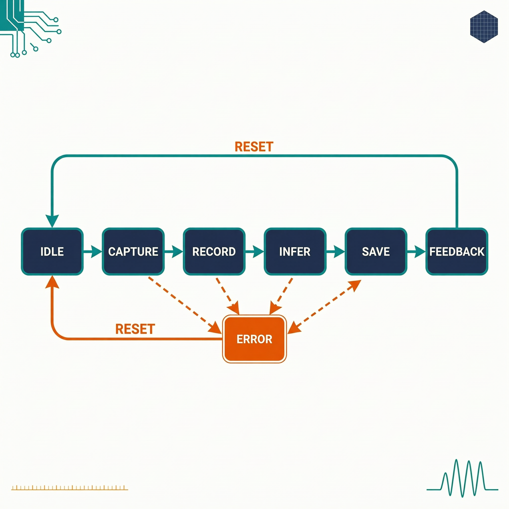
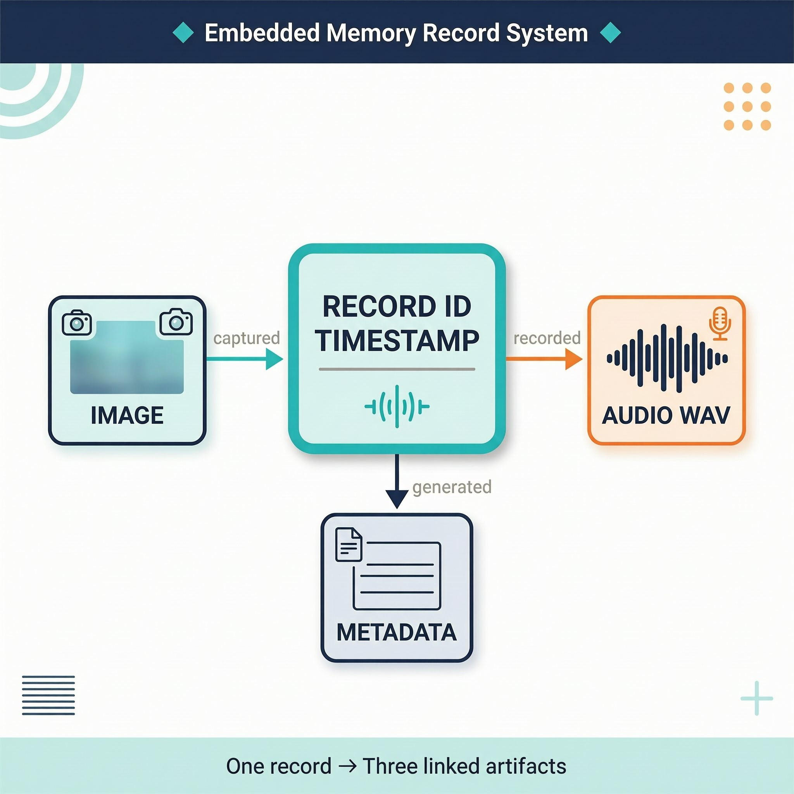

# 扩展案例 10：真实动作与状态机验证

> 类型：`FW` ｜ 验证状态：参考值，待实机校准 ｜ 对应微课：[`microcourses/10_system_state_machine`](../../microcourses/10_system_state_machine/)

## 摘要

微课最小案例 10 用模拟动作验证了状态机规则表；本扩展把四个"假动作"换成真家伙：

- **CAPTURE**：从摄像头预览管线偷看（peek）最新一帧 RGB565 图像，复制到 PSRAM；
- **RECORD**：用板载 I2S 麦克风采满 160000 个样本（16 kHz × 10 秒），写成 WAV 存到 MicroSD；
- **INFER**：把刚拍的帧喂给嵌入固件的猫狗模型 `catdog_mobilenet_v2.espdl`（ESP-DL 运行）；
- **SAVE**：把图像（`.rgb565`）和元数据（`.txt`，含标签/分数/时间戳/路径）写到 MicroSD。

状态机核心 `state_machine.c` **原封不动复用微课源码**（CMake 直接引用同一份文件）。一次按键（GPIO0）= 一条完整"记忆记录"：LCD 预览全程可见、状态文字实时刷新、串口打印每步迁移和耗时；成功后 SD 卡上留下**编号一致的三个文件**（如 `memory_000001.rgb565 / .wav / .txt`）。

本案例还提供 8 种确定性测试场景（正常 + 4 种失败注入 + 取消 + 2 种超时），验证"任一动作失败 → ERROR → RESET → IDLE 并清理半成品"的回退路径。当前触发入口是按键，WakeNet/MultiNet 语音触发属后续综合案例。

## Quick Start

**预备知识**

- **什么变了、什么没变**：微课里 `mock_action_event(状态)` 按场景宏返回假事件；本扩展换成 `real_action_capture()` 等真调硬件的函数，返回 true/false，由 `main.cpp` 翻译成 `ACTION_DONE` / `ACTION_FAILED` 事件。状态枚举、迁移规则、日志格式与微课完全一致——读 `[STATE]` 日志的技能直接复用。
- **`.espdl` 模型怎么进固件**：摄像头预览和猫狗模型复用自阶段性作业 [`extensions/03_live_catdog_assignment`](../03_live_catdog_assignment/)。构建时 CMake 检查模型文件并用 `EMBED_FILES` 嵌入固件 flash rodata 段，运行时直接从 flash 加载——**不需要 SD 卡上有模型文件**；这也是 `factory` 分区高达 6000K 的原因，文件缺失时构建直接报 `FATAL_ERROR: Missing model file`。LCD 刷新是独立任务，所以**录音和推理期间预览不会停**。
- **图像为什么复制到 PSRAM**：peek 到的帧缓冲属于预览管线，下一帧就会覆盖它，而录音要 10 秒。所以拍照时用 `heap_caps_malloc(..., MALLOC_CAP_SPIRAM)` 申请独立内存 `memcpy` 整帧（一帧约一两百 KB），记录结束后归还。
- **WAV 为什么最后补头**：WAV 头要写数据总长度，录音开始时还不知道最终写了多少。流程是：写占位头 → 边录边写 PCM → 录满后 `voice_wav_patch_header()` 回填真实长度。任何一步失败，文件立即 `remove()`，不留"坏 WAV"。metadata 的 `timestamp` 来自 `esp_timer_get_time()`（单调微秒、断电清零），`timestamp_source=esp_timer` 如实标注——它足够关联三个文件，但墙上时间需 RTC/NTP，属拓展挑战。


**前置产物检查（构建前必须满足）**

1. **猫狗模型**：确认 `extensions/03_live_catdog_assignment/main/models/s3/catdog_mobilenet_v2.espdl` 存在（最小案例 1～2训练+量化的产物，或讲师分发版本）。构建时嵌入固件，**不需要**拷到 SD 卡；
2. **MicroSD 卡**：FAT 格式、可写、建议 ≥ 4 GB，**开机前插好**——`voice_sdcard_init()` 挂载失败会直接 abort 重启；
3. **ESP32-S3-EYE 板**：BSP 默认 `esp32_s3_eye`（本课程不需要改）。

**正常场景构建与运行**

**第 1 步：进入工程、确认 IDF 并设置目标芯片**

```bash
cd extensions/10_state_machine_test
idf.py --version
idf.py set-target esp32s3
```

预期 `ESP-IDF v5.x.x`；`set-target` 按 `sdkconfig.defaults` 生成配置（8MB Flash、PSRAM OCT 80M、CPU 240MHz、LCD 单缓冲 40 行、FATFS 长文件名），并自动拉取托管依赖 `esp-dl 3.3.9`、`esp32_s3_eye BSP`，首次约 1～3 分钟。

**第 2 步：编译**

```bash
idf.py build
```

编译 `main.cpp`、`real_actions.cpp`、微课的 `state_machine.c`、03 作业的管线和 who_* 组件，并把 `.espdl` 模型嵌入固件。首次约 5～10 分钟；报 `Missing model file:` 就回去检查前置产物第 1 条。

**第 3 步：插好 SD 卡，烧录并打开监视器**

```bash
idf.py -p <PORT> flash monitor
```

固件含模型较大，烧录约 1～3 分钟。启动后依次看到 NVS 初始化、SD 卡信息、LCD 出现摄像头预览，最后日志 `ready: press GPIO0 to start one real record`。退出 monitor 按 `Ctrl+]`。

**第 4 步：按 GPIO0 完成一次真实记录**

等预览稳定后短按 BOOT 键。LCD 状态标签依次变为 `CAPTURE → CAPTURE COMPLETE → RECORDING 10s（约 10 秒，预览不断）→ INFER CAT/DOG → SAVING MEMORY → SUCCESS - RECORD SAVED → IDLE - READY`；串口滚动 `[STATE]`、`[ACTION]`、`[LCD]` 日志，最后有 `[RESULT]` 行。全程约 12～15 秒（大头是 10 秒录音）。

**第 5 步：验证 SD 卡产物**

关机取卡，在电脑上查看根目录：`memory_000001.wav`（约 320 KB，可播放，10 秒）、`memory_000001.rgb565`（原始像素）、`memory_000001.txt`（metadata，含 timestamp/width/height/format/image/audio/label/score 字段）。再按一次键应产生编号 `000002` 的三个文件。

**异常场景构建（以推理失败为例）**

场景编号在 [`main/test_config.h`](main/test_config.h)：0 正常、1 拍照失败、2 录音失败、3 推理失败、4 保存失败、5 取消、6 命令超时、7 录音超时。**用独立 build 目录**避免污染正常场景：

```bash
idf.py -B build/scenario_fail_infer -D REAL_ACTION_SCENARIO=3 reconfigure
idf.py -B build/scenario_fail_infer build
idf.py -B build/scenario_fail_infer -p <PORT> flash monitor
```

`-D REAL_ACTION_SCENARIO=3` 经 CMake 变成编译期宏，覆盖 `test_config.h` 的默认值（带 `#ifndef` 守卫）；非法编号触发 `#error`。预期：按 GPIO0 后 CAPTURE、RECORD 正常走完（**录音仍真实录满 10 秒**），INFER 时打印 `infer_failed=injected`、LCD `ERROR: INFER TEST`、`[STATE] error INFER -> ERROR event=ACTION_FAILED accepted=no`，随后 `record_failed final_state=ERROR`、RESET 回 IDLE。**验证清理**：SD 卡上不应留下本轮的 `.wav`（被删）、`.rgb565`/`.txt`（SAVE 没执行）。其余场景换编号和目录名重复。

没有开发板时：可完成全部场景的构建验证，但闭环现象必须实机验证。

## 预期现象

正常路径串口日志（**格式示例，具体数值以实机为准**；TAG：`lesson10_real` 主流程 / `state_actions` 动作层）。注意日志中会出现 LISTENING/COMMAND 状态——按键代行了语音触发，连续派发三个事件：

```text
I (xxx) lesson10_real: record_start
I (xxx) lesson10_real: [STATE] transition IDLE -> LISTENING event=START accepted=yes
I (xxx) lesson10_real: [STATE] transition LISTENING -> COMMAND event=WAKE_DETECTED accepted=yes
I (xxx) lesson10_real: [STATE] transition COMMAND -> CAPTURE event=COMMAND_DETECTED accepted=yes
...（每步同格式：capture_done 等动作日志、[LCD] status=... 与 [ACTION] <阶段>_ms=... result=ok 伴随 [STATE] 迁移）...
I (xxx) lesson10_real: [STATE] transition CAPTURE -> RECORD event=ACTION_DONE accepted=yes
...约 10 秒录音（LCD "RECORDING 10s"，预览不断）...
I (xxx) state_actions: record_done path=/sdcard/memory_000001.wav duration_ms=10000 elapsed_ms=...
I (xxx) lesson10_real: [STATE] transition RECORD -> INFER event=ACTION_DONE accepted=yes
I (xxx) state_actions: infer_done label=cat score=0.xxxx elapsed_ms=...
I (xxx) lesson10_real: [STATE] transition INFER -> SAVE event=ACTION_DONE accepted=yes
I (xxx) state_actions: save_done image=/sdcard/memory_000001.rgb565 audio=... meta=...
I (xxx) state_actions: [RESULT] image=... audio=... label=cat timestamp=...
I (xxx) lesson10_real: [STATE] transition SAVE -> FEEDBACK event=ACTION_DONE accepted=yes
I (xxx) lesson10_real: feedback=record_complete
I (xxx) lesson10_real: [STATE] transition FEEDBACK -> IDLE event=ACTION_DONE accepted=yes
```

失败路径关键片段（推理失败注入，场景 3）：

```text
E (xxx) state_actions: infer_failed=injected
I (xxx) lesson10_real: [LCD] status=ERROR: INFER TEST
I (xxx) lesson10_real: [STATE] error INFER -> ERROR event=ACTION_FAILED accepted=no
E (xxx) lesson10_real: record_failed final_state=ERROR
I (xxx) lesson10_real: [STATE] transition ERROR -> IDLE event=RESET accepted=yes
```

判读要点：成功记录 = 三个同编号文件 + `feedback=record_complete` + 最终 `FEEDBACK -> IDLE`；失败记录 = LCD 有 `ERROR:` 前缀、串口有 `reason=`、SD 卡上**没有**该编号的残留文件。取消场景（5）会打印 `record_failed final_state=IDLE` 和一条幂等的 `IDLE -> IDLE` RESET，属正常收尾。这些现象均需实机验证，不能用示例日志代替。

**常见问题排查**

| 现象 | 可能原因 | 解决办法 |
|---|---|---|
| 构建报 `Missing model file` | 03 作业的 `.espdl` 模型不存在 | 完成最小案例 1/2产出模型或从讲师处获取，放到指定路径 |
| 开机反复重启，日志停在 SD 挂载附近 | 没插卡、卡非 FAT 格式或接触不良 | 换 FAT32 可写卡，开机前插好，先在电脑上确认能读写 |
| `classifier_init_failed` | 嵌入的 `.espdl` 损坏或与 ESP-DL 版本不匹配 | 重新执行最小案例 2 量化流程，确认依赖版本未被改动 |
| `ERROR: NO FRAME` / `reason=no_frame` | 预览管线还没出帧就按键，或摄像头异常 | 等预览稳定 1～2 秒再按键；黑屏先单独运行 03 作业排查 |
| 录音总是 `reason=audio_or_write` 或 WAV 时长为 0 | SD 写入慢/坏块、麦克风读取失败或中途拔卡 | 换卡重试，用最小案例 5 工程单独验证麦克风，只保存成功记录 |
| `infer_done label=` 与画面不符 | 模型只有 cat/dog 两类，给出的是"二者中更像的" | 看 `score=`：低置信结果仅供参考，这是有限类别模型的边界 |

## 学习目标

- 完成一次按键触发的真实记录闭环，在 SD 卡上找到三个关联文件；
- 解释图像、音频、分类结果和 timestamp 如何通过记录编号与 metadata 关联；
- 用 `-D REAL_ACTION_SCENARIO=n` 构建并运行失败注入场景，读懂 `[STATE]`、`[ACTION]`、`[LCD]`、`[RESULT]` 四类日志的分工；
- 验证 `ERROR → RESET → IDLE` 路径上的资源清理（删半成品 WAV、释放 PSRAM 图像）。

## 原理讲解

**一次按键后发生了什么？（`run_real_record()`，与代码一致）**

```text
real_actions_init(帧节点, 分类器, LCD回调)  ← 失败则 LCD "ERROR: ACTION INIT"，本轮终止
dispatch START → IDLE->LISTENING；WAKE_DETECTED → LISTENING->COMMAND（按键代行语音触发）
场景分支：场景5 CANCEL → IDLE 止；场景6 TIMEOUT → ERROR；其他 COMMAND_DETECTED → CAPTURE
CAPTURE/RECORD/INFER/SAVE：先检查状态再调 real_action_*()，成功→ACTION_DONE /
  失败→ACTION_FAILED（→ERROR）；RECORD 约 10 秒，场景7 在此注入 TIMEOUT
FEEDBACK：feedback=record_complete，LCD "SUCCESS - RECORD SAVED" → ACTION_DONE → IDLE
ok = 到达过 FEEDBACK && 最终状态==IDLE
若 !ok：record_failed final_state=... → RESET → LCD "IDLE - READY" → 删半成品 WAV
最后无条件 real_actions_release()：释放 PSRAM 图像、清空路径/标签/回调
```

每个 `if` 都先检查当前状态：一旦某步失败进入 ERROR，后面的动作全部跳过。**CANCEL 场景的细节**：CANCEL 后状态已是 IDLE，但 `ok` 仍为 false（没到 FEEDBACK），于是也会打印 `record_failed final_state=IDLE` 并对 IDLE 派发 RESET——规则表里 `IDLE + RESET` 是原地接受（`IDLE -> IDLE accepted=yes`），这是刻意保留的幂等收尾，不是 bug。

**四个真实动作的日志契约（`real_actions.cpp`）**

每个动作先 `set_status()` 更新 LCD（同时打印 `[LCD] status=...`），结束时打印一行机器可读的 `[ACTION] <阶段>_ms=<耗时> result=ok|failed [reason=...]`：

| 动作 | LCD 状态文字 | 成功日志 | 可能的失败 reason |
|---|---|---|---|
| capture | `CAPTURE` → `CAPTURE COMPLETE` | `capture_done width=... height=... bytes=...` | `injected`（场景1）/ `no_frame` / `psram_alloc` |
| record | `RECORDING 10s` → `RECORD COMPLETE` | `record_done path=... duration_ms=... elapsed_ms=...` | `injected`（场景2）/ `no_image` / `open` / `audio_or_write` |
| infer | `INFER CAT/DOG` | `infer_done label=cat score=0.xxxx elapsed_ms=...` | `injected`（场景3）/ `missing_input` / `no_result` |
| save | `SAVING MEMORY` | `save_done image=... audio=... meta=...` + `[RESULT]` 行 | `injected`（场景4）/ `missing_artifacts` / `write` / `metadata_or_close` |

录音的 `duration_ms` 由样本数换算（160000 × 1000 ÷ 16000 = 10000），`elapsed_ms` 是含 SD 写入的实际耗时，两者接近 10 秒说明录音节奏正常。

**状态迁移图（与代码一致，标注各状态的真实动作）**

```text
GPIO0 按下 → record_start → 连续派发（无真实语音动作）：
IDLE ─START→ LISTENING ─WAKE_DETECTED→ COMMAND ─COMMAND_DETECTED→ CAPTURE
  CAPTURE：peek 最新帧复制到 PSRAM ─ACTION_DONE→ RECORD：录 10 s WAV 到 /sdcard
  ─ACTION_DONE→ INFER：猫狗推理 ─ACTION_DONE→ SAVE：写 .rgb565 + .txt
  ─ACTION_DONE→ FEEDBACK：LCD "SUCCESS - RECORD SAVED" ─ACTION_DONE→ IDLE
  CANCEL(场景5)：COMMAND ─CANCEL→ IDLE（accepted=yes）
  ACTION_FAILED(场景1~4)/TIMEOUT(场景6~7，场景7 在 RECORD)：对应状态 → ERROR（accepted=no）
  收尾：record_failed → RESET → IDLE + 删半成品 WAV + 释放 PSRAM 图像
```





> 图：一次真实记录要同时完成动作状态迁移，并用同一记录标识关联图像、音频和 metadata。实际文件名和时间戳以设备日志为准。

## 整体流程图

```text
启动：NVS → LED → 嵌入模型加载 CatDogClassifier → 预览管线(摄像头+LCD) → 音频/SD/按键初始化
      LCD "IDLE - READY"，20 ms 轮询按键
                    ↓ 按键
run_real_record：START/WAKE_DETECTED/COMMAND_DETECTED → CAPTURE → RECORD(约10 s) → INFER
                → SAVE → FEEDBACK → IDLE（成功，LCD "SUCCESS - RECORD SAVED"）
                任一步失败/取消/超时 → ERROR → RESET → IDLE + 清理
                    ↓
SD 卡产物：memory_XXXXXX.rgb565 + memory_XXXXXX.wav + memory_XXXXXX.txt（编号一致）
```

## 关键代码解析

**1. 取帧复制：`real_action_capture()`（`main/real_actions.cpp`）**

粘合层 `run_real_record()`（`main/main.cpp`）的写法是 `dispatch_event(&state, real_action_xxx() ? ACTION_DONE : ACTION_FAILED)`：动作只返回 bool，翻译成事件、以状态为门槛（ERROR 后跳过所有动作）都由粘合层负责；录音超时场景（7）则在这一层直接派发 `APP_EVENT_TIMEOUT`。取帧本身：

```cpp
who::cam::cam_fb_t *fb = s_frame_node ? s_frame_node->cam_fb_peek() : nullptr;
if (!fb || !fb->buf || fb->len == 0) { /* capture_failed=no_frame */ }
uint8_t *copy = static_cast<uint8_t *>(heap_caps_malloc(fb->len, MALLOC_CAP_SPIRAM));
if (!copy) { /* capture_failed=psram_alloc bytes=... */ }
memcpy(copy, fb->buf, fb->len);
if (s_image) { heap_caps_free(s_image); }   /* 先释放上一轮图像，防泄漏 */
s_image = copy; s_image_len = fb->len;
```

peek + 立即复制：不打断预览管线，也不长期占用帧缓冲。录音（`real_action_record()`）则是阻塞式：先写占位 WAV 头，循环"读麦克风 → 写 SD"直到 160000 样本，最后回填头部；`no_image` 出口保证"没拍照就不录音"。推理把复制的 RGB565 帧交给 `CatDogClassifier`，取 top-1 的 label/score 暂存，等 SAVE 写进 metadata；SAVE 用 `s_record_id` 作为三个文件的公共键，任何一步失败都 `remove()` 已建文件——宁可不留，不留半截。

**2. 失败收尾三件套（`main/main.cpp` + `main/real_actions.cpp`）**

本轮没走到 FEEDBACK（失败/取消/超时）时：打印 `record_failed final_state=...` → 派发 RESET 回 IDLE（ERROR→IDLE；取消场景是 IDLE→IDLE 幂等）→ `real_actions_cleanup_failed()` 删除半成品 WAV → LCD 回到 `IDLE - READY`。无论成败最后都执行 `real_actions_release()`：`heap_caps_free` 图像、清空全部静态状态，保证下一轮按键从干净状态开始——连续按 10 次，PSRAM 余量应基本不漂移。

## 关键文件说明

| 文件/目录 | 职责 | 类型 |
|---|---|---|
| [`main/main.cpp`](main/main.cpp) | 初始化（NVS/LED/分类器/预览/音频/SD/按键）、按键轮询、LCD 状态、`run_real_record` 流程 | 课程代码 |
| [`main/real_actions.cpp`](main/real_actions.cpp) / [`real_actions.hpp`](main/real_actions.hpp) / [`test_config.h`](main/test_config.h) | 四类真实动作 + `cleanup_failed`/`release` 清理；8 个场景编号（0～7）与 `REAL_ACTION_SCENARIO` 开关 | 课程代码 / 实验配置 |
| [`main/CMakeLists.txt`](main/CMakeLists.txt) / [`CMakeLists.txt`](CMakeLists.txt) | 复用微课 `state_machine.c` 与 03 作业管线；模型检查 + `EMBED_FILES`；场景宏注入；工程名 `state_machine_test` | 构建配置 |
| [`main/idf_component.yml`](main/idf_component.yml) | 托管依赖 `esp-dl 3.3.9`、`esp32_s3_eye ^6.0.0`；还声明了 `esp-sr ^2.0.0` 但本工程未使用（语音触发属后续综合案例） | 构建配置 |
| [`../../microcourses/10_system_state_machine/main/state_machine.c`](../../microcourses/10_system_state_machine/main/state_machine.c) / [`../03_live_catdog_assignment/main/`](../03_live_catdog_assignment/main/frame_cap_pipeline.cpp) | 状态机核心（与微课同一份源码）；摄像头取帧管线与 [`catdog_mobilenet_v2.espdl`](../03_live_catdog_assignment/main/models/s3/) 模型（必需前置产物） | 共享课程代码 / 前置产物 |
| [`sdkconfig.defaults`](sdkconfig.defaults) / [`partitions.csv`](partitions.csv) | 8MB Flash、PSRAM、LCD 缓冲、FATFS 长文件名；`factory` 6000K（含嵌入模型）+ `storage` 1M | 实验/构建配置 |

## 配置说明

| 修改位置 | 配置项 | 现象变化 |
|---|---|---|
| 构建命令 `-D REAL_ACTION_SCENARIO=n` | 场景编号 0～7 | 正常/四种失败注入/取消/两种超时，配独立 `-B` 目录使用 |
| [`main/test_config.h`](main/test_config.h) | `REAL_ACTION_SCENARIO` 默认值 | 不传 `-D` 时的场景（默认 0）；非法值编译期 `#error` |
| [`main/real_actions.cpp`](main/real_actions.cpp) | `VOICE_SAMPLE_RATE * 10` 录音目标、metadata `fprintf` 字段 | 影响 WAV 时长；metadata 不能丢失 image/audio/label/timestamp 四类关键字段 |
| [`partitions.csv`](partitions.csv) / [`sdkconfig.defaults`](sdkconfig.defaults) | factory 大小、`CONFIG_BSP_LCD_DRAW_BUF_HEIGHT=40` | factory 6000K 是嵌入模型的底线；LCD 缓冲高度影响预览流畅度与内存 |

## 术语小表

| 术语 | 解释 |
|---|---|
| 真实动作 / 失败注入 | 实际调用硬件并返回成败的动作函数 / 用编译期场景宏强制某动作失败，确定性测试回退路径 |
| metadata / 记录编号 | `memory_XXXXXX.txt`，关联一条记录各产物 / `s_record_id` 递增的 6 位数字，三个文件的公共键（重启后从 1 计数） |
| 单调时间 | `esp_timer` 微秒计数，启动后递增、断电清零，适合相对关联（墙上时间需 RTC/NTP） |
| RGB565 | 每像素 16 bit（红 5 绿 6 蓝 5）的图像格式，与 LCD 和摄像头输出一致 |
| peek（偷看帧） | `cam_fb_peek()` 只读最新帧不取走所有权，预览管线继续运转 |
| EMBED_FILES / WAV 头回填 | 把二进制文件编进固件 rodata 的机制 / 先写占位头、录完再 `voice_wav_patch_header()` 补真实长度 |
| 清理 | 失败后删临时文件、释放 PSRAM 图像、复位静态变量 |
| BSP / ESP-DL | 板级支持包（`esp32_s3_eye`）/ 乐鑫端侧深度学习运行库（加载 `.espdl`） |

## 验证清单

- [ ] 至少完成 3 次按键成功记录，编号连续，每条的 `.rgb565`/`.wav`/`.txt` 三个文件存在且编号一致；
- [ ] WAV 时长接近 10 秒（`duration_ms≈10000`，电脑播放确认），metadata 能关联标签、分数、路径和 timestamp；
- [ ] 分别注入场景 1～7，各保存一份串口日志；
- [ ] 每个失败场景都观察到 LCD `ERROR:` 状态、`accepted=no` 迁移、`RESET` 回 IDLE；
- [ ] 失败后临时 WAV 已删除，连续多轮后 PSRAM 余量不持续下降（`release` 生效）；
- [ ] 记录硬件、IDF 版本、模型来源、SD 卡型号和连续运行结果。

## 思考题与拓展挑战

**思考题**

1. 为什么 metadata 要使用同一条记录的 timestamp 和路径？

   **参考答案：**图像、音频和识别结果是一个事件的不同产物，用记录编号 + timestamp + 路径统一关联才能可靠回看。FAT 文件时间戳在没有 RTC 的设备上并不可信，不能靠它猜测。

2. 为什么拍照要 memcpy 到 PSRAM，而不是直接用 `cam_fb_peek()` 返回的指针？另外录音的 10 秒里按键循环被阻塞，系统为什么没"卡死"？

   **参考答案：**peek 的帧缓冲会被后续帧覆盖，而录音长达 10 秒，必须复制一份生命周期独占的快照。阻塞的只是 `app_main` 一个任务，摄像头取帧和 LCD 刷新是独立 FreeRTOS 任务照常运行，所以预览不断。

**拓展挑战**

- 在不改状态接口的前提下加入 RTC/NTP 墙上时间字段（metadata 增加 `wall_time=` 并标注来源）；
- 设计一次连续 10 条记录的存储容量和恢复测试：记录每条的 `capture_ms/record_ms/infer_ms/save_ms`、SD 剩余空间和 PSRAM 余量变化；
- 把 `.rgb565` 产物在 PC 端用 Python 转成 PNG（按 metadata 的 width/height/RGB565 解析），做成"记忆回看"小工具；或将触发入口从 GPIO0 换成最小案例 8 的 MultiNet 命令事件，向综合案例迈进一步。

