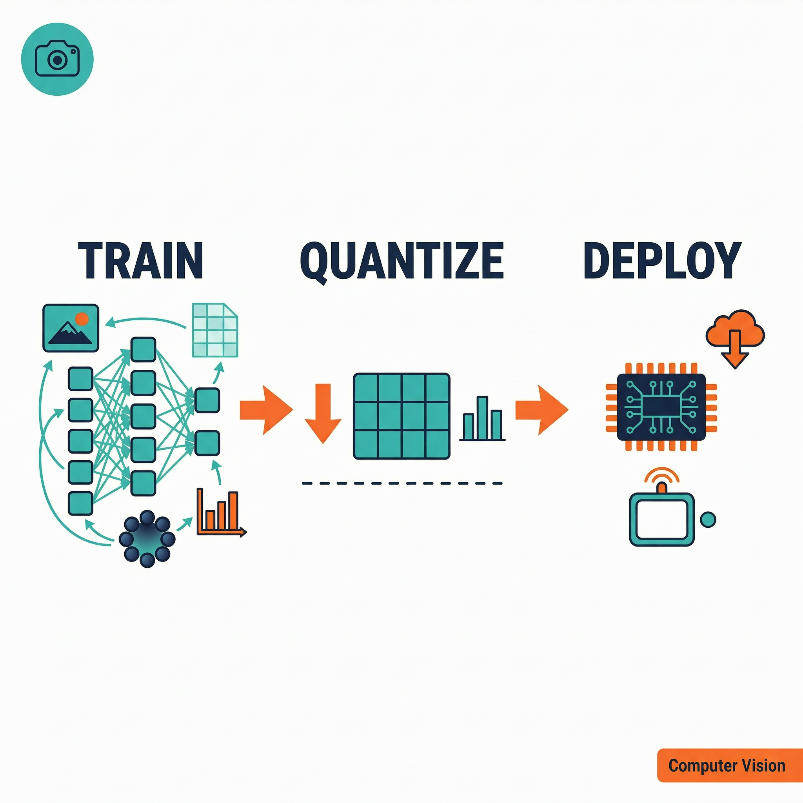

# 最小案例 3：端侧视觉模型推理（ESP32 加载 sin 模型）

> 类型：`FW` ｜ 验证状态：参考值，待实机校准 ｜ 前置：[`microcourses/02_quantize_sin_model`](../02_quantize_sin_model/)

## 摘要

前两集在电脑上训练并量化出一个约 7.5 KB 的 `sin_model.espdl`。这一集把它"烤"进 ESP32 固件，让芯片自己算出 sin(90°) ≈ 1，并测出每次推理花了多少微秒。同一个模型、同一个输入会跑三遍（`run1`/`run2`/`run3`），演示 ESP-DL 的三种调用方式，最后再跑一次模型自带的板上自检 `test()`。产出就是几行串口日志：预测值、期望值、误差、耗时和 PASS/FAIL。猫狗图片分类属于扩展案例 [`extensions/03_catdog_static_infer`](../../extensions/03_catdog_static_infer/)，本微课不涉及。

## Quick Start

**预备知识（零基础必读）**

- **ESP-IDF / `idf.py`**：乐鑫官方开发框架和它的总命令，本课程要求 **v5.4.x**（本工程在 v5.4.3 验证）。用之前先在终端加载环境：`. export.sh`（macOS/Linux）或 `export.bat`（Windows）。
- **`set-target esp32s3`**：指定给哪款芯片编固件，本工程只支持 esp32s3。
- **`build` / `flash` / `monitor`**：编成固件（产物在 `build/`）/ 通过 USB 写进板子 / 串口看日志。monitor 默认波特率 115200（两端不一致会乱码），退出按 **`Ctrl + ]`**。
- **串口 `<PORT>`**：macOS 是 `/dev/` 下以 `cu` 开头的设备，Linux 常见 `/dev/ttyUSB0`，Windows 是 `COM3` 这类。
- **`.espdl` 与 flash rodata**：`.espdl` 是最小案例 2 量化导出的模型文件，装着 int8 权重、网络结构和测试数据；flash rodata 是固件里的只读资料区，模型放这里等于和程序一起烧进芯片，断电不丢、开机即用，不需要 SD 卡或联网。
- **PSRAM**：板载额外运行内存（本工程配 8 线 80 MHz），模型运行时的中间数据主要放这里。

**模型从哪来？** 最小案例 2 产物在 `../02_quantize_sin_model/outputs/sin_model.espdl`；同目录 `sin_model.info` 可看结构：输入 `%input[INT8, 1x1]`，三层全连接 1→64→64→1。仓库里 `main/models/s3/model.espdl` 已放好一份可用副本。


所有命令都在**已加载 ESP-IDF 环境**的终端里执行。

**第 1 步：进入目录并确认 IDF 版本**（预期形如 `ESP-IDF v5.4.3`）

```bash
cd microcourses/03_run_sin_model
idf.py --version
```

**第 2 步：复制最小案例 2 的模型产物（可选但推荐）**。嵌入路径和文件名在 CMake 里写死为 `main/models/s3/model.espdl`；仓库已自带一份，没跑最小案例 2 也能直接构建，但那样就跳过了完整链路。

```bash
cp ../02_quantize_sin_model/outputs/sin_model.espdl main/models/s3/model.espdl
```

**第 3 步：设置目标芯片**。首次执行会按 `sdkconfig.defaults` + `sdkconfig.defaults.esp32s3` 重新生成 `sdkconfig`，约半分钟。

```bash
idf.py set-target esp32s3
```

**第 4 步：编译**。首次会**联网**拉取 `espressif/esp-dl` 等组件到 `managed_components/`，约 2~10 分钟，成功标志是 `Project build complete`。可再跑 `idf.py size` 看各段占用（模型嵌入后 rodata 多出约 7.5 KB）。

```bash
idf.py build
```

**第 5 步：烧录并观察（需要开发板）**。`<PORT>` 换成实际串口；烧录十几秒到一分钟，随后自动进 monitor。本程序跑完一轮约 1 秒内结束并停在 `完成` 之后（不循环，属正常），退出按 **`Ctrl + ]`**。没有开发板时，`idf.py build` 成功即完成主机侧验证。

```bash
idf.py -p <PORT> flash monitor
```

## 预期现象

下面是与代码日志格式一致的示例（`I (321)` 里的数字是开机毫秒数，会变；**格式示例，具体数值以实机为准**）：

```text
I (321) run_sin_model: 最小案例 3：ESP32 加载 sin 量化模型推理（输入 sin(90 degree)）
[run1] sin(90 degree) = 0.987654 (期望 1.000000, 误差 -0.0123), 推理耗时 210 us (0.210 ms)
[run2] sin(90 degree) = 0.987654 (期望 1.000000, 误差 -0.0123), 推理耗时 180 us (0.180 ms)
[run3] sin(90 degree) = 0.987654 (期望 1.000000, 误差 -0.0123), 推理耗时 195 us (0.195 ms)
I (456) run_sin_model: 模型自检 test(): PASS
I (460) run_sin_model: 完成
```

- 三行 `[runN]` 的**预测值和误差应基本一致**，但**耗时可以不同**：封装开销不一样，首次推理还常因缓存预热偏慢。误差不会是 0：输入量化步长 0.0625、各层 int8 舍入、网络拟合能力都会带来偏差，±0.0x 量级属正常；日志中间夹杂的 ESP-DL 加载信息（`FbsLoader`、`dl::Model` 标签）也属正常。
- 加载失败时程序打印 `模型加载失败: ...` 并停止，**不会**出现 `[runN]` 行；`test(): FAIL` 常见原因是量化时没开 `export_test_values=True`。

**常见问题排查**

| 现象 | 原因 | 解决 |
|---|---|---|
| `idf.py: command not found` | 终端没加载 IDF 环境 | 执行 `. <IDF安装目录>/export.sh`（Windows 用 `export.bat`）后重试 |
| `cp: ... No such file or directory` | 最小案例 2 还没跑，`outputs/` 里没产物 | 先完成最小案例 1～2，或直接用仓库自带的 `main/models/s3/model.espdl` |
| 构建报 `Only esp32s3 is supported by this course project` | 没执行或执行错 `set-target` | `idf.py set-target esp32s3` 后重新 `idf.py build` |
| CMake 找不到 `models/s3/model.espdl` | 文件名或目录不对（如复制后没改名） | 确认路径为 `main/models/s3/model.espdl`，与 `main/CMakeLists.txt` 一致 |
| `flash` 报串口打不开 / Permission denied | 端口写错、被占用，或 Linux 缺权限 | 核对端口、关掉占用程序；Linux 执行 `sudo usermod -aG dialout $USER` 后重登录 |
| monitor 全是乱码 | 波特率不匹配或线材问题 | 用 `idf.py -p <PORT> monitor` 让工具自动配置（默认 115200），或 `Ctrl+]` 退出重进 |

## 学习目标

- 会构建、烧录一个目标芯片为 `esp32s3` 的 ESP-IDF 工程，说清 `build`、`flash`、`monitor` 各在做什么；
- 能解释模型如何被嵌入固件（flash rodata），以及 `load()` 和 `build()` 两阶段加载的作用；
- 理解量化模型的 int8 数据、exponent 与 float 之间的换算；
- 会比较 ESP-DL 的三种推理调用方式；
- 会用 `esp_timer_get_time()` 测推理耗时，用 `model->test()` 判断模型是否加载正确。

## 原理讲解

**1. 模型怎么"进入"固件**

`main/CMakeLists.txt` 用 `target_add_aligned_binary_data(... models/s3/model.espdl BINARY)` 把模型按对齐方式打包进固件只读数据段，同时限制目标芯片必须是 `esp32s3`，否则直接报错终止。打包后链接器生成符号 `_binary_model_espdl_start`，指向模型在 flash 中的起始地址；C++ 里一行 `extern` 声明就能拿到它，不需要文件系统、SD 卡或联网下载。

**2. 加载模型：load() + build() 两阶段**

- `load(...)`：解析 `.espdl` 文件头和网络结构，返回 `esp_err_t` 错误码，**失败可以被检测到**（一步到位的构造函数失败时是静默的，这是本案例选两阶段的原因）。位置参数传 `fbs::MODEL_LOCATION_IN_FLASH_RODATA`，表示模型嵌在 flash 只读区。
- `build(0)`：真正为模型分配运行内存（权重缓冲、中间张量）。参数含义是"允许占用的内部 RAM 上限（字节）"，传 `0` 表示**不占用宝贵的内部 RAM，模型内存全部放到 PSRAM**。

**3. 量化的世界：int8 与 exponent**

量化模型内部只用 int8（-128~127）运算，每个张量带一个 exponent 记录缩放比例：`真实值 ≈ int8 值 × 2^exponent`。本模型输入的 exponent 是 `-4`，即每格代表 0.0625，输入 90° = π/2 ≈ 1.5708 只能落在 1.5625（25 × 0.0625）这样的格点上——这就是量化误差的来源之一。`run1` 手动做 int8 ↔ float 换算，`run2`/`run3` 由 ESP-DL 的 Tensor 机制自动完成。

**4. 三种调用方式与耗时测量**

| 方式 | 输入怎么给 | 输出怎么读 | 特点 |
|---|---|---|---|
| `run1` | 手动 `quantize` 后写 int8 指针 | 手动 `dequantize` | 最底层，看清量化细节 |
| `run2` | float Tensor `assign()` 自动量化 | float Tensor `assign()` 自动反量化 | 高层封装，代码最短 |
| `run3` | `input_map`（按输入名映射） | `output_map`（按输出名映射） | 多输入/输出模型的标准写法 |

三次跑的是同一个模型、同一个输入，结果应当一致，方便把"API 用法差异"和"模型本身误差"分开看。耗时用推理前后各调一次 `esp_timer_get_time()`（返回微秒）相减得到。

**5. 板上自检 test()**

最小案例 2 量化脚本开了 `export_test_values=True`，一组测试输入/期望输出也嵌进了 `.espdl`。板上调用 `model->test()` 时会实际推理一遍并比对，返回 `ESP_OK` 即 PASS——等于模型自带"体检报告"，不依赖电脑就能验证量化模型是否完好。



> 图：本集使用前两集的模型产物，在 ESP32 上完成加载、输入和推理。图中设备图标是概念示意，嵌入路径以 `main/CMakeLists.txt` 为准。

## 整体流程图

```text
outputs/sin_model.espdl（最小案例 2 产物，约 7.5 KB）
        ↓ 复制到 main/models/s3/model.espdl
idf.py build：CMake 把模型嵌入固件 flash rodata
        ↓ idf.py flash：固件烧进 ESP32-S3-EYE
开机 → app_main()
        ↓ load_model()：load() 解析 → build() 分配内存
run1（手动 int8）/ run2（Tensor assign）/ run3（map 调用）
        ↓ 每次都打印：预测值、期望值、误差、耗时
self_test()：model->test() → PASS 或 FAIL → ESP_LOGI "完成"
```

## 关键代码解析

片段摘自 [`main/app_main.cpp`](main/app_main.cpp) 和 [`main/CMakeLists.txt`](main/CMakeLists.txt)，有删节。

**1. CMake 嵌入模型（main/CMakeLists.txt）**

```cmake
# 本课程只支持 ESP32-S3-EYE（esp32s3）
if (IDF_TARGET STREQUAL "esp32s3")
    set(embed_files models/s3/model.espdl)
else()
    message(FATAL_ERROR "Only esp32s3 is supported by this course project")
endif()
# 把 model.espdl 按对齐方式打包进固件只读数据段
target_add_aligned_binary_data(${COMPONENT_LIB} ${embed_files} BINARY)
```

`embed_files` 路径相对于 `main/` 目录，所以完整路径是 `main/models/s3/model.espdl`。

**2. 两阶段加载 load_model()（main/app_main.cpp）**

```cpp
extern const uint8_t model_espdl[] asm("_binary_model_espdl_start");  // CMake 嵌入的模型

static dl::Model *load_model(void)
{
    dl::Model *model = new dl::Model();
    esp_err_t ret = model->load((const char *)model_espdl,
                                fbs::MODEL_LOCATION_IN_FLASH_RODATA,
                                (const uint8_t *)nullptr);   // 第三参数是解密密钥，未加密
    if (ret != ESP_OK) {                    // 失败可检测：打印错误、释放对象、返回 NULL
        ESP_LOGE(TAG, "模型加载失败: %s", esp_err_to_name(ret));
        delete model; return NULL;
    }
    model->build(0);   // 0 = 不占内部 RAM，模型内存全部放 PSRAM
    return model;
}
```

`load()` 返回错误码，所以加载失败可检测：失败就打印错误、释放对象、返回 `NULL`，调用方直接退出，不会拿空模型继续算。

**3. run1：手动量化/反量化（main/app_main.cpp）**

```cpp
float input_v = degree * M_PI / 180;              // 90° → 弧度 π/2
int8_t q = dl::quantize<int8_t>(input_v, DL_RESCALE(model_input->exponent));
*(int8_t *)model_input->data = q;                  // 直接写模型的 int8 输入缓冲

int64_t t0 = esp_timer_get_time();
model->run();                                      // 推理
int64_t t1 = esp_timer_get_time();

float output_v = dl::dequantize(*(int8_t *)model_output->data,
                                DL_SCALE(model_output->exponent));
```

这就是量化模型最原始的样子：数据在模型里全是 int8，进出都要按 exponent 手动换算。`run2` 用 `TensorBase::assign()` 自动量化/反量化，`run3` 用 `model->run(input_map, dl::RUNTIME_MODE_SINGLE_CORE, output_map)` 按名字映射，都是后续猫狗、检测模型的通用写法。

## 关键文件说明

| 文件/目录 | 职责 | 类型 |
|---|---|---|
| [`main/app_main.cpp`](main/app_main.cpp) | 程序入口：加载模型、三种推理、自检和全部日志 | 课程代码 |
| [`main/CMakeLists.txt`](main/CMakeLists.txt) | 声明 ESP-DL 依赖、限制 esp32s3、把模型嵌入固件 | 构建配置 |
| [`main/idf_component.yml`](main/idf_component.yml) | 依赖 `espressif/esp-dl`（锁定版本见 `dependencies.lock`） | 依赖清单 |
| [`main/models/s3/model.espdl`](main/models/s3/model.espdl) | 被嵌入固件的量化模型（最小案例 2 产物副本，约 7.5 KB） | 生成/部署物 |
| [`CMakeLists.txt`](CMakeLists.txt)、[`partitions.csv`](partitions.csv) | 顶层工程 `run_sin_model`；自定义分区表（factory 8000K，装下固件+模型） | 构建配置 |
| [`sdkconfig.defaults`](sdkconfig.defaults)、[`sdkconfig.defaults.esp32s3`](sdkconfig.defaults.esp32s3) | 前者是空文件（触发 IDF 读 target 后缀配置，勿删）；后者含 8 MB flash、八线 PSRAM 80 MHz、CPU 240 MHz | 构建配置 |
| `dependencies.lock`、`managed_components/`、`build/` | 版本锁定、自动下载的组件源码、构建产物 | 生成物 |

## 配置说明

| 修改位置 | 配置项 | 现象变化 |
|---|---|---|
| `main/app_main.cpp` | `degree`（默认 90） | 改变输入角度和期望值，重新 `build` + `flash` 即可看日志变化 |
| `main/CMakeLists.txt` | `embed_files` | 改变嵌入模型路径，写错会直接构建失败 |
| `main/idf_component.yml` | `espressif/esp-dl` 版本 | 换版本需删 `managed_components/` 与 `dependencies.lock` 后重建 |
| `sdkconfig.defaults.esp32s3` | `CONFIG_ESP_DEFAULT_CPU_FREQ_MHZ_240` / `CONFIG_SPIRAM*` | 改低 CPU 频率会明显拉长推理耗时（最小案例 4 专门研究）；关闭或改错 PSRAM，模型 `build()` 可能因内存不足失败 |

改动 `sdkconfig.defaults*` 或 `partitions.csv` 后需重新 `idf.py build`（必要时先 `idf.py fullclean`）。

## 术语小表

| 术语 | 解释 |
|---|---|
| ESP-IDF / `idf.py` | 乐鑫官方开发框架及其命令行入口：`build` 编译、`flash` 烧录、`monitor` 看日志 |
| 波特率 | 串口每秒传输的位数，本工程监视器默认 115200 |
| ESP-DL / `.espdl` | 在 ESP 芯片上加载运行神经网络模型的 C++ 库 / ESP-PPQ 量化导出的模型格式，内含 int8 权重、结构和可选测试数据 |
| flash rodata | 固件中的只读资源区，模型嵌入后随固件烧录、断电不丢 |
| int8 量化 / exponent | 用 8 位整数存算数据（省内存、算得快、有精度损失）；缩放参数满足 真实值 ≈ int8 值 × 2^exponent |
| Tensor | 带 shape、数据类型和缓冲区的张量对象，模型输入输出的载体 |
| `load()` / `build()` / `run()` | 解析模型并返回错误码 / 分配运行内存 / 执行一次推理 |
| `test()` / `esp_timer_get_time()` | 用量化时嵌入的测试数据在板上自检模型 / 返回开机以来微秒数，用于测推理耗时 |
| PSRAM | 板载外部运行内存，模型中间数据的主要存放地 |

## 验证清单

- [ ] `idf.py --version` 显示 v5.4.x，`main/models/s3/model.espdl` 存在且与 CMake `embed_files` 一致；
- [ ] `idf.py set-target esp32s3` 已执行，`idf.py build` 成功；
- [ ] 板上日志能区分 `[run1]`/`[run2]`/`[run3]`，各含预测值、期望值、误差和微秒耗时，三次预测值基本一致；
- [ ] 出现 `模型自检 test(): PASS`（或记录了 FAIL 及排查过程）；
- [ ] 加载失败时不会输出伪造结果，并已按 `Ctrl+]` 退出 monitor。

## 思考题与拓展挑战

**思考题**

1. 为什么 `run1` 需要手动反量化，而 `run2` 可以直接读 float Tensor？

   **参考答案：**`run1` 直接操作模型的 int8 缓冲区，必须自己按 exponent 做 2^exponent 换算；`run2` 的 `assign()` 内部封装了类型检查和量化/反量化。

2. 为什么模型加载失败后必须停止本次推理？

   **参考答案：**加载失败说明模型没有有效的输入输出和执行结构，继续跑会把无效内存当成结果——"失败伪装成成功"比崩溃更难排查。代码里 `load_model()` 返回 `NULL`、各 `run` 直接 `return` 就是这个原则。

3. 三次推理的误差为什么不是 0？

   **参考答案：**一是输入量化误差（π/2 只能落在 0.0625 的整数倍格点上），二是各层 int8 运算舍入，三是网络本身对 sin 的拟合误差（最小案例 1 loss 不为 0）。

**拓展挑战**

- 每种调用方式各跑 100 次，记录平均和最大耗时，比较三种方式的开销差异；
- 复制模型时用 `shasum` 校验最小案例 2 产物与 `main/models/s3/model.espdl` 是否一致，并记入实验记录；
- 把 `degree` 改成 0、30、180、270 重新烧录，观察误差随输入的变化，用量化格点解释现象。

