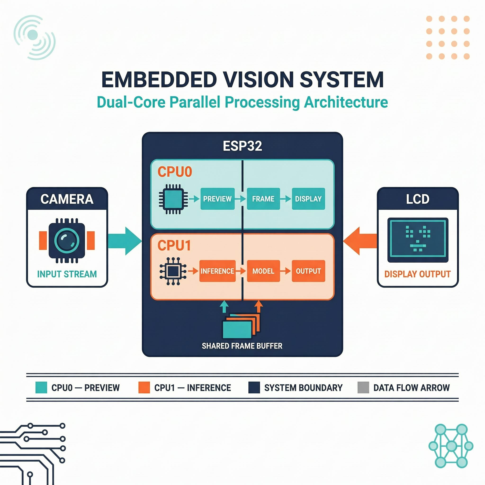

# 最小案例 4：视觉实时推理性能调优

> 类型：`FW` ｜ 验证状态：参考值，待实机校准 ｜ 前置：最小案例 3 实时猫狗分类阶段性作业

## 摘要

本微课只回答一个问题：**同一个猫狗模型、同一块板子，把推理任务换到另一个 CPU 核心，或把主频从 160 MHz 提到 240 MHz，单次推理耗时会不会变？变多少？** 工程复用最小案例 3 作业的摄像头预览和猫狗模型，输出 `core`、`cpu`、`infer`、`period` 四个字段；LCD FPS、watchdog、帧年龄和内存分析属于扩展案例 [`extensions/04_live_infer_optimized`](../../extensions/04_live_infer_optimized/)。你不需要会写模型，只要会改两个配置文件里的几个数字、会重新编译烧录、会读串口日志就够了。

## Quick Start

**预备知识**

- **双核 CPU**：ESP32-S3 有两个 Xtensa LX7 核心（CPU0/CPU1），可同时各跑各的任务。本工程摄像头取帧和 LCD 显示固定钉在 CPU0；推理任务跑在哪个核由 `main/perf_config.h` 的 `CATDOG_INFER_CORE` 决定。
- **FreeRTOS 任务与优先级**：任务就是一个带优先级的循环函数，数字越大越先跑；同核上高优先级会压制低优先级。本工程推理（优先级 3）高于预览（2），挤在同一个核就会卡——这就是"卡顿基线"的由来。
- **CPU 频率与 DFS**：主频是 CPU 每秒的节拍数，160 MHz 即每秒 1.6 亿拍，节拍越快同样计算用时越短。DFS（动态调频）会自动升降频，但本微课为了受控对比，用 `sdkconfig.defaults` 把频率固定死；两个核共享同一主频。
- **FPS**：每秒显示帧数，与单帧耗时互为倒数。本微课**不测 FPS**，那是扩展案例的事。
- **infer 与 period**：`infer` 是一次 `g_classifier->run()` 的耗时；`period` 是上次推理结束到本次结束的间隔，代码里每轮还睡 500 ms，所以 `period` 永远比 `infer` 大。


**第 0 步：前置条件**

- ESP-IDF ≥ 5.4 已安装，`idf.py --version` 能输出版本号；
- 已完成最小案例 3 阶段性作业 [`extensions/03_live_catdog_assignment`](../../extensions/03_live_catdog_assignment/)。**本微课不自带组件和模型**：根 `CMakeLists.txt` 通过 `EXTRA_COMPONENT_DIRS` 复用作业目录的 `components/who_*` 五个组件，`main/CMakeLists.txt` 通过 `EMBED_FILES` 嵌入作业目录的 `main/models/s3/catdog_mobilenet_v2.espdl`，缺了会直接报 `Missing model file`。

**第 1 步：进入目录、设置目标芯片**

```bash
cd microcourses/04_live_infer_tuning
idf.py --version          # 预期输出 ESP-IDF v5.4.x 之类的版本号
idf.py set-target esp32s3 # 按 sdkconfig.defaults 生成 sdkconfig，约 1～2 分钟
```

注意：`set-target` 会丢弃 `sdkconfig` 里的手工改动。

**第 2 步：编译**

```bash
idf.py build
```

编译固件并把 `.espdl` 模型嵌入镜像。首次约 5～15 分钟（联网拉取 esp-dl 等托管组件），之后增量编译 1 分钟内；最后出现 `Project build complete`。

**第 3 步：烧录并打开串口监视器（有开发板时）**

```bash
idf.py -p <PORT> flash monitor
```

`<PORT>` 换成板子的串口设备名（macOS 形如 `/dev/` + `cu.usbmodemXXXX`，Linux 形如 `/dev/ttyACM0`，Windows 形如 `COM3`）。几秒后出现 `Ready: preview CPU0, inference CPU0, CPU=160MHz`，LCD 显示摄像头画面。退出监视器按 `Ctrl+]`。

**第 4 步：记录基线数据**

什么都不改，跑 2～3 分钟，抄下至少 3 行推理日志（格式见"预期现象"）。这就是基线组：**CPU0 / 160 MHz**。

**第 5 步：实验一——切换推理核心**

`main/perf_config.h` 修改前：

```c
#define CATDOG_INFER_CORE 0
```

修改后（把推理挪到 CPU1）：

```c
#define CATDOG_INFER_CORE 1
```

这个宏传给 `xTaskCreatePinnedToCore(..., CATDOG_INFER_CORE)`，决定推理任务钉在哪个核。头文件是**编译期生效**的，改完必须重新 `idf.py build && idf.py -p <PORT> flash monitor`。验证方式：日志 `core=` 变成 `core=1`——它来自 `xPortGetCoreID()` 现场查询的真实运行核心，不是配置复读。

**第 6 步：实验二——切换 CPU 频率**

先把 `CATDOG_INFER_CORE` 改回 `0`（一次只动一个变量）。`sdkconfig.defaults` 修改前：

```text
CONFIG_ESP_DEFAULT_CPU_FREQ_MHZ_160=y
# CONFIG_ESP_DEFAULT_CPU_FREQ_MHZ_240 is not set
```

修改后（两行是互斥选项，一个 `=y` 另一个必须 `is not set`）：

```text
CONFIG_ESP_DEFAULT_CPU_FREQ_MHZ_240=y
# CONFIG_ESP_DEFAULT_CPU_FREQ_MHZ_160 is not set
```

`sdkconfig.defaults` 只是"默认值种子"：根目录已存在 `sdkconfig` 时构建系统**不会**自动覆盖它，所以改完必须执行：

```bash
rm sdkconfig          # 删掉旧配置，让 defaults 重新生效
idf.py set-target esp32s3
idf.py build
idf.py -p <PORT> flash monitor
```

替代做法：进入 IDF 图形化配置菜单，在 `Component config` → `ESP System Settings` → `CPU frequency` 里直接改，效果相同；课程更推荐改 defaults，便于复现。验证方式：启动行 `Ready: ... CPU=240MHz`，每行日志 `cpu=240MHz`（来自 `esp_clk_cpu_freq()` 实时读取）。

没有开发板时执行到 `idf.py build` 为止，板上数据标为待验证。最后按验证清单整理数据：每组配置至少 3 条日志，标明硬件、IDF 版本和配置，历史参考值与实测值分开记。

## 预期现象

启动日志显示模型加载成功和 `Ready`，之后约每 `infer + 500ms` 出现一行推理日志：

```text
[2] core=0 cpu=160MHz infer=3272.545ms period=3.794s
```

字段对照（`main/app_main.cpp` 的 `ESP_LOGI`，TAG 为 `catdog_perf_tuning`）。单次推理约 3 秒，日志行间隔约 3.8～5.7 秒属正常，不要以为板子卡死：

| 字段 | 来源 | 含义 |
|---|---|---|
| `[2]` | `s_infer_count` | 第几次推理，从 1 递增 |
| `core=0` | `xPortGetCoreID()` | 任务此刻**实际**运行的核心 |
| `cpu=160MHz` | `esp_clk_cpu_freq()` | 当前实际主频 |
| `infer=3272.545ms` | 前后 `esp_timer_get_time()` 之差 | 单次 `g_classifier->run()` 耗时 |
| `period=3.794s` | 本次结束时刻减上次结束时刻 | 两次推理完成的间隔；第一次打印 `0.000s` |

历史参考值（来源可追溯到旧版案例文档，无独立原始串口文件，故为"参考值，待实机校准"）：

| 配置 | 历史参考推理耗时 | 解释 |
|---|---:|---|
| CPU0 / 160 MHz | 3273～3278 ms | 基线 |
| CPU1 / 160 MHz | 5140～5164 ms | 本次对照中更慢 |
| CPU0 / 240 MHz | 2984～2988 ms | 本次对照中更快 |

历史数据里 CPU1 反而**更慢**（约 5.1 s），与"CPU1 更空闲所以更快"的直觉相反，可能解释包括共享 PSRAM/flash 带宽竞争、缓存局部性差异。你的实测未必复现同样数字，重点是先用 `core=`/`cpu=` 确认变量真的生效，再比较 `infer`。若模型初始化失败或没有新帧，必须保留错误日志；不要把编译成功写成板上运行成功。

**常见问题排查**

| # | 现象 | 原因 | 解决 |
|---|---|---|---|
| 1 | 构建报 `Missing model file: ...catdog_mobilenet_v2.espdl` | 本微课依赖最小案例 3 作业目录的组件和模型 | 先完成作业工程，确认其 `main/models/s3/` 下有 `.espdl` |
| 2 | 改了 defaults 为 240 MHz，日志仍 `cpu=160MHz` | 已存在的 `sdkconfig` 优先于 defaults | `rm sdkconfig && idf.py set-target esp32s3 && idf.py build` |
| 3 | 改了 `CATDOG_INFER_CORE=1`，日志仍 `core=0` | 没重新编译烧录，板子还跑旧固件 | 重新 `idf.py build` 和 `idf.py -p <PORT> flash monitor` |
| 4 | 一直没有 `[N] core=...` 推理日志 | 模型加载失败或管线未启动 | 回看启动日志有无 `Failed to initialize classifier` / `Failed to start camera capture / LCD tasks` |
| 5 | 启动即重启循环 / `Guru Meditation Error` | `sdkconfig` 与板子不匹配（八线 PSRAM 配置丢失） | 删 `sdkconfig` 重新 `set-target` 构建，确认 defaults 未被改动 |
| 6 | 烧录报 `Could not open port` | 串口名错误或被其他工具占用 | macOS 用 `ls /dev/cu*` 确认设备名（以 cu 开头的设备），关闭其他串口工具后重插 USB |

## 学习目标

- 解释 `infer`、`period`、`core`、`cpu` 四个日志字段；
- 修改推理核心配置，并用 `core=` 验证实际运行核心；
- 修改 CPU 频率配置，比较单次推理耗时；
- 理解"推理更快"和"预览更流畅"是两个不同目标。

## 原理讲解

`classifier_task` 每 500 ms 取一次最新预览帧、跑一次分类器。三个要点：

1. **换核心不一定更快**：模型计算量没变，变的只是环境——CPU1 上没有预览任务抢执行时间，但两个核共享 PSRAM/flash 访存总线。所以实测可能更快、持平甚至更慢，用数据回答，不要背结论。
2. **升频率通常更快**：240 MHz 每秒多 50% 节拍，计算部分近似按比例缩短；但访存速度不由主频决定，加速远小于 50%（历史参考：3273 ms → 2985 ms，约快 9%）。
3. **"推理更快" ≠ "预览更流畅"**：本微课只优化单次 `infer`；预览流畅需要任务隔离和优先级设计，见扩展案例 [`04_live_infer_optimized`](../../extensions/04_live_infer_optimized/)。



> 图：实时视觉系统同时处理预览帧和模型推理，实际任务绑定以工程代码为准。

## 整体流程图

```text
摄像头/LCD 预览（CPU0） ─┐
                         ├─ 最新帧 → classifier_task
猫狗 ESPDL 模型（flash） ─┘          ↓
                 日志：core/cpu/infer/period
```

数据流：摄像头把 240×240 RGB565 帧写进 PSRAM 帧缓冲（共 3 块）→ `FrameCapFetch` 把最新帧放进长度 1 的环形缓冲 → `LCDDisp` 和 `classifier_task` 都用 `cam_fb_peek()` 只读最新帧（不排队、不积压）→ 打印一行日志。

## 关键代码解析

**1. 实验变量一：[`main/perf_config.h`](main/perf_config.h)（全文）**

```c
#pragma once

// 最小案例 4 性能实验配置：只修改推理任务运行核心。
#define CATDOG_INFER_CORE 0   // 改成 1 = 把推理任务钉到 CPU1
```

**2. 推理任务：[`classifier_task`](main/app_main.cpp)（节选）**

```cpp
static constexpr TickType_t kInferIntervalTicks = pdMS_TO_TICKS(500); // 每轮睡 500ms
static constexpr UBaseType_t kInferPriority = 3;                      // 推理任务优先级

while (true) {
    auto fb = g_frame_node ? g_frame_node->cam_fb_peek() : nullptr;  // 只看最新帧，不取走不排队
    if (fb && g_classifier) {
        int64_t start = esp_timer_get_time();                        // 微秒计时开始
        dl::image::img_t img = static_cast<dl::image::img_t>(*fb);   // 帧 → ESP-DL 视图（零拷贝）
        g_classifier->run(img);                                      // 一次完整推理
        int64_t end = esp_timer_get_time();
        // 日志字段：core=xPortGetCoreID()、cpu=esp_clk_cpu_freq()/1000000、infer、period
    }
    vTaskDelay(kInferIntervalTicks);                                 // 主动让出 CPU 500ms
}
```

**3. 任务创建与绑核：[`app_main`](main/app_main.cpp)（节选）**

```cpp
// 预览任务：优先级 2，全部钉在 CPU0（最后一个参数 0）
for (const auto &node : frame_cap->get_all_nodes()) ok &= node->run(4096, 2, 0);
ok &= lcd_disp->run(2560, 2, 0);

// 推理任务：栈 8192，优先级 kInferPriority=3，钉在 CATDOG_INFER_CORE
xTaskCreatePinnedToCore(classifier_task, "classifier_task", 8192,
                        nullptr, kInferPriority, nullptr, CATDOG_INFER_CORE);
```

`xTaskCreatePinnedToCore` 比 `xTaskCreate` 多一个核心号参数：填 0/1 钉死在对应核，填 `tskNO_AFFINITY` 由调度器自由分配（最小案例 3 作业用的就是自由分配）。

## 关键文件说明

| 文件 | 职责 | 类型 |
|---|---|---|
| [`main/app_main.cpp`](main/app_main.cpp) | 预览、分类任务和性能日志 | 课程代码 |
| [`main/perf_config.h`](main/perf_config.h) | 推理核心配置（实验变量一） | 实验配置 |
| [`main/frame_cap_pipeline.cpp`](main/frame_cap_pipeline.cpp) | 摄像头帧管线（RGB565、3 帧缓冲） | 课程代码 |
| [`main/catdog_classifier.hpp`](main/catdog_classifier.hpp) | ESP-DL 分类封装 | 课程代码 |
| [`main/labels.hpp`](main/labels.hpp) | 类别标签 `{"cat", "dog"}` | 课程代码 |
| [`main/CMakeLists.txt`](main/CMakeLists.txt) | 从作业目录嵌入 `.espdl` 模型 | 构建配置 |
| [`CMakeLists.txt`](CMakeLists.txt) | 复用作业目录的 `components/who_*` 组件 | 构建配置 |
| [`sdkconfig.defaults`](sdkconfig.defaults) | 目标、PSRAM、频率默认值（实验变量二） | 构建配置 |
| [`partitions.csv`](partitions.csv) | `factory` 约 6.8 MB + `storage` 1 MB | 构建配置 |

## 配置说明

| 修改位置 | 配置项 | 现象变化 |
|---|---|---|
| [`main/perf_config.h`](main/perf_config.h) | `CATDOG_INFER_CORE` | 改变推理任务实际运行核心 |
| [`sdkconfig.defaults`](sdkconfig.defaults) | 160/240 MHz 选项 | 改变启动日志中的 CPU 频率和推理耗时 |
| `main/app_main.cpp` | `kInferIntervalTicks` | 只影响 `period` 和日志密度，不影响 `infer`，不是实验变量 |

实操要点：改 `perf_config.h` 后直接 `idf.py build` 即可（源文件变动触发重编译）；改 `sdkconfig.defaults` 后必须先删 `sdkconfig` 再构建，否则不生效。

## 术语小表

| 术语 | 解释 |
|---|---|
| `infer` | 单次模型推理耗时 |
| `period` | 两次推理完成之间的实际间隔 |
| core | 任务当前实际运行的 CPU 核心 |
| CPU 频率 | 芯片计算时钟频率，两个核共享同一设置 |
| DFS | 动态调频；本微课固定频率做受控对比 |
| FreeRTOS 任务 | 带优先级和独立栈的循环函数；同核高优先级压制低优先级 |
| `xTaskCreatePinnedToCore` | 创建任务并钉死在指定核心（0/1）的 API |
| `xPortGetCoreID()` | 返回当前任务在哪个核上执行，日志 `core=` 的来源 |
| PSRAM | 外部伪静态 RAM，存帧缓冲和推理张量，两核共享带宽 |
| flash rodata | 固件只读数据区，`.espdl` 模型经 `EMBED_FILES` 嵌入其中 |
| peek | 只读最新帧、不排队不拷贝的取帧方式，避免积压 |
| 卡顿基线 | 推理与预览竞争同一核心时的可重复对照条件（CPU0/160 MHz） |

## 验证清单

- [ ] 每次实验只改变核心或频率中的一个变量；
- [ ] 每组至少记录 3 次 `infer`、`period`、`core`、`cpu`；
- [ ] 记录硬件、模型、帧缓冲和配置；
- [ ] 历史参考数字与本次实测数字分开记录；
- [ ] 不以本微课的 `infer` 数字替代 LCD FPS 或系统稳定性验收。

## 思考题与拓展挑战

**思考题**

1. 为什么把任务迁到 CPU1 不一定让推理更快？

   **参考答案：**迁移只改变调度和缓存/带宽竞争环境，没有改变模型计算量；如果 CPU1 上的访存竞争更不利，单次耗时可能反而增加。

2. 为什么 `period` 通常大于 `infer`？

   **参考答案：**`period` 还包含每轮 500 ms 的任务延时和调度等待时间，不只是模型执行时间。

3. 主频从 160 MHz 提到 240 MHz 提高了 50%，为什么历史参考数据里 `infer` 只快了约 9%？

   **参考答案：**推理耗时不全是 CPU 计算，还包括从 PSRAM 读图像、从 flash 读权重等访存时间；访存带宽不随主频线性提升，整体加速比远小于 50%。

**拓展挑战**

- 保持模型和频率不变，测量不同推理间隔对结果新鲜度的影响；
- 进入扩展案例，设计能同时观察预览 FPS、帧年龄和内存的实验表。

