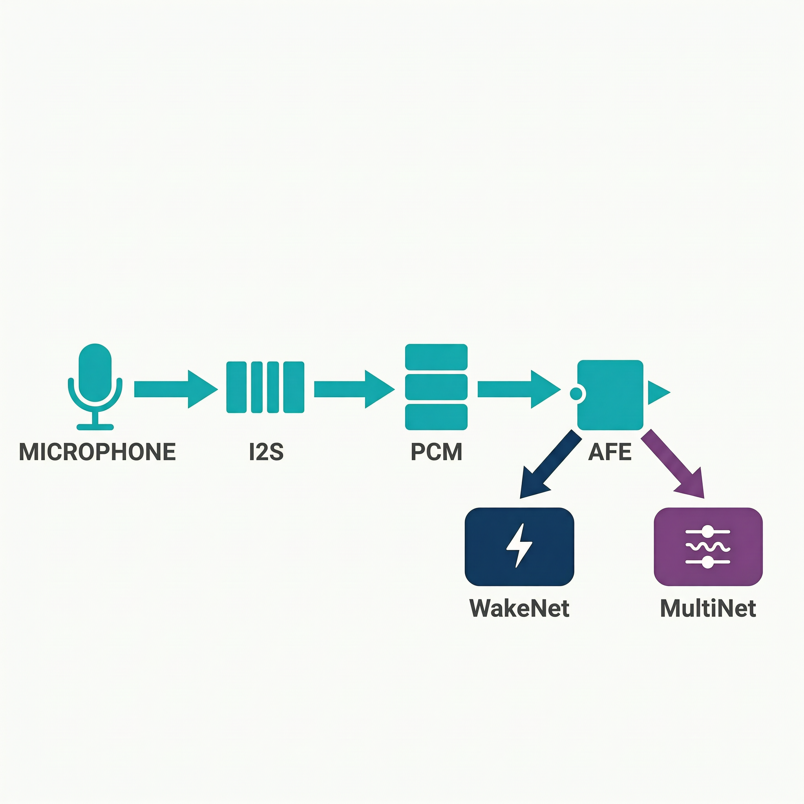

# 最小案例 5：麦克风基本使用及固定时长录音

> 类型：`FW` ｜ 验证状态：参考值，待实机校准 ｜ 后续：[`extensions/05_recording_playback_verify`](../../extensions/05_recording_playback_verify/)

## 摘要

本案例用 ESP32-S3-EYE 板载麦克风采集 16 kHz、单声道、16 bit PCM。烧录后**自动**录约 10 秒，串口输出进度日志，不需要按键、SD 卡，也不保存文件。它只建立两件事：音频输入链路（麦克风 → I2S → 内存）和"录音时长 = 样本数 ÷ 采样率"的概念。保存 WAV 文件和回放验证在扩展案例 [`extensions/05_recording_playback_verify`](../../extensions/05_recording_playback_verify/) 完成。

## Quick Start

**预备知识**

- **样本（sample）**：麦克风把声音振动转成电压，ADC 按固定节奏把每一瞬间的电压记成一个整数。
- **采样率**：每秒采多少个样本。本例 16000 Hz，语音识别常用，够覆盖人声主要频率。
- **位深**：每个样本占多少位。本例软件输出 16 bit（`int16_t`，范围 −32768～+32767，2 字节）；硬件 I2S 槽宽是 32 bit。
- **单声道（mono）**：只有一路麦克风数据。
- **数据量换算**：1 秒 = 16000 样本 = 32000 字节；10 秒 = 160000 样本 = 320000 字节（约 312.5 KB）。
- **I2S**：数字音频芯片间的串行总线，三线：BCLK（位时钟，GPIO41）、WS（帧时钟，GPIO42）、DIN（数据，GPIO2）。板载 MEMS 麦克风内部已完成 ADC，直接发数字样本。
- **PCM 与 WAV**：PCM 是裸样本流，没有格式说明；WAV = 44 字节文件头（写明采样率等）+ PCM 数据。本微课只把 PCM 放内存，不生成文件。
- **ESP-IDF 常用命令**：`idf.py build` 编译；`idf.py -p <端口> flash` 烧录；`idf.py -p <端口> monitor` 看串口日志（115200，`Ctrl + ]` 退出）。
- **日志格式**：`级别 (开机后毫秒数) TAG: 内容`，如 `I (1326) lesson05_record: progress=1000 ms samples=16000`。`I`=INFO，`E`=ERROR。


以下命令都在电脑上执行。先确认已安装 ESP-IDF 并导出环境（macOS/Linux 执行 `export.sh`，Windows 用 ESP-IDF 命令行工具）。课程构建验证版本是 ESP-IDF v5.4.3，见 [`docs/build-verification.md`](../../docs/build-verification.md)。

**第 1 步：进入工程目录**

```bash
cd microcourses/05_mic_recording
```

工程通过 `EXTRA_COMPONENT_DIRS` 引用仓库里的共享组件，必须在仓库内原位构建，不要单独拷走。

**第 2 步：确认 IDF 环境**

```bash
idf.py --version
```

预期输出 `ESP-IDF v5.4.3`（或其他 v5.x）。报 `command not found` 就先执行 IDF 的 `export.sh`。

**第 3 步：设置目标芯片**

```bash
idf.py set-target esp32s3
```

[`sdkconfig.defaults`](sdkconfig.defaults) 已写好 esp32s3、8MB Flash、自定义分区、八线 PSRAM@80MHz、CPU 240MHz，这一步据此生成 `sdkconfig`。若已存在且目标正确可跳过。

**第 4 步：编译**

```bash
idf.py build
```

首次构建会按 [`main/idf_component.yml`](main/idf_component.yml) 下载 `espressif/esp-sr` 到 `managed_components/`——本微课代码并不调用它，只是为了和最小案例 6 以后保持统一的依赖与分区布局。预期末尾 `Project build complete`。首次 3～10 分钟，之后增量几十秒。没有开发板的同学做到这一步即完成构建验证。

**第 5 步：找到开发板的串口**

USB 线连接板子和电脑后：macOS 执行 `ls /dev/cu*`（找以 `cu` 开头的设备，使用时带 `/dev/` 前缀）；Linux `ls /dev/ttyUSB* /dev/ttyACM*`；Windows 在设备管理器看 `COMx`。

**第 6 步：烧录并打开串口监视器**

```bash
idf.py -p <PORT> flash monitor
```

把 `<PORT>` 换成第 5 步的端口（如 `/dev/cuXXXX`、`/dev/ttyUSB0`、`COM3`）。烧录约 1～2 分钟，随后自动复位。**程序一复位就开始录音，不需要按键**：先打印 `state=START target_ms=10000`，之后约每秒一行进度，10 秒后打印 `duration_ms` 和 `state=DONE`，不再有新日志。想再录一次按板上 RST 键。退出监视器按 `Ctrl + ]`。

## 预期现象

成功日志如下（每行前有 `I (毫秒数) lesson05_record:` 前缀；**格式示例，具体时间戳以实机为准**）：

```text
I (330) lesson05_record: state=START target_ms=10000
I (1331) lesson05_record: progress=1000 ms samples=16000
I (2331) lesson05_record: progress=2000 ms samples=32000
...
I (10331) lesson05_record: progress=10000 ms samples=160000
I (10331) lesson05_record: duration_ms=10000 total_samples=160000
I (10331) lesson05_record: state=DONE
```

相邻进度行的间隔应接近 1000 ms。

失败路径：读取失败时先输出 `E ... audio_error=<错误名>`，再输出 `state=FAILED error=<错误名>`，本轮采集立即停止，不会谎报 DONE。若初始化阶段失败（`voice_audio_init()` 返回非 `ESP_OK`），`ESP_ERROR_CHECK` 会直接 `abort()` 重启——说明 I2S 都没初始化成功，应重新 `set-target` 和构建。

**常见问题排查**

| # | 现象 | 可能原因 | 解决办法 |
|---|---|---|---|
| 1 | 串口输出乱码 | 波特率不匹配 | 用 `idf.py -p <PORT> monitor`（默认 115200） |
| 2 | `idf.py: command not found` | 没导出 IDF 环境 | 执行 IDF 安装目录的 `export.sh` 后重试 |
| 3 | 烧录时 `Failed to connect` | 端口错、USB 线只能充电、未进下载模式 | 换数据线；按住 BOOT 再按 RST，松开 BOOT 后重试 |
| 4 | 打开监视器后没有日志 | 复位后的 10 秒录音已跑完，程序只录一次 | 按板上 RST 键重新观察 |
| 5 | `audio_error=...` 后 `state=FAILED` | I2S 通道异常或驱动层错误 | 记录错误名，复位重试，检查供电和其他占用 I2S 的程序 |
| 6 | 编译报 `voice_common.h: No such file` | 工程目录被单独拷出，相对路径失效 | 在整个仓库内构建，不要移动目录相对位置 |

## 学习目标

- 运行一次固定时长的板载 PCM 采集；
- 解释采样率、样本数和录音时长的关系（16000 × 10 = 160000 个样本）；
- 读懂 `START`、进度、`DONE`、`FAILED` 四类状态日志；
- 理解共享组件 `voice_common` 如何把 I2S 的 32 bit 原始样本转成 16 bit；
- 明白读取失败时必须停止本轮采集，不能把部分样本计为成功。

## 原理讲解

**数据链路：从麦克风到内存**

音频采集封装在共享组件 [`components/voice_common/`](../../components/voice_common/) 里，最小案例 5～10都复用它：

1. `voice_audio_init()` 把 `I2S_NUM_1` 初始化为主机，时钟 16000 Hz，槽位配置为 **32 bit、单声道、只取左槽**——板载麦克风在左槽按 32 bit 宽度发数据。
2. `voice_read_samples()` 阻塞读取 32 bit 原始样本，再逐个转成 16 bit。
3. 转换是**右移 14 位**：`samples[i] = (int16_t)(raw32[i] >> 14);`。为什么不是 16 位？右移 14 位相当于把信号放大约 4 倍，声音更"响"，便于最小案例 6～9的 VAD/WakeNet 检测；代价是特别响的声音可能超出 int16 范围被截断（削顶），教学场景影响不大。

**160 样本 = 10 ms，160000 样本 = 10 秒**

[`voice_common.h`](../../components/voice_common/include/voice_common.h) 定义了 `VOICE_SAMPLE_RATE 16000`、`VOICE_FEED_SAMPLES 160` 等常量。160 ÷ 16000 = 0.01 秒，所以每次读 160 个样本正好是 10 ms 音频；160 也是 ESP-SR 常用的 feed 帧长。

[`main/main.c`](main/main.c) 的 `record_audio()` 不用 `vTaskDelay` 计时，而是累计样本数：目标 `16000 × 10 = 160000`，每读 160 个加 160，够了就退出。因为 `i2s_channel_read()` 是阻塞的，循环速度完全由麦克风产生数据的真实速度决定——**样本数就是最诚实的时钟**。进度日志同理：每累计满 16000 个样本（约 1 秒）打印一行。




> 图：采样率决定单位时间产生多少样本，录音时长决定累计样本总数。图中公式用于概念说明，实际采样格式以工程配置为准。

## 整体流程图

```text
板载麦克风 → I2S(GPIO41/42/2) → voice_read_samples()  [32bit→16bit，每次160样本=10ms]
                                        ↓ 每读一次累加 160
                          record_audio() 直到 total_samples ≥ 160000（10 秒）
                                        ↓ 每满 16000 样本（约 1 秒）
                          串口输出 progress 日志 → duration_ms → state=DONE
                          （任何一次读取失败 → audio_error → state=FAILED，立即停止）
```

## 关键代码解析

以下片段摘自真实代码，注释为教学补充。

**1. `app_main`：初始化 → START → 录音 → DONE/FAILED（[`main/main.c`](main/main.c)）**

```c
void app_main(void)
{
    ESP_ERROR_CHECK(voice_audio_init());           // 初始化 I2S 麦克风，失败则 abort 重启
    ESP_LOGI(TAG, "state=START target_ms=%d", RECORD_SECONDS * 1000);
    esp_err_t err = record_audio();                // 阻塞式录满 10 秒（RECORD_SECONDS=10）
    if (err == ESP_OK) {
        ESP_LOGI(TAG, "state=DONE");
    } else {
        ESP_LOGE(TAG, "state=FAILED error=%s", esp_err_to_name(err));
    }
}
```

**2. `record_audio` 循环体：用样本数控制时长和进度（[`main/main.c`](main/main.c)）**

```c
while (total_samples < target_samples) {           // target_samples = 16000×10 = 160000
    esp_err_t err = voice_read_samples(samples, VOICE_FEED_SAMPLES);  // 阻塞读 160 样本（10ms）
    if (err != ESP_OK) {
        ESP_LOGE(TAG, "audio_error=%s", esp_err_to_name(err));
        return err;                                // 读取失败：立即放弃本轮
    }
    total_samples += VOICE_FEED_SAMPLES;           // 按样本数累计，不靠计时
    if (total_samples >= next_log) {               // 每满 16000 样本（约 1 秒）打印一行
        ESP_LOGI(TAG, "progress=%u ms samples=%lu",
                 total_samples * 1000 / VOICE_SAMPLE_RATE, (unsigned long)total_samples);
        next_log += VOICE_SAMPLE_RATE;
    }
}
```

**3. `voice_read_samples` 核心：32 bit → 16 bit（[`voice_common.c`](../../components/voice_common/voice_common.c)）**

```c
int32_t raw32[sample_count];                       // 硬件按 32bit 槽宽发送，先原样接收
esp_err_t err = i2s_channel_read(rx_handle, raw32, sample_count * sizeof(int32_t),
                                 &bytes_read, portMAX_DELAY);   // 阻塞到读满为止
if (err != ESP_OK) {
    return err;
}
for (size_t i = 0; i < sample_count; ++i) {
    samples[i] = (int16_t)(raw32[i] >> 14);        // 右移 14 位（放大约 4 倍）后截为 int16
}
```

## 关键文件说明

| 文件 | 职责 | 类型 |
|---|---|---|
| [`main/main.c`](main/main.c) | 固定时长采集和状态日志（`RECORD_SECONDS`、进度、DONE/FAILED） | 课程代码 |
| [`main/CMakeLists.txt`](main/CMakeLists.txt) | 声明 `main` 依赖 `voice_common` | 构建配置 |
| [`main/idf_component.yml`](main/idf_component.yml) | 声明 `espressif/esp-sr` 依赖（本微课未调用，统一布局用） | 构建配置 |
| [`CMakeLists.txt`](CMakeLists.txt) | `EXTRA_COMPONENT_DIRS` 引入共享组件 `voice_common` | 构建配置 |
| [`partitions.csv`](partitions.csv) | `factory` 应用区 2500K + `model` SPIFFS 5168K（本微课不写 model 分区） | 构建配置 |
| [`sdkconfig.defaults`](sdkconfig.defaults) | esp32s3、8MB Flash、自定义分区、八线 PSRAM、CPU 240MHz | 构建配置 |
| [`../../components/voice_common/include/voice_common.h`](../../components/voice_common/include/voice_common.h) | 音频格式常量（16000/1/16/160）和 API 声明 | 共享组件 |
| [`../../components/voice_common/voice_common.c`](../../components/voice_common/voice_common.c) | I2S 采集、32→16bit 转换（另含 SD 卡、按键、WAV 头，本微课未用） | 共享组件 |

## 配置说明

| 修改位置 | 配置项 | 现象变化 |
|---|---|---|
| [`main/main.c`](main/main.c) | `RECORD_SECONDS`（默认 10） | 改为 5 则 `target_ms=5000`、`total_samples=80000` |
| [`main/main.c`](main/main.c) | `next_log` 步进（默认每 16000 样本） | 只改进度日志频率，不改采集数据 |
| [`voice_common.h`](../../components/voice_common/include/voice_common.h) | `VOICE_SAMPLE_RATE` / `VOICE_FEED_SAMPLES` | 同时影响 I2S 时钟、时长换算和后续语音模型的输入条件 |
| [`sdkconfig.defaults`](sdkconfig.defaults) | PSRAM/Flash/CPU 配置 | 需与 ESP32-S3-EYE 硬件匹配，不要随意关闭 |

改共享采样格式前先确认最小案例 6～9 VAD/WakeNet/MultiNet 的输入要求——ESP-SR 模型按 16 kHz、16 bit、单声道设计。改完要重新 `idf.py build`（改了 `sdkconfig.defaults` 建议删掉 `sdkconfig` 或重新 `set-target`）。

## 术语小表

| 术语 | 解释 |
|---|---|
| PCM | 未压缩的裸音频样本流，本例 16 kHz / 16 bit / 单声道 |
| WAV | 音频文件容器 = 44 字节文件头 + PCM 数据 |
| I2S | 数字音频串行总线，本例三线 BCLK(GPIO41)/WS(GPIO42)/DIN(GPIO2) |
| 采样率 | 每秒采集的样本数，本例 16000 Hz |
| 位深 | 单个样本的位数；硬件槽宽 32 bit，软件输出 16 bit |
| 样本（sample） | 某一瞬间声压对应的一个整数值 |
| feed 帧 | 一次送给后续算法的数据块，`VOICE_FEED_SAMPLES=160` 样本 = 10 ms |
| 阻塞读（portMAX_DELAY） | `i2s_channel_read()` 等到读满才返回，循环速度=真实采样速度 |
| `esp_err_t` / `ESP_OK` | ESP-IDF 错误码；`ESP_OK`=0 表示成功，非 0 可用 `esp_err_to_name()` 转成名字 |
| 串口监视器（monitor） | 实时显示板子串口日志的工具，默认 115200，`Ctrl+]` 退出 |
| TAG | 日志前缀标识，本例 `lesson05_record`，便于过滤 |

## 验证清单

- [ ] 日志包含 `state=START target_ms=10000`、每秒进度、`state=DONE`（或失败时 `state=FAILED error=...`）；
- [ ] 成功时 `total_samples=160000`，与 16000 Hz × 10 s 换算一致；
- [ ] 相邻进度日志时间戳间隔接近 1000 ms；
- [ ] 记录目标板（ESP32-S3-EYE）、IDF 版本（`idf.py --version`）和音频格式（16 kHz/mono/16 bit）；
- [ ] 失败路径可识别：`audio_error` 出现后本轮立即终止，不输出 DONE；
- [ ] 不把内存缓冲误称为"已保存的 WAV 文件"，**不提交任何真实个人语音或录音文件到仓库**。

## 思考题与拓展挑战

**思考题**

1. 16 kHz 采样率下，10 秒单声道 16 bit PCM 需要多少数据？

   **参考答案：**16000×10 = 160000 个样本 × 2 字节 = 320000 字节；若是 WAV 文件再加 44 字节头。

2. 为什么进度按样本数换算，而不是用 `vTaskDelay` 计时？

   **参考答案：**`i2s_channel_read()` 阻塞到读满才返回，累计样本数直接反映真实收到的数据；任务调度和日志开销会让延时计时不准。

3. 为什么先按 32 bit 读取再右移 14 位，而不是直接配 16 bit？

   **参考答案：**板载麦克风在 I2S 上按 32 bit 槽宽发送，只能先按 32 bit 收。右移 14 位（而非 16 位）相当于放大约 4 倍，提高语音幅度便于后续 VAD/WakeNet，代价是极大音量可能削顶。

**拓展挑战**

- 在扩展案例中把同一条 PCM 数据封装为合法 WAV，并用文件头反向验证格式；
- 不保存原始语音，只记录每帧最大绝对值、过零率等统计量，判断麦克风是否真的采到了声音；
- 把进度日志改为每 500 ms 一行（改 `next_log` 步进），验证总样本数和时长不受影响。

