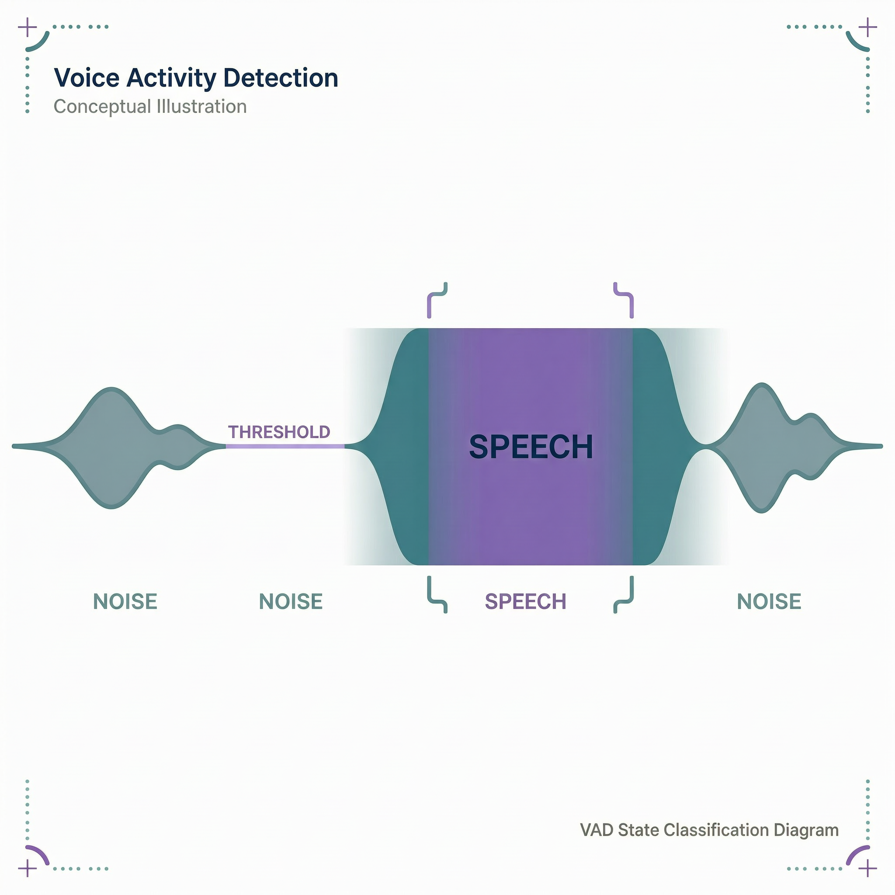

# 最小案例 6：VAD 语音活动检测

> 类型：`FW` ｜ 验证状态：参考值，待实机校准 ｜ 后续：[`extensions/06_vad_stability_test`](../../extensions/06_vad_stability_test/)

## 摘要

本案例把板载麦克风的 PCM 送进 **ESP-SR 的 AFE（音频前端）**，再读取其中的 **VAD（语音活动检测）**结果，只在状态变化时通过串口输出 `state=SPEECH`（有人说话）或 `state=NOISE`（安静/噪声）。它建立的是"让设备知道现在有没有人在说话"这一语音链路的第一道闸门。本案例**不含唤醒词（WakeNet）、命令词（MultiNet）或统计**；三场景稳定性测试由扩展案例 [`extensions/06_vad_stability_test`](../../extensions/06_vad_stability_test/) 完成。

> ⚠️ 隐私要求：VAD 只输出状态，本案例**不保存、不上传任何音频**。做实验时也**不要录入或提交真实个人语音**——我们只观察状态切换，不需要你说了什么。

## Quick Start

**预备知识**

做完微课 05 的话，前两条可快速略过；VAD/AFE/双任务是新知识。

- **麦克风 PCM（复习）**：与最小案例 5 相同，I2S 送来 32 bit 原始样本，`voice_read_samples()` 右移 14 位截成 16 bit，格式 16 kHz/单声道/16 bit，见 [`voice_common.c`](../../components/voice_common/voice_common.c)。本案例把每块数据**喂给 AFE**，不再自己累加。
- **多核与绑核（复习）**：ESP32-S3 是双核（CPU0、CPU1），`xTaskCreatePinnedToCore(..., core)` 可把任务"钉"在指定核上，避免两个重任务互相抢占。
- **VAD**：Voice Activity Detection，只回答一个问题——"这一小段音频里有没有人在说话？"输出二值状态（SPEECH/NOISE）。它很轻量，先用它把关、有语音才唤醒后面的识别，是 Memory Pendant 长期待机的基础；SPEECH→NOISE 跳变还天然给出"一句话的边界"。
- **AFE 与 feed/fetch**：AFE（Audio Front End）是 ESP-SR 的音频预处理链路（可含降噪、增益、VAD）。工作方式是生产者—消费者两段式：**feed** 不断把 PCM 喂进输入缓冲，**fetch** 取出处理结果（本案例只看 `vad_state` 字段）。两者节奏不同，所以拆成两个任务并行跑。
- **ESP-SR 模型存在哪**：VAD 模型（VadNet）打包成镜像烧到 Flash 的 **`model` 分区**（[`partitions.csv`](partitions.csv) 里 5168K 的 SPIFFS 分区），运行时用 `esp_srmodel_init("model")` 加载。**烧录必须连 `model` 分区一起烧**，只烧应用会加载失败。


以下命令在电脑上执行。先确认已安装 ESP-IDF（课程验证版本 v5.4.3）并导出环境。**本案例涉及模型分区，务必用 `idf.py flash`（会连同 `model` 分区一起烧），不要只烧应用 bin。**

**第 1 步：进入工程目录并确认环境**

```bash
cd microcourses/06_vad_detection
idf.py --version
```

工程通过 `EXTRA_COMPONENT_DIRS` 引入共享组件，须在仓库原位构建。版本预期 `ESP-IDF v5.4.3`（或其他 v5.x）；报 `command not found` 先执行 IDF 的 `export.sh`。

**第 2 步：设置目标芯片**

```bash
idf.py set-target esp32s3
```

[`sdkconfig.defaults`](sdkconfig.defaults) 除通用配置外，有两条与语音模型直接相关：`CONFIG_SR_VADN_VADNET1_MEDIUM=y`（VAD 模型选 VadNet1 medium）和 `CONFIG_SR_WN_WN9_HIESP=y`（WakeNet9 模型，本案例不运行，但决定打包进 `model` 分区的模型集合）。

**第 3 步：编译（首次较慢）**

```bash
idf.py build
```

编译固件并**生成 `model` 分区镜像**（打包选中的 SR 模型）。首次会下载 `espressif/esp-sr`（较大，含模型），**可能 5～15 分钟**，之后增量几十秒。预期末尾 `Project build complete`。没有开发板的同学到此完成构建验证——但构建成功不代表板上 VAD 能跑。

**第 4 步：找串口**

USB 连板后：macOS `ls /dev/cu*`（以 `cu` 开头的设备）；Linux `ls /dev/ttyUSB* /dev/ttyACM*`；Windows 看设备管理器 `COMx`。

**第 5 步：烧录并监视**

```bash
idf.py -p <PORT> flash monitor
```

烧录应用 + 模型分区约 2～4 分钟，随后复位。先加载模型、初始化 AFE，接着打印 `ready: speak into the microphone`，之后**对着板载麦克风做实验**：保持安静看是否停在 `NOISE`；距麦克风 10～30 cm 正常说话看是否切到 `SPEECH`；停止说话约 1 秒后看是否切回 `NOISE`。退出监视器按 `Ctrl + ]`，重跑按 RST 键。

## 预期现象

复位后先出现 `I (xxx) lesson06_vad: ready: speak into the microphone`，随后**只在状态变化时**输出。一次典型的"安静→说话→安静"：

```text
I (xxx) lesson06_vad: state=NOISE      # 开机初始状态（previous=-1，首次必打印）
I (xxx) lesson06_vad: state=SPEECH     # 说话持续 >128ms 后触发
I (xxx) lesson06_vad: state=NOISE      # 停止说话、安静持续 >1000ms 后切回
```

这是**日志格式示例，不是固定实测序列**：`state` 出现的时刻和次数完全取决于你何时说话、环境多吵。持续说话时会一直停在 `SPEECH`，不会因换气频繁跳回（受 `vad_min_noise_ms=1000` 保护）。

失败路径：若 `fetch()` 返回空指针或 `result->ret_value == ESP_FAIL`，打印一行 `E ... fetch_error` 后检测任务退出，不再有 VAD 状态输出。遇到它应检查模型是否成功烧入 `model` 分区、内存是否够用；**不要把 fetch 停止前的最后一次状态当成"持续有效"的结果。**

**常见问题排查**

| # | 现象 | 可能原因 | 解决办法 |
|---|---|---|---|
| 1 | 没有 `ready` 或启动即崩溃重启 | `model` 分区没烧、模型加载失败、PSRAM 配置不符 | 用 `idf.py flash` 整片烧录；重新 `set-target esp32s3` 后重烧 |
| 2 | `fetch_error` 后不再有输出 | AFE fetch 失败（内存不足、配置异常、feed 未供数） | 保留日志，检查堆/PSRAM，重烧重试 |
| 3 | 说话却始终 `state=NOISE` | 麦克风没采到声、音量太小/太远、模式太严格 | 靠近麦克风正常音量说话；回微课 05 确认采集；试 `VAD_MODE_0` |
| 4 | 安静环境频繁跳到 `SPEECH`（误触发） | 环境噪声大、`vad_min_speech_ms` 太小 | 换安静环境；增大阈值或提高 `vad_mode`；扩展案例会量化这些现象 |
| 5 | 说话时状态反复抖动 | `vad_min_noise_ms` 太小，停顿就切回 | 增大 `vad_min_noise_ms`（如 1000→1500）对照 |
| 6 | 编译报 `esp_afe_sr_iface.h: No such file` | esp-sr 组件未下载 | 联网执行 `idf.py build` 让组件管理器下载；检查 `REQUIRES voice_common esp-sr` |

## 学习目标

- 解释 AFE 的 **feed / fetch 两段式**链路，以及为什么拆成两个任务分别绑在 CPU0 和 CPU1；
- 运行固件并识别串口里的 `SPEECH`、`NOISE` 和失败标记 `fetch_error`；
- 解释 `vad_min_speech_ms=128` 和 `vad_min_noise_ms=1000` 各抑制什么问题；
- 明白"只在状态变化时打印"为什么比"每帧都打印"更适合观察、更省资源。

## 原理讲解

**双任务分工**

`feed_task`（钉 CPU0，优先级 5，栈 8192）是生产者：阻塞读麦克风、把 PCM 喂进 AFE；`detect_task`（钉 CPU1）是消费者：`fetch()` 取出结果、读 `vad_state`、只在跳变时打印。两个任务共用同一个 `afe_data` 句柄。分别绑核让持续的音频采集不被检测逻辑抢占——这是 ESP-SR 官方推荐的双核分工。

**chunk 由 AFE 决定，不是写死的**

`feed_task` 一开始就向 AFE 查询它每次要吃多少数据：`get_feed_chunksize()`（每次处理的样本数，16 kHz 下常见 512，即 32 ms）和 `get_feed_channel_num()`（声道数），再按查询结果分配缓冲、每轮读 `chunk × channels` 个样本喂进去。**不能用微课 05 固定的 160 样本**——必须"问它、按它给的数喂"，否则 AFE 内部缓冲会错位。输入格式字符串由 `voice_get_input_format()` 提供（返回 `"MN"`，M=麦克风声道、N=未用声道）。

**两个时间阈值与灵敏度模式**

- **`vad_min_speech_ms = 128`**：声音持续超过 128 ms 才判 SPEECH，抑制键盘敲击等极短噪声脉冲。越大越不易误触发，太大会漏掉很短的词。
- **`vad_min_noise_ms = 1000`**：进入 SPEECH 后持续安静超过 1 秒才切回 NOISE，避免说话中的换气停顿让状态频繁抖动。越大越稳定，但一句话结束后要等更久才看到 NOISE。
- **`vad_mode = VAD_MODE_1`**：灵敏度模式，ESP-SR 枚举里 0=Normal、1=Aggressive、2～4 依次更"激进"，**模式越高判定 SPEECH 越严格**。（源码注释写作"中等灵敏度"，与头文件 `VAD_MODE_1=Aggressive` 的官方命名有出入，以头文件为准。）

**为什么只在状态变化时打印**

每帧（约 32 ms）都打印会刷屏，反而看不清"什么时候开始说、什么时候停"。`detect_task` 用 `previous` 变量记住上次状态，只在跳变时打印，日志就成了清晰的事件序列：`NOISE → SPEECH → NOISE`。`previous` 初值 `-1`，保证开机后第一次 fetch 一定打印初始状态。



> 图：VAD 根据输入波形和时间条件把片段划分为 `SPEECH` 与 `NOISE`。概念示意，不是实测波形。

## 整体流程图

```text
板载麦克风（I2S，16 kHz 单声道 16 bit）
        ↓ voice_read_samples() 持续读取
feed_task（钉在 CPU0）：把 PCM 送进 AFE
        ↓
AFE 内部处理（运行 VAD 模型，判定每帧是否有语音）
        ↓ afe->fetch() 取出 afe_fetch_result_t
detect_task（钉在 CPU1）：读 result->vad_state
        ↓ 仅当状态和上一次不同（跳变）时
串口日志 state=SPEECH / state=NOISE
```

## 关键代码解析

以下片段摘自 [`main/main.c`](main/main.c) 真实代码，注释为教学补充。

**1. `feed_task`：持续采集并喂入 AFE（钉在 CPU0）**

```c
int chunk = afe_handle->get_feed_chunksize(afe_data);      // 问 AFE：每次要多少样本
int channels = afe_handle->get_feed_channel_num(afe_data);  // 问 AFE：几个声道
int16_t *buffer = malloc(chunk * sizeof(int16_t) * channels);
assert(buffer);
while (true) {
    ESP_ERROR_CHECK(voice_read_samples(buffer, (size_t)chunk * channels));  // 阻塞读满一块
    afe_handle->feed(afe_data, buffer);                    // 送进 AFE，立即读下一块
}
```

`voice_read_samples` 是阻塞的，所以 feed 节奏自动跟上麦克风的真实采样速度，不会喂太快或太慢。

**2. `detect_task`：取结果、只在跳变时打印（钉在 CPU1）**

```c
int previous = -1;                                          // 初值 -1：保证首次一定打印
ESP_LOGI(TAG, "ready: speak into the microphone");
while (true) {
    afe_fetch_result_t *result = afe_handle->fetch(afe_data);   // 阻塞取一块处理结果
    if (!result || result->ret_value == ESP_FAIL) {
        ESP_LOGE(TAG, "fetch_error");
        break;                                              // 失败：退出循环，任务自删
    }
    int state = result->vad_state == VAD_SPEECH;            // 1=语音, 0=非语音
    if (state != previous) {                                // 状态变化才打印
        ESP_LOGI(TAG, "state=%s", state ? "SPEECH" : "NOISE");
        previous = state;
    }
}
```

`afe_fetch_result_t` 里还有 `wakeup_state`、`wake_word_index` 等字段，最小案例 7～8会用到；本案例只看 `vad_state` 和 `ret_value`。

**3. `app_main`：加载模型、配置 AFE、建两个任务**

```c
ESP_ERROR_CHECK(voice_audio_init());                        // I2S 麦克风 16kHz/mono/16bit
models = esp_srmodel_init("model");                         // 从 model 分区加载 SR 模型
afe_config_t *config = afe_config_init(voice_get_input_format(), models, AFE_TYPE_SR, AFE_MODE_LOW_COST);
config->vad_min_speech_ms = 128;   // 持续 >128ms 才判 SPEECH，抑制短噪声脉冲
config->vad_min_noise_ms  = 1000;  // 持续安静 >1s 才切回 NOISE，抑制说话间隙抖动
config->vad_mode = VAD_MODE_1;     // 灵敏度模式（头文件枚举：Aggressive，越高越严格）
afe_handle = esp_afe_handle_from_config(config);            // 取得 AFE"函数表"句柄
esp_afe_sr_data_t *afe_data = afe_handle->create_from_config(config);
afe_config_free(config);
xTaskCreatePinnedToCore(feed_task, "afe_feed", 8192, afe_data, 5, NULL, 0);    // 采集：CPU0
xTaskCreatePinnedToCore(detect_task, "vad_detect", 8192, afe_data, 5, NULL, 1); // 检测：CPU1
```

## 关键文件说明

| 文件 | 职责 | 类型 |
|---|---|---|
| [`main/main.c`](main/main.c) | AFE feed/fetch 双任务、VAD 阈值配置、状态跳变日志 | 课程代码 |
| [`main/CMakeLists.txt`](main/CMakeLists.txt)、[`main/idf_component.yml`](main/idf_component.yml) | 声明 `voice_common`、`esp-sr` 依赖 | 构建配置 |
| [`CMakeLists.txt`](CMakeLists.txt)、[`partitions.csv`](partitions.csv)、[`sdkconfig.defaults`](sdkconfig.defaults) | 引入共享组件；`factory` + `model` 5168K 分区；目标/PSRAM/CPU + `CONFIG_SR_VADN_VADNET1_MEDIUM`、`CONFIG_SR_WN_WN9_HIESP` 模型选择 | 构建配置 |
| [`../../components/voice_common/voice_common.c`](../../components/voice_common/voice_common.c) | 板载 I2S 输入、`voice_get_input_format()` | 共享组件 |
| `managed_components/espressif__esp-sr/` | ESP-SR 组件与头文件 | 第三方/生成物 |

## 配置说明

| 修改位置 | 配置项 | 现象变化 |
|---|---|---|
| [`main/main.c`](main/main.c) | `vad_min_speech_ms=128` | 增大→更难被短脉冲触发（可能漏短词）；减小→更灵敏但易误触发 |
| [`main/main.c`](main/main.c) | `vad_min_noise_ms=1000` | 增大→更稳但结束后切回慢；减小→切回快但易抖动 |
| [`main/main.c`](main/main.c) | `vad_mode` / 任务栈 8192、优先级 5、绑核 0/1 | 0=Normal 最易触发，越高越严格；栈太小可能崩溃，绑核影响是否互相抢占 |
| [`sdkconfig.defaults`](sdkconfig.defaults) | `CONFIG_SR_*` 模型选项 | 决定打包进 `model` 分区的模型；改后需重新 build+flash |
| [`partitions.csv`](partitions.csv) | `model` 分区大小 5168K | 太小放不下模型会导致烧录或加载失败 |

改任何 SR 模型相关配置后，务必重新 `idf.py build` 并 `idf.py flash`（连模型分区一起烧），只重烧应用不会更新模型。

## 术语小表

| 术语 | 解释 |
|---|---|
| VAD | Voice Activity Detection，输出"有没有人说话"的二值状态 |
| AFE | Audio Front End，ESP-SR 音频前端处理链路（可含降噪/AGC/VAD） |
| feed / fetch | 把 PCM 喂进 AFE（生产者）/ 取出处理结果（消费者） |
| chunk | AFE 一次处理的样本数，由 `get_feed_chunksize()` 运行时查询（16kHz 常见 512=32ms） |
| `esp_afe_sr_iface_t` | AFE 的"函数表"句柄，`feed`/`fetch` 等方法经它调用 |
| `afe_fetch_result_t` | fetch 返回的结果结构，含 `vad_state`、`ret_value`、`wakeup_state` 等 |
| `vad_min_speech_ms` | 判为语音所需的最短持续时间（本例 128ms），抑制短噪声脉冲 |
| `vad_min_noise_ms` | 切回静音所需的最短安静时间（本例 1000ms），抑制说话间隙抖动 |
| `vad_mode` | 灵敏度模式，0=Normal 最易触发，数值越高越严格（1=Aggressive） |
| `model` 分区 | Flash 上存放 ESP-SR 模型的 SPIFFS 分区，`esp_srmodel_init("model")` 从此加载 |
| 绑核（Pinned to Core） | `xTaskCreatePinnedToCore` 把任务固定在 CPU0 或 CPU1 上运行 |

## 验证清单

- [ ] 记录目标板（ESP32-S3-EYE）、IDF 版本、SR 模型配置（`CONFIG_SR_VADN_VADNET1_MEDIUM` 等）；
- [ ] 复位后看到 `ready: speak into the microphone`；
- [ ] 安静、说话两种场景都观察到对应状态（或记录了未变化的原因，如误触发/漏检）；
- [ ] 日志**只在状态变化时**输出，没有每帧刷屏，也没有伪造检测结果；
- [ ] 能识别 `fetch_error` 失败路径，并说出 `vad_min_speech_ms` 和 `vad_min_noise_ms` 各自抑制的问题；
- [ ] **不保存、不提交任何真实个人语音**——本案例只输出状态，不产生音频文件。

## 思考题与拓展挑战

**思考题**

1. 为什么 `vad_min_noise_ms` 通常不能设得太小？

   **参考答案：**说话中总有换气、想词等短停顿，确认窗口太小会让状态在 SPEECH/NOISE 间频繁抖动，一句话被切成碎片。加大它可稳定片段边界，代价是语音结束后要等更久才看到 NOISE。

2. 为什么 feed 和 fetch 适合放在不同任务、不同核？

   **参考答案：**采集需要持续稳定供数，检测是另一套节奏；拆成两个任务互不阻塞，再分别钉在 CPU0/CPU1 避免单核互相抢占——这是 ESP-SR 官方推荐的双核分工。

3. 为什么 `feed_task` 要先调用 `get_feed_chunksize()`，不能直接用微课 05 的 160 样本？

   **参考答案：**AFE 对每次喂入的帧长有内部要求（16 kHz 下常见 512 样本），必须按它运行时给出的数喂，否则内部缓冲错位、结果不可靠；160 不一定等于当前 AFE 配置的 chunk。

**拓展挑战**

- 在扩展案例 [`extensions/06_vad_stability_test`](../../extensions/06_vad_stability_test/) 中设计安静、说话、噪声三种场景，统计每 30 秒的状态切换次数和语音片段数量；
- 只改一个阈值（如 `vad_min_noise_ms` 500/1000/2000）或一个 `vad_mode`（0/1/2），对照同一场景下的抖动、误触发与漏检变化，做成对照表；
- 在 `detect_task` 里额外打印 `result->data_volume`（输入能量），观察说话与安静时的差异，但不保存任何原始音频。

