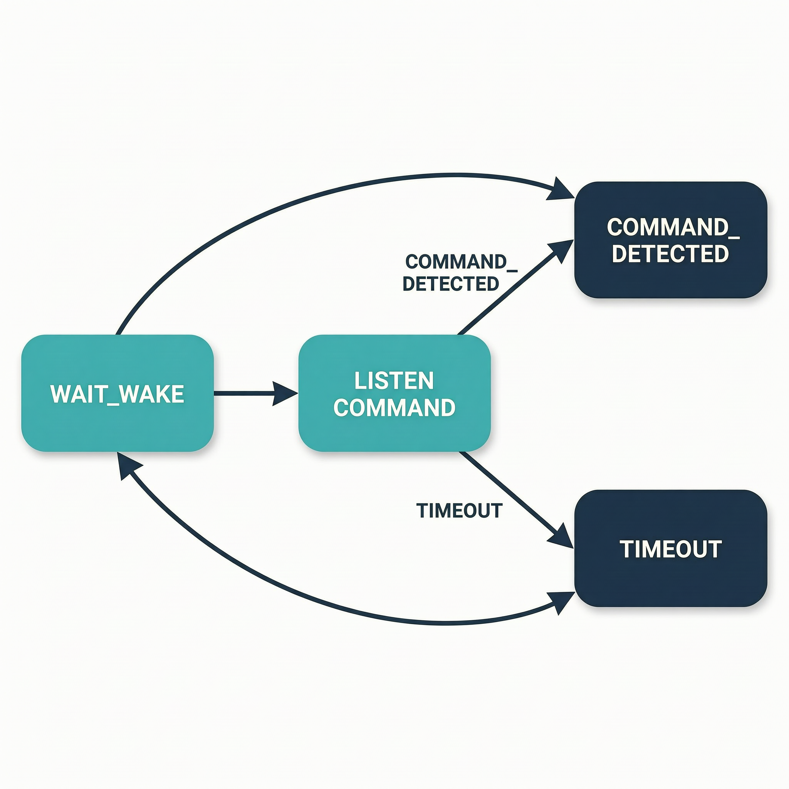

# 最小案例 8：MultiNet 命令识别

> 类型：`FW` ｜ 验证状态：参考值，待实机校准 ｜ 后续：[`extensions/08_command_action_binding`](../../extensions/08_command_action_binding/)

## 摘要

本案例在最小案例 7"实时唤醒"的基础上加入 **MultiNet 命令词识别**，建立"唤醒词与命令词分离"的完整交互链路：待机时只跑 WakeNet 监听 `Hi ESP`（模型 `wn9_hiesp`）；唤醒后打开一个命令监听窗口（本工程为 6 秒），用 MultiNet7 中文模型识别 `sdkconfig.defaults` 里配置的固定命令——`da kai deng`（打开灯，编号 1）和 `guan bi deng`（关闭灯，编号 2）；命中后串口打印命令编号、短语和概率，超时打印 `COMMAND_TIMEOUT`，两种结局都重新启用 WakeNet 回到待机。本案例只输出识别结果，**不直接启动摄像头、录音或视觉推理**——把编号映射到动作是扩展案例 [`extensions/08_command_action_binding`](../../extensions/08_command_action_binding/) 的事。

## Quick Start

**预备知识**

- **唤醒词 vs 命令词**：唤醒词（`Hi ESP`）只负责"叫醒"，由 WakeNet 检测；命令词（"打开灯"等）负责"告诉设备做什么"，由 MultiNet 识别。待机只跑轻量的 WakeNet，唤醒后的短窗口才跑较重的 MultiNet——这就是"待机→唤醒→命令→动作→待机"的分层模式。
- **MultiNet**：ESP-SR 的固定命令词识别模型，不做开放域语音转文字，只判断"这句话是不是命令表里的某一条"，给出命令编号（`command_id`）和置信度（`prob`）。本工程用 `CONFIG_SR_MN_CN_MULTINET7_QUANT=y` 选择 MultiNet7 中文量化模型（模型名形如 `mn7_cn...`）。
- **命令词表怎么来的**：不需要训练模型！命令词写在 `sdkconfig.defaults` 的 `CONFIG_CN_SPEECH_COMMAND_ID1/ID2/...` 里，启动时由 `esp_mn_commands_update_from_sdkconfig()` 注册进 MultiNet。中文命令用拼音书写（音节空格分隔），如"打开灯"写作 `da kai deng`。改命令词只是改配置、重新编译。
- **命令编号**：`CONFIG_CN_SPEECH_COMMAND_IDn` 对应 `command_id=n`。应用层拿到编号再决定动作——识别层和业务层靠编号解耦。
- **监听窗口/超时**：`multinet->create(name, 6000)` 里的 `6000` 是命令监听超时（毫秒）。唤醒后 6 秒内没识别出命令，MultiNet 返回 `ESP_MN_STATE_TIMEOUT`，设备放弃本轮交互回待机。


前置条件：ESP32-S3-EYE（板载麦克风）；`model` 分区将烧入 `Hi ESP` 唤醒词模型、MultiNet7 中文模型和 VADNet（由 `sdkconfig.defaults` 勾选）。不需要 SD 卡。

```bash
cd microcourses/08_multinet_command
idf.py --version          # 确认 ESP-IDF 可用，报错就先按环境文档配置
idf.py set-target esp32s3 # 目标芯片 esp32s3
idf.py build              # 构建固件并自动打包 srmodels.bin（唤醒+命令+VAD 模型）
idf.py -p <PORT> flash monitor   # 有开发板时烧录并打开串口
```

1. **核对命令配置**。[`sdkconfig.defaults`](sdkconfig.defaults) 中应有：

   ```text
   CONFIG_SR_VADN_VADNET1_MEDIUM=y      ← VAD 模型（判断有没有人声）
   CONFIG_SR_WN_WN9_HIESP=y             ← 唤醒词模型 "Hi ESP"
   CONFIG_SR_MN_CN_MULTINET7_QUANT=y    ← MultiNet7 中文命令模型
   CONFIG_CN_SPEECH_COMMAND_ID1="da kai deng"    ← 命令1：打开灯
   CONFIG_CN_SPEECH_COMMAND_ID2="guan bi deng"   ← 命令2：关闭灯
   ```

2. **`idf.py build`**：预期 `Project build complete`。三个模型打包进 `srmodels.bin`（约几 MB），`model` 分区留了 5168K。`idf.py flash` 通过 esp-sr 的 `add_dependencies(flash srmodels_bin)` 机制自动把模型写入 `model` 分区，无需额外命令。
3. **烧录后核对命令表**：启动时先看 esp-sr 的加载日志和生效命令表（形如 `Command ID1, phrase ID0: da kai deng`），再看 `state=WAIT_WAKE word=Hi ESP`。改了配置但打印的还是旧命令，说明没重新 build/flash。
4. **唤醒并说命令**：安静环境清楚说 `Hi ESP`，看到 `LISTEN_COMMAND` 后**在 6 秒内**说"打开灯"或"关闭灯"；另做一次唤醒后保持沉默 6 秒以上，观察超时路径。退出：monitor 里按 `Ctrl + ]`。

环境安装与 `<PORT>` 见仓库根 README 和 [`docs/environment-setup.md`](../../docs/environment-setup.md)。没有开发板时只能完成构建验证，不能把识别结果写成"已实测"。

## 预期现象

下面是**格式示例，具体数值（id、prob、时间戳）以实机为准**（TAG 为 `lesson08_multinet`）。启动阶段，以及一次"唤醒→命中"和一次"唤醒→超时"：

```text
I (xxxx) MN_SPEECH_COMMANDS: Command ID1, phrase ID0: da kai deng
I (xxxx) MN_SPEECH_COMMANDS: Command ID2, phrase ID1: guan bi deng
I (xxxx) lesson08_multinet: state=WAIT_WAKE word=Hi ESP
I (xxxx) lesson08_multinet: state=LISTEN_COMMAND
I (xxxx) lesson08_multinet: state=COMMAND_DETECTED id=1 phrase=da kai deng prob=0.8xx
I (xxxx) lesson08_multinet: state=WAIT_WAKE
I (xxxx) lesson08_multinet: state=LISTEN_COMMAND
I (xxxx) lesson08_multinet: state=COMMAND_TIMEOUT
I (xxxx) lesson08_multinet: state=WAIT_WAKE
```

（前两行来自 esp-sr 的 `print_active_speech_commands`，TAG 与格式以组件实际输出为准。）

- `WAIT_WAKE`：待机中，只跑 WakeNet。`LISTEN_COMMAND`：唤醒命中，6 秒 MultiNet 窗口已打开，并已 `clean()` 清空旧状态。
- `COMMAND_DETECTED id=... phrase=... prob=...`：命令命中。`id` 对应 `CONFIG_CN_SPEECH_COMMAND_ID<n>` 的 n，`phrase` 来自 `mn->string`，`prob` 是置信度（0~1）。
- `COMMAND_TIMEOUT`：窗口内没识别到命令。命中或超时后都再次出现 `WAIT_WAKE`，表示 `enable_wakenet()` 已重新打开 WakeNet。

失败路径：AFE `fetch` 出错打印 `fetch_error` 并退出检测任务；模型或命令配置缺失时，启动阶段命令表打印为空或 esp-sr 报错。**不要把"唤醒成功"误记为"命令识别成功"**，两者是不同的日志事件。

**常见问题排查**

| 现象 | 可能原因 | 解决办法 |
|---|---|---|
| 说 `Hi ESP` 后没有 `LISTEN_COMMAND` | 唤醒本身没命中（噪声、距离、发音） | 参照扩展案例 7：安静环境、靠近麦克风、清晰发音 |
| 唤醒后说命令总是 `COMMAND_TIMEOUT` | 没在 6 秒窗口内说完，或发音与拼音词条差异大 | 唤醒后立刻清楚念命令，语速适中，音节要完整 |
| 启动时命令表为空或报错 | `CONFIG_CN_SPEECH_COMMAND_ID*` 未配置，或音节不被模型支持 | 检查 `sdkconfig.defaults`，用空格分隔的标准拼音音节 |
| 改了命令词但设备上还是旧命令 | 只改了文件没有重新构建烧录 | 重新 `idf.py build flash`，核对启动时打印的命令表 |
| `prob` 低、识别不稳定或启动即崩溃 | 环境噪声、命令词发音相近，或 PSRAM 配置不对 | 换安静环境复测；核对 `CONFIG_SPIRAM=y`、`CONFIG_SPIRAM_MODE_OCT=y`、8MB flash |

## 学习目标

- 解释 WakeNet（唤醒）和 MultiNet（命令）的职责边界，以及为什么两者要分阶段运行；
- 运行待机、监听、命令命中和命令超时四条路径，读懂每个状态的日志；
- 读懂 `esp_mn_commands_update_from_sdkconfig()` 如何把文本配置注册为命令表；解释命令词为什么用拼音形式配置、为什么添加命令词不需要重新训练模型。

## 原理讲解

**程序整体做了什么**

1. `app_main`：初始化 I2S 麦克风、加载模型、创建 AFE（`AFE_TYPE_SR + AFE_MODE_LOW_COST`），创建 `feed_task`（CPU0，持续喂麦克风数据）和 `detect_task`（CPU1，状态流主体，栈 12288——MultiNet 比纯 WakeNet 更吃栈空间）。
2. `detect_task` 启动时：`esp_srmodel_filter(models, ESP_MN_PREFIX, ESP_MN_CHINESE)` 找到中文 MultiNet（关键字 `mn` + `cn`），`create(name, 6000)` 创建实例，注册命令表，`print_active_speech_commands()` 把生效命令打印到串口。
3. 主循环：`fetch()` 取 AFE 结果 → `wakeup_state == WAKENET_DETECTED` 时置 `listening=true`、`multinet->clean()` 清空上一轮状态、打印 `LISTEN_COMMAND` → 监听中把 `result->data` 喂给 `multinet->detect()`。
4. 命中时用 `get_results()` 取出 `command_id`、`string`（短语）、`prob`（概率）并打印；超时打印 `COMMAND_TIMEOUT`。两种情况都调用 `afe_handle->enable_wakenet()` 重新启用 WakeNet 回待机——否则设备会一直停在命令识别状态，既费资源又收不到下一次 `Hi ESP`。




## 整体流程图

```text
板载麦克风 → feed_task(CPU0) → AFE → detect_task(CPU1)
                          ↓ fetch()
     wakeup_state == WAKENET_DETECTED ?
          ├─ 否 → 保持 WAIT_WAKE（待机，只跑 WakeNet）
          └─ 是 → clean() + LISTEN_COMMAND（打开 6 s 命令窗口）
                          ↓ multinet->detect(result->data)
          ├─ DETECTED → COMMAND_DETECTED id/phrase/prob
          ├─ TIMEOUT  → COMMAND_TIMEOUT
          └─ DETECTING→ 继续喂下一帧
                          ↓（命中或超时后）
          enable_wakenet() → WAIT_WAKE（回到待机）
```

## 关键代码解析

以下片段均来自 [`main/main.c`](main/main.c)。

**1) 创建 MultiNet 并从 sdkconfig 注册命令表（`detect_task` 开头）**

```c
// 在模型列表里找中文 MultiNet：前缀 "mn" + 关键字 "cn"，本工程命中 mn7_cn...
char *name = esp_srmodel_filter(models, ESP_MN_PREFIX, ESP_MN_CHINESE);
esp_mn_iface_t *multinet = esp_mn_handle_from_name(name);   // 拿到接口函数表
model_iface_data_t *model_data = multinet->create(name, 6000); // 6000ms：命令监听超时
esp_mn_commands_update_from_sdkconfig(multinet, model_data); // 注册拼音命令，编号=配置项序号
multinet->print_active_speech_commands(model_data);         // 串口打印当前生效命令表
bool listening = false;
ESP_LOGI(TAG, "state=WAIT_WAKE word=Hi ESP");               // 进入待机
```

**2) 唤醒→监听的切换**

```c
afe_fetch_result_t *result = afe_handle->fetch(afe_data);   // 取 AFE 结果
if (!result || result->ret_value == ESP_FAIL) { ESP_LOGE(TAG, "fetch_error"); break; }
if (result->wakeup_state == WAKENET_DETECTED) {             // WakeNet 命中 "Hi ESP"
    listening = true;
    multinet->clean(model_data);                            // 清掉上一轮识别残留状态
    ESP_LOGI(TAG, "state=LISTEN_COMMAND");                  // 打开命令监听窗口
}
if (!listening) continue;   // 未唤醒：只待机，不跑 MultiNet（"待机只跑 WakeNet"的代码体现）
```

**3) 命令检测、结果读取与回到待机**

```c
// 把 AFE 处理后的这一帧喂给 MultiNet；返回 DETECTING/DETECTED/TIMEOUT 三种状态
esp_mn_state_t state = multinet->detect(model_data, result->data);
if (state == ESP_MN_STATE_DETECTED) {                       // 命中命令
    esp_mn_results_t *mn = multinet->get_results(model_data);
    if (mn && mn->num > 0) {
        ESP_LOGI(TAG, "state=COMMAND_DETECTED id=%d phrase=%s prob=%.3f",
                 mn->command_id[0], mn->string, mn->prob[0]); // 编号/短语/概率
    }
    listening = false;
    afe_handle->enable_wakenet(afe_data);                   // 重新启用 WakeNet
    ESP_LOGI(TAG, "state=WAIT_WAKE");                       // 回到待机
}
// 超时分支：打印 COMMAND_TIMEOUT 后收尾与命中分支一致（listening=false、enable_wakenet、WAIT_WAKE）
```

`esp_mn_results_t`（`esp_mn_iface.h` 定义）：`num` 是候选个数，`command_id[]`/`prob[]` 是编号和概率，`string` 是命令短语，本案例只取第 0 个（最优）结果。`ESP_MN_STATE_DETECTING` 表示还在窗口内，继续喂下一帧。

## 关键文件说明

| 文件 | 职责 | 类型 |
|---|---|---|
| [`main/main.c`](main/main.c) | AFE、WakeNet、MultiNet 的完整状态流 | 课程代码 |
| [`main/CMakeLists.txt`](main/CMakeLists.txt) | 注册源文件，`REQUIRES voice_common esp-sr` | 构建脚本 |
| [`partitions.csv`](partitions.csv) | `factory` 2500K + `model` spiffs 5168K（要装下 WakeNet+MultiNet+VAD） | 分区表 |
| [`sdkconfig.defaults`](sdkconfig.defaults) | 模型选择与命令词拼音文本配置 | 构建配置 |
| [`../../components/voice_common/voice_common.c`](../../components/voice_common/voice_common.c) | I2S 麦克风采集实现（API 见同目录 `include/voice_common.h`） | 共享组件 |
| `managed_components/espressif__esp-sr/` | `esp_mn_iface.h`、`esp_process_sdkconfig.h` 等第三方接口 | 第三方依赖 |
| `srmodels.bin` | 构建时自动打包、`flash` 写入 `model` 分区的模型镜像 | 生成物/部署资源 |

## 配置说明

| 修改位置 | 配置项 | 现象变化 |
|---|---|---|
| [`sdkconfig.defaults`](sdkconfig.defaults) | `CONFIG_CN_SPEECH_COMMAND_ID1="da kai deng"` | 修改命令 1 的拼音词条；必须是模型支持的音节形式 |
| 同上 | `CONFIG_CN_SPEECH_COMMAND_ID2="guan bi deng"` | 修改命令 2；再增加 `ID3`、`ID4` 可扩展更多命令（见扩展案例 8） |
| 同上 | `CONFIG_SR_MN_CN_MULTINET7_QUANT` / `CONFIG_SR_WN_WN9_HIESP` / `CONFIG_SR_VADN_VADNET1_MEDIUM` | 命令、唤醒、VAD 模型选择；关掉对应项会找不到模型 |
| [`main/main.c`](main/main.c) | `multinet->create(name, 6000)` | 改变命令监听窗口时长（毫秒）；改小容易超时，改大待机恢复变慢 |
| 同上 | `listening` 状态流与 `enable_wakenet()` | 决定何时调 MultiNet、何时恢复 WakeNet；去掉 `enable_wakenet` 会无法回到待机 |

## 术语小表

| 术语 | 解释 |
|---|---|
| MultiNet | ESP-SR 中负责固定命令词识别的模型（本工程为 MultiNet7 中文量化版） |
| WakeNet | 负责唤醒词 `Hi ESP` 检测的模型（`wn9_hiesp`），待机时常驻运行 |
| command_id | 命令编号：`CONFIG_CN_SPEECH_COMMAND_ID<n>` → `id=n` |
| 命令词表 | 由 `esp_mn_commands_update_from_sdkconfig()` 从 sdkconfig 注册进 MultiNet 的拼音命令集合 |
| prob / phrase | 命令结果的置信度（0~1）/ 命令短语字符串（`mn->string`） |
| 监听窗口 | 唤醒后允许命令识别的时段，本工程为 `create(name, 6000)` 的 6 秒 |
| `ESP_MN_STATE_TIMEOUT` | 窗口内未识别到任何命令时 `detect()` 的返回状态 |
| `enable_wakenet()` | 命中/超时后重新启用 WakeNet，使设备回到低负载待机（调用前先 `multinet->clean()` 清空上一轮状态） |
| AFE | 音频前端：降噪/增益/VAD 等处理，并把结果分发给 WakeNet 与 MultiNet |
| VADNet | 判断"有没有人在说话"的模型（`CONFIG_SR_VADN_VADNET1_MEDIUM`） |

## 验证清单

- [ ] 记录唤醒词（`Hi ESP`）、命令词拼音形式、命令编号和模型版本（wn9_hiesp / mn7_cn / vadnet1_medium）；
- [ ] 完整观察 `WAIT_WAKE → LISTEN_COMMAND → COMMAND_DETECTED 或 COMMAND_TIMEOUT → WAIT_WAKE` 状态流，命中日志含 `id`、`phrase`、`prob` 且 `id` 与配置序号一致；
- [ ] 启动时命令表与 `sdkconfig.defaults` 一致；修改命令词后重新构建，并对照启动打印验证新命令被加载；
- [ ] 分别记录命中和超时两条路径的日志；
- [ ] 不把"唤醒成功"记成"命令识别成功"，也不把命令识别成功写成拍照/录音已成功。

## 思考题与拓展挑战

**思考题**

1. 为什么唤醒词和命令词要由两个模型、两个阶段处理？

   **参考答案：**WakeNet 模型小、负载低，适合长期待机监听；MultiNet 更重，一直运行会持续占用大量 CPU 和内存，也更容易误触发。分层后 MultiNet 只在唤醒后的 6 秒窗口内运行，既控制资源又减少误触发。

2. 为什么超时后要调用 `enable_wakenet()` 重新启用 WakeNet？

   **参考答案：**超时说明本轮交互没有有效命令，设备必须回到低负载待机；重新启用 WakeNet 后才能再次被 `Hi ESP` 唤醒。否则设备会停在命令识别状态，既耗资源又收不到下一次唤醒。

3. 为什么命令词要写成 `da kai deng` 这样的拼音，而不是汉字"打开灯"？

   **参考答案：**当前 ESP-SR 中文命令配置以模型支持的拼音音节形式书写（音节空格分隔），MultiNet 按音节序列匹配发音。这也说明"添加命令词"只是改配置文本，不涉及重新训练模型；具体书写形式以实际模型版本和示例为准。

**拓展挑战**

- 为 `command_id` 增加一个不触发硬件的模拟回调（比如打印"模拟开灯"），并统计一段时间内的命中/超时次数——这正是扩展案例 8 的方向，比较你的实现与 [`extensions/08_command_action_binding`](../../extensions/08_command_action_binding/) 的差异。

