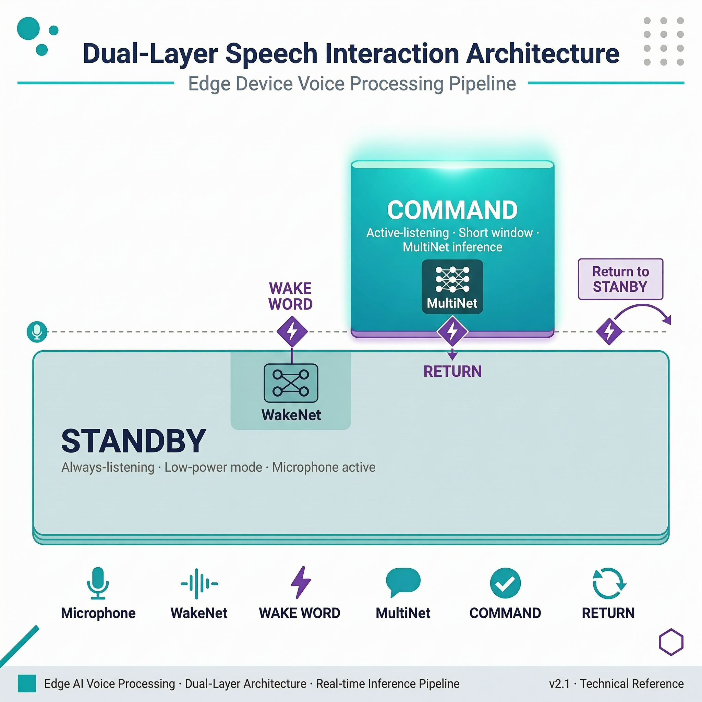

# 最小案例 9：语音性能指标与权衡

> 类型：`FW` ｜ 验证状态：参考值，待实机校准 ｜ 后续：[`extensions/09_audio_resource_budget`](../../extensions/09_audio_resource_budget/)

## 摘要

前 8 个最小案例让设备"听得见、分得清、听得懂"。本集回答新问题：**跑得起吗？跑得稳吗？** 用同一套基准程序，在 ESP32-S3-EYE 上分别测量三种语音模式处理一帧音频的耗时：

1. **VAD 模式**：只测 AFE 的 `fetch()`（内含语音活动检测）；
2. **WakeNet 模式**：只测 AFE 的 `fetch()`（内含唤醒词检测）；
3. **MultiNet 模式**：测 `fetch()` 之后的 MultiNet `detect()`。

每次运行同步记录内部 RAM 余量、PSRAM 余量、CPU 核心和频率，产出是 10 秒窗口内的 `count / avg_us / min_us / max_us` 统计摘要。这套测法直接为扩展案例的"六组配置资源预算矩阵"提供数据基础；本微课只教**怎么测、怎么读、怎么判断**。

## Quick Start

**预备知识**

- **AFE / WakeNet / MultiNet**：AFE 是持续运行的音频前端（降噪、分帧）；WakeNet 持续检测唤醒词（待机成本）；MultiNet 在唤醒后按需识别命令词（触发成本）。VAD/WakeNet 的结果直接挂在 `fetch()` 的返回值里；MultiNet 需要把 `fetch()` 拿到的帧再喂给 `detect()` 单独识别——这就是 MultiNet 模式要单独计时 `detect()` 的原因。
- **堆内存（heap）**：运行时动态申请的内存。ESP32-S3 分内部 RAM（几百 KB、快、抢手）和 PSRAM（本板 8 MB、容量大、稍慢）。语音模型是内存大户；余量持续下降不回升就是泄漏，设备迟早崩溃。
- **延迟 vs 吞吐**：延迟 = 处理一帧要多久（`elapsed_us`）；吞吐 = 单位时间处理多少帧（`count` ÷ 窗口时长）。单帧耗时长期超过帧的音频时长，帧就会积压，表现为响应越来越慢。
- **微秒计时**：`esp_timer_get_time()` 返回设备启动以来的微秒数，标准用法是前后各打一次点再相减。


以下命令假设已安装 ESP-IDF v5.x 并执行过 `export` 脚本。

**第 1 步：进入工程并确认环境**

```bash
cd microcourses/09_audio_perf_tradeoff
idf.py --version
```

确认 `idf.py` 可用，预期输出类似 `ESP-IDF v5.x.x`；报 `command not found` 就重新 source IDF 的 `export` 脚本。

**第 2 步：设置目标芯片**

```bash
idf.py set-target esp32s3
```

按 `sdkconfig.defaults` 生成配置（8MB Flash、OCT PSRAM、240 MHz、三个语音模型）。注意 `set-target` 会重置手改过的 `sdkconfig`。

**第 3 步：编译**

```bash
idf.py build
```

编译固件并把语音模型打包进 5168K 的 `model` 分区。首次约 3～8 分钟（要编译整个 ESP-SR）。

**第 4 步（有开发板时）：烧录并打开监视器**

```bash
idf.py -p <PORT> flash monitor
```

`<PORT>` 在 macOS 上是 `/dev/` + `cu.usbmodemXXXX` 这类完整路径，Linux 上形如 `/dev/ttyACM0`，Windows 上形如 `COM5`。烧录约 1～3 分钟，退出 monitor 按 `Ctrl+]`。

**第 5 步：观察 10 秒自动基准**

不需要按键：启动后自动进入 10 秒测量窗口，打印 summary 后停止，默认 VAD 模式。没有开发板时只能完成第 1～3 步构建验证；耗时和内存数据必须来自实机，不能编造。

**详细步骤：切换三种模式**

模式是本微课唯一的实验变量，切换方法：

1. 打开 [`main/perf_config.h`](main/perf_config.h)，把 `VOICE_BENCH_MODE_VAD` 改成 `VOICE_BENCH_MODE_WAKENET`（=2）或 `VOICE_BENCH_MODE_MULTINET`（=3）；写成别的值会触发编译期 `#error`，防止拼写错误；
2. 重新 `idf.py build` 并烧录。每次只改这一个值，其他保持不变，这才是控制变量实验；
3. 可选：把 `VOICE_BENCH_DURATION_MS`（默认 10000）改成 20000，观察 `count` 是否大致翻倍——窗口越长统计越稳；
4. 在实验记录表登记模式、CPU 频率（看 `[BENCH] start` 行的 `cpu=240MHz`）、窗口时长，再抄录 summary 数字。

MultiNet 模式下对着板子说命令词 "da kai deng"（`CONFIG_CN_SPEECH_COMMAND_ID1` 配置的拼音形式），会看到 `event=COMMAND_DETECTED id=1 phrase=da kai deng`——计时和命令识别在同时工作。

## 预期现象

以下为**日志格式示例，具体数值以实机为准**。启动与逐帧日志（VAD 模式，注意 `vad=`/`wake=` 字段）：

```text
I (xxx) lesson09_bench: [BENCH] start mode=VAD duration_ms=10000 cpu=240MHz
I (xxx) lesson09_bench: [BENCH] stage=afe_fetch mode=VAD elapsed_us=9xxx core=1 internal_free=1xxxxx psram_free=6xxxxxx vad=0 wake=0
```

MultiNet 模式每帧一条（无 vad/wake 字段）：

```text
I (xxx) lesson09_bench: [BENCH] stage=multinet_detect elapsed_us=2xxxx core=1 internal_free=1xxxxx psram_free=5xxxxxx
```

结束摘要与退出（不适用的阶段显式打 `count=0`）：

```text
I (xxx) lesson09_bench: [BENCH] summary mode=VAD stage=afe_fetch count=... avg_us=... min_us=... max_us=...
I (xxx) lesson09_bench: [BENCH] summary mode=VAD stage=multinet_detect count=0 avg_us=0 min_us=0 max_us=0
I (xxx) lesson09_bench: done mode=VAD
```

判读要点：

- `count` 应大致等于窗口时长 ÷ 单帧音频时长；明显偏小说明 `fetch()` 经常出错或系统被拖累；
- `avg_us` 与 `max_us` 差距悬殊说明有长尾卡顿，对照同时刻内存余量看是否紧张；
- `internal_free`/`psram_free` 应在小范围内波动；单调下降标记为"疑似泄漏"，不要用它的平均值下结论；
- 出现 `feed_alloc_failed`、`fetch_error`、`srmodel_init_failed` 等错误或设备中途重启，该组记为失败，保留日志排查，绝不用不完整摘要下结论。

**常见问题排查**

| 现象 | 可能原因 | 解决办法 |
|---|---|---|
| `idf.py build` 报 model 分区放不下 | 启用了过多 SR 模型或改小了 `partitions.csv` | 保持 `sdkconfig.defaults` 的三个模型配置，确认 Flash 为 8MB |
| 启动即打印 `srmodel_init_failed` | model 分区没烧进去（只烧了 app） | 用全量 `idf.py flash` 而不是 `app-flash` |
| `feed_alloc_failed samples=...` | 内部 RAM 不足，`calloc` 失败 | 检查是否额外开了 WiFi/蓝牙等大内存组件 |
| `vad=0 wake=0` 恒为 0，说话也没反应 | 麦克风无声、增益过低或没在窗口内说话 | 10 秒窗口内贴近板子说话，先用最小案例 5/6 工程验证麦克风链路 |
| 运行几秒后重启或 `fetch_error` 后 `count` 很小 | 内存耗尽、看门狗超时、电源不稳 | 看出错前 `*_free` 是否骤降，换好 USB 线，该组标为失败 |
| 改了 `perf_config.h` 但日志模式没变 | 没重新编译烧录，板上还是旧固件 | 完整执行 `idf.py build` + `flash`，核对 `[BENCH] start mode=` 行 |

## 学习目标

- 解释 `avg_us`、`min_us`、`max_us`、`count` 四个统计量的含义和局限；
- 修改 `main/perf_config.h` 里的 `VOICE_BENCH_MODE` 切换基准模式并重新构建；
- 读懂逐帧日志中的 `elapsed_us`、`core`、`internal_free`、`psram_free` 字段；
- 结合内存余量判断"更快"是否伴随稳定性风险。

## 原理讲解

**测量在哪里发生？**

`main.c` 的 `benchmark_task` 是唯一的计时点：在 10 秒窗口内循环 `fetch()` 取帧并计时；MultiNet 模式再对 `detect()` 计时；每帧打印一条日志（耗时、core、两个内存余量），窗口结束打印两行 summary。

**`count=0` 是正常现象**：MultiNet 模式下代码只把 `detect_us` 累加进统计，摘要里 `stage=afe_fetch count=0` 是设计如此，表示"本模式不统计这一段"，不是测量失败；VAD/WakeNet 模式的 `stage=multinet_detect count=0` 同理。`count=0` 永远意味着"该阶段不适用"，不能当成 0 微秒的有效测量。

**双任务结构**

`app_main` 创建两个任务分核运行：`feed_task`（核 0）从板载 I2S 麦克风读音频喂给 AFE；`benchmark_task`（核 1）`fetch()` 取帧并计时。喂数据和计时分开，避免计时被麦克风读取阻塞干扰——这是最小案例 4"任务隔离"思想在语音链路的重现。麦克风驱动细节封装在共享组件 [`components/voice_common`](../../components/voice_common/) 里。

**AFE 配置如何影响资源？**

AFE 用 LOW_COST 低成本模式，再按模式开关算法：VAD 模式只开 vad，WakeNet 模式只开 wakenet，MultiNet 模式两者都关。**初始化的算法越少，启动内存占用越低**——这是三种模式内存基线不同的根本原因。CPU 频率由 [`sdkconfig.defaults`](sdkconfig.defaults) 的 `CONFIG_ESP_DEFAULT_CPU_FREQ_MHZ_240=y` 决定：改成 160 后每帧算得慢但功耗低，扩展案例会系统地测这个权衡。



> 图：WakeNet 适合持续待机，MultiNet 通常在唤醒后按需运行。图示表达运行关系，不代表具体功耗比例。

## 整体流程图

```text
板载麦克风（I2S, 16 kHz 单声道 16 bit）
        ↓ voice_read_samples()
feed_task（核 0）──feed()──→ AFE（LOW_COST 模式）
                              ↓ fetch()
              benchmark_task（核 1，10 秒窗口）
              ├─ VAD/WakeNet 模式：计时 afe_fetch，读 vad_state/wakeup_state
              └─ MultiNet 模式：afe_fetch 后计时 multinet_detect
                              ↓
   每帧日志：elapsed_us / core / internal_free / psram_free
                              ↓
   summary：mode + stage + count/avg_us/min_us/max_us × 2（afe_fetch 与 multinet_detect）
                              ↓
                      done mode=... 任务退出
```

## 关键代码解析

**1. 计时核心：`benchmark_task()`（`main/main.c`）**

```c
const int64_t deadline_us = start_us + (int64_t)VOICE_BENCH_DURATION_MS * 1000;
while (s_running && esp_timer_get_time() < deadline_us) {
    const int64_t fetch_start = esp_timer_get_time();
    afe_fetch_result_t *result = s_afe_handle->fetch(afe_data);
    const uint32_t fetch_us = (uint32_t)(esp_timer_get_time() - fetch_start);
    ...
}
```

窗口用绝对 deadline 判断，不会因循环体耗时长而"多测几秒"。`fetch()` 出错时打印 `fetch_error` 并跳出循环——出错的帧不计入统计，宁缺毋滥。

**2. 每帧资源快照（`main/main.c`，VAD/WakeNet 分支）**

```c
ESP_LOGI(TAG, "[BENCH] stage=afe_fetch mode=%s elapsed_us=... core=%d"
         " internal_free=... psram_free=... vad=%d wake=%d",
         bench_mode_name(), fetch_us, xPortGetCoreID(),
         heap_caps_get_free_size(MALLOC_CAP_INTERNAL),   /* 内部 RAM 余量 */
         heap_caps_get_free_size(MALLOC_CAP_SPIRAM),     /* PSRAM 余量 */
         result->vad_state == VAD_SPEECH,                /* 这帧是否判为语音 */
         result->wakeup_state == WAKENET_DETECTED);      /* 是否检测到唤醒词 */
```

一行日志回答四个问题：这帧算了多久、在哪个核算的、内存还剩多少、算法有没有报事件。对着它说话，`vad=1` 或 `wake=1` 会一闪而过。

**3. 统计打印：`voice_bench_stats_log()`（`main/voice_benchmark.c`）**

```c
if (stats->count == 0) {   /* 不适用的阶段：明确打 count=0，不打假数字 */
    ESP_LOGI(tag, "[BENCH] summary mode=%s stage=%s count=0 avg_us=0 min_us=0 max_us=0",
             mode, stage);
    return;
}
ESP_LOGI(tag, "[BENCH] summary mode=%s stage=%s count=... avg_us=... min_us=... max_us=...", ...);
```

运行中只做 `count++`、累加、更新 min/max，平均值在打印时才除法，几乎不增加每帧开销。`count=0` 分支是刻意设计：显式输出 0，让扩展案例的解析脚本和实验记录都机器可读。模式名（`bench_mode_name()`）由编译期宏决定，**换模式必须重新编译**，保证日志和固件严格对应。

## 关键文件说明

| 文件 | 职责 | 类型 |
|---|---|---|
| [`main/main.c`](main/main.c) | feed/benchmark 双任务，三种模式的基准与每帧资源日志 | 课程代码 |
| [`main/perf_config.h`](main/perf_config.h) | `VOICE_BENCH_MODE` 与 `VOICE_BENCH_DURATION_MS`，唯一实验变量 | 实验配置 |
| [`main/voice_benchmark.c`](main/voice_benchmark.c) / [`voice_benchmark.h`](main/voice_benchmark.h) | 统计累加（count/total/min/max）和 summary 输出 | 课程代码 |
| [`main/CMakeLists.txt`](main/CMakeLists.txt) / [`idf_component.yml`](main/idf_component.yml) | 注册源文件与托管依赖 `espressif/esp-sr: "^2.0.0"` | 构建配置 |
| [`CMakeLists.txt`](CMakeLists.txt) | 工程名 `audio_perf_tradeoff`，引入共享组件 | 构建配置 |
| [`sdkconfig.defaults`](sdkconfig.defaults) | 8MB Flash、PSRAM OCT 80M、CPU 240MHz、三个 SR 模型、命令词 | 实验配置 |
| [`partitions.csv`](partitions.csv) | `factory` 2500K + `model` 5168K，模型放独立分区 | 构建配置 |
| [`../../components/voice_common/`](../../components/voice_common/) | I2S 麦克风、按键、SD 卡等板级封装 | 共享课程代码 |

## 配置说明

| 修改位置 | 配置项 | 现象变化 |
|---|---|---|
| [`main/perf_config.h`](main/perf_config.h) | `VOICE_BENCH_MODE` | 在 VAD/WakeNet/MultiNet 三种基准之间切换（需重新编译） |
| 同上 | `VOICE_BENCH_DURATION_MS` | 改变测量窗口长度和样本数量，默认 10000 |
| [`sdkconfig.defaults`](sdkconfig.defaults) | `CONFIG_ESP_DEFAULT_CPU_FREQ_MHZ_240` | 改成 160 后每帧耗时变大、功耗更低，需登记配置 |
| [`sdkconfig.defaults`](sdkconfig.defaults) | 三个 SR 模型选项（WN9_HIESP / MULTINET7_QUANT / VADNET1_MEDIUM） | 决定 model 分区打包哪些模型，换模型改变内存基线 |
| [`sdkconfig.defaults`](sdkconfig.defaults) | `CONFIG_CN_SPEECH_COMMAND_ID1="da kai deng"` | MultiNet 识别的命令词（拼音），可加 ID2/ID3 扩展 |
| `main/main.c` | `AFE_MODE_LOW_COST` 与 `vad_min_speech_ms`/`vad_min_noise_ms`/`vad_mode` | AFE 档位与 VAD 参数，影响内存占用和检测灵敏度 |

## 术语小表

| 术语 | 解释 |
|---|---|
| AFE | Audio Front-End，音频前端，负责降噪/增益/分帧 |
| `fetch()` | 从 AFE 取出一帧处理结果的阻塞调用，VAD/WakeNet 模式的计时对象 |
| `detect()` | MultiNet 对一帧做命令词识别的调用，MultiNet 模式的计时对象 |
| `avg_us` | 所有有效样本的平均处理时间（微秒） |
| `min_us` / `max_us` | 窗口内最小/最大处理时间，`max_us` 暴露长尾卡顿 |
| `count` | 窗口内有效样本数；`count=0` 表示该阶段不适用于当前模式 |
| heap（堆） | 运行时动态分配的内存池，用 `heap_caps_get_free_size()` 查余量 |
| 内部 RAM / PSRAM | 芯片内部快速小内存 / 板载 8 MB 外部大内存，对应 `internal_free`/`psram_free` |
| CPU 频率 | 每秒时钟周期数（160/240 MHz），越高算得越快、功耗越大 |
| 响应延迟 | 处理单个输入所需时间，决定交互的"跟手感" |
| 吞吐量 | 单位时间处理的帧数，跟不上采集速度就会积压 |
| 长尾 | 少量明显高于平均值的耗时样本 |

## 验证清单

- [ ] 每次实验记录模式、CPU 频率、窗口时长和模型配置（登记 `[BENCH] start` 行）；
- [ ] 记录 count、avg、min、max 和运行期内存余量范围；
- [ ] 不把 `count=0` 的不适用阶段当成测量值；
- [ ] 三种模式各至少运行一次，日志与固件模式一一对应；
- [ ] 至少重复一次并检查是否重启或内存持续下降；
- [ ] 结论同时考虑延迟（avg/max）和稳定性（内存、重启、错误日志）。

## 思考题与拓展挑战

**思考题**

1. 为什么不能只看平均耗时？

   **参考答案：**平均值会掩盖偶发长尾，例如 avg 20 ms 但 max 300 ms，交互上就是一顿。最大耗时和连续运行稳定性更能反映会不会卡顿或触发看门狗。

2. 为什么 WakeNet 和 MultiNet 的资源成本不能简单相加？

   **参考答案：**WakeNet 是持续待机的成本，MultiNet 只在唤醒后按需运行。正确预算是"待机消耗 × 待机时长 + 触发消耗 × 触发频次"，而不是把两个数字加起来。

3. MultiNet 模式的摘要里 `stage=afe_fetch count=0`，这算测量失败吗？

   **参考答案：**不算。该模式只把 `detect_us` 计入统计，`count=0` 是"本模式不统计该阶段"的显式标记。真正失败会伴随 `fetch_error` 等错误日志，且 detect 的 count 也异常偏小。

**拓展挑战**

- 为六组模式/频率组合设计统一的 CSV 记录格式（扩展案例的 `parse_audio_bench.py` 就是一种参考答案）；
- 在不改变统计 API 的前提下增加长尾比例指标（如统计 `elapsed_us > 2 × avg` 的样本占比），或把窗口改成 60000 ms 观察 `max_us` 和内存曲线是否仍然稳定。

